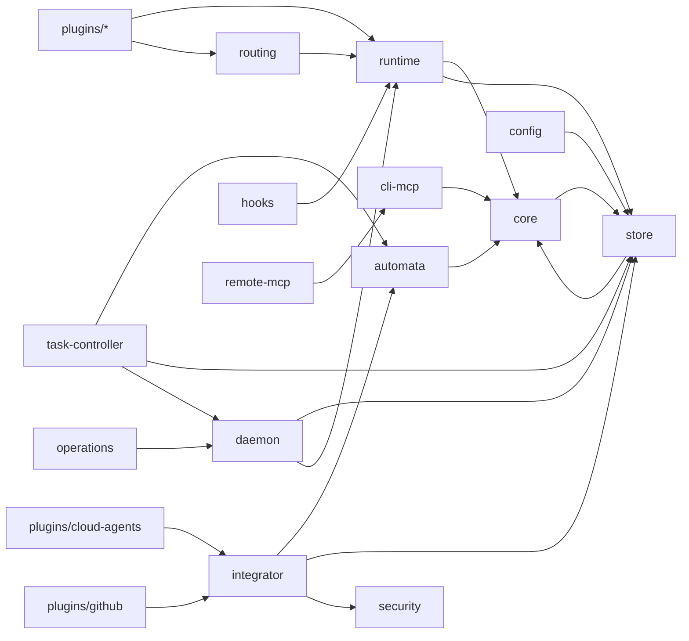
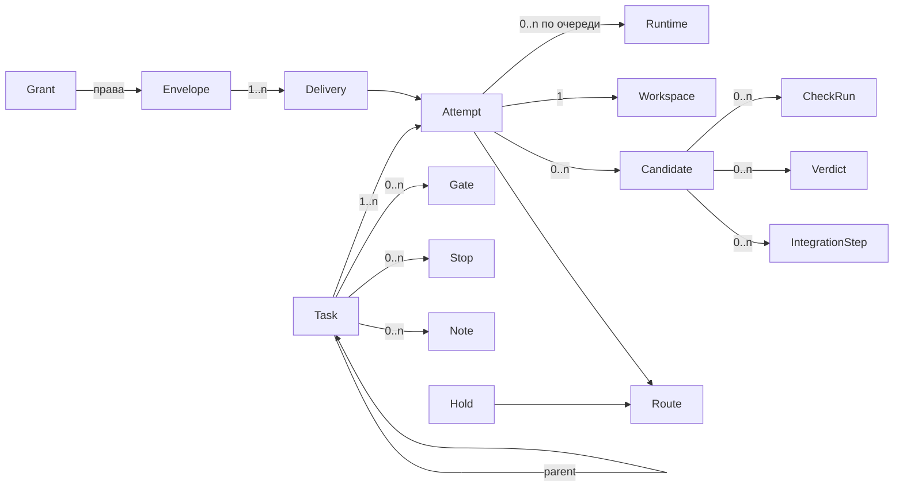
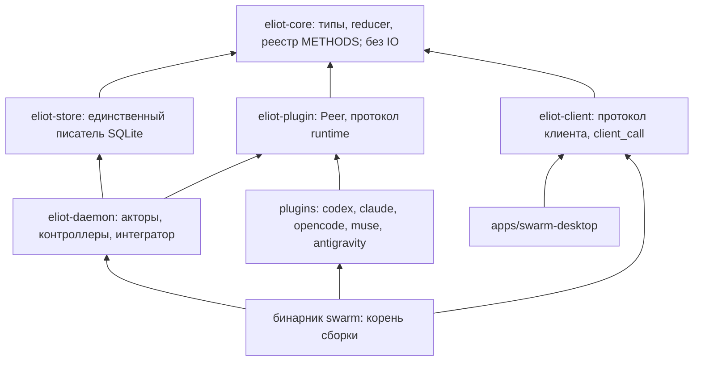
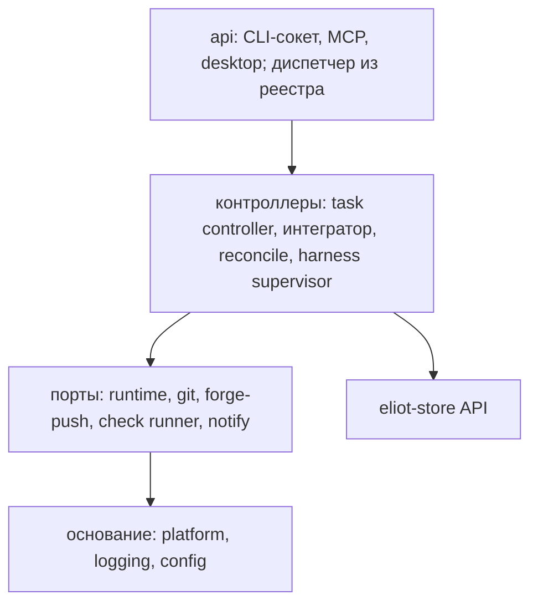

# Граф: сущности, модули, кто что пишет

> Источник фактов: целевая архитектура v2.6 (27.11.2026), разделы 14 «Модули» и 14а; живые границы уточняются здесь, исходник сохранён в архиве. Суть — [ARCHITECTURE.md](ARCHITECTURE.md), навигация — [INDEX.md](INDEX.md).

**Зачем.** У каждого понятия один владелец решения, зависимости идут в разрешённую сторону. CI ограничивает обнаруженные нарушения; его границы — в [tools/README.md](tools/README.md). Перед задачей, которая добавляет зависимость, таблицу или модуль, сверься с этим файлом.

## Кто что пишет

В таблице названы логические владельцы решений. Физическая запись всех сущностей — через `eliot-store`; это не разрешение контроллерам писать SQL или менять чужое состояние напрямую.

| Сущность | Пишет (модуль-владелец) | Файл блока |
| --- | --- | --- |
| Task, Attempt, Candidate, Verdict, Gate, Stop | task controller (eliot-daemon) через API Store | [task-controller.md](implementation/task-controller.md), [automata.md](implementation/automata.md) |
| Runtime, Hold | harness supervisor (eliot-daemon) | [daemon.md](implementation/daemon.md), [routing.md](implementation/routing.md) |
| Envelope, Delivery, Event, Note | Store и admission; исход Delivery сообщает runtime | [core.md](implementation/core.md), [store.md](implementation/store.md) |
| CheckRun, IntegrationStep, Workspace | интегратор (check runner, sweeper удаляет Workspace) | [integrator.md](implementation/integrator.md) |
| Grant | владелец через CLI | [remote-mcp.md](implementation/remote-mcp.md) |
| task.md, journal.md, workflow.toml, routes.toml, triggers.toml | демон в work-truth.git (владелец — через swarm workflow edit) | [store.md](implementation/store.md), [config.md](implementation/config.md) |
| main и ветки на remote | только forge-push по команде интегратора | [integrator.md](implementation/integrator.md), [plugins/github.md](implementation/plugins/github.md) |

## Блоки документации и их зависимости

Стрелка — «читает контракт из». Блок плагина зависит от общего контракта плагинов и runtime, но не от другого плагина.

| Блок | Крейт или модуль кода |
| --- | --- |
| core, automata | eliot-core (типы, reducer, Checked, METHODS, таблица ошибок) |
| store | eliot-store |
| daemon, task-controller, integrator, routing, operations | eliot-daemon (акторы и супервизор, task controller, scheduler, интегратор, reconcile, API) |
| runtime, plugins/* | agent runtime, eliot-plugin, plugins/codex, claude, opencode, muse, antigravity |
| cli-mcp, remote-mcp | бинарник swarm (CLI), eliot-client, API демона, cloud_mcp.rs |
| integrator (forge-push, check runner) | короткие процессы интегратора |

---

### Модули

| Модуль | Что в нём | На чём строится |
| --- | --- | --- |
| eliot-core | типы, reducer переходов, трейт Checked, METHODS, таблица ошибок провайдера; без tokio, файлов и процессов | нынешний eliot-core |
| eliot-store | Store: commands и admission, events, Task и Attempt, кандидаты, журнал интегратора, бюджеты | нынешний eliot-store; схема сокращается по мере срезов |
| eliot-daemon | акторы и супервизор, task controller, scheduler (выбор задачи и route, справедливость между проектами), интегратор, reconcile, API, проверка JWT и Grant | нынешний демон, срез за срезом |
| agent runtime | отсоединённый процесс на агента: адаптер харнесса, stdio, журнал доставки, сокет, custody и владение Job, дедлайны; для kind = remote — облачный плагин без своего состояния | нынешний per-agent плагин плюс custody.rs, windows.rs, unix.rs |
| swarm (CLI) | разбор команды, swarm hook | ручной разбор; вызов через сгенерированный диспетчер |
| eliot-plugin | общий Peer, PendingCalls, EarlyEventBuffer, native\_lifecycle, retry | нынешний eliot-plugin/1 |
| eliot-client | протокол клиента, client\_call и client\_call\_typed, разбор кадров RPC; единственный путь CLI, MCP и desktop в демон | выносится из eliot-daemon на этапе 0 |
| forge-push, check runner | короткие процессы интегратора | git-раннер git\_monitor.rs, scripts/process.rs, publication.rs |

## 14а. Граф: сущности, модули и правила против распада

### Связи сущностей

| Ребро | Инвариант | Кто проверяет |
| --- | --- | --- |
| Task → Attempt | не больше одного живого Attempt роли executor; его n = Task.gen | условие перехода в Store |
| Attempt → Runtime | Runtime служит одному Attempt; local binding `agent_id + agent_generation` неизменен и не равен `Task.gen` по определению; новый Runtime после подтверждённой смерти старого; remote — терминальное состояние или orphan | harness supervisor, dispatch в Store; сверка identity процесса или external\_ref |
| Grant → Envelope | команда удалённого принципала принимается, только если метод с флагом remote есть в действующем Grant | admission |
| Attempt → Workspace | один пишущий Attempt на worktree; quarantine не отдаётся другому | интегратор, sweeper |
| Candidate → CheckRun, Verdict | допуск действует только для своего (rev, gen, base, tree) | интегратор перед эффектом |
| Candidate → IntegrationStep | шаг записан до эффекта; unknown решается чтением origin | интегратор, сверка |
| Task → Gate | открытый Gate старой ревизии или кандидата становится superseded | task controller |
| Envelope → Delivery → Attempt | `Task.gen/rev` адресуют исполнение; ACK относится к Runtime, который начал эту доставку; поздний ACK не закрывает доставку нового Runtime; полномочия из соединения | Store, runtime |
| Hold → Route | route с действующим Hold не выбирается | планировщик |

### Крейты: целевой граф

Правила:

- eliot-core ни от чего внутреннего не зависит и не делает IO.
- rusqlite есть только в eliot-store. Сейчас eliot-daemon объявляет rusqlite в dev-dependencies, но ни в коде, ни в тестах его не использует: строка удаляется, и правило deps.py распространяется на dev-dependencies.
- CLI, MCP и desktop ходят в демон только через eliot-client. Это новый маленький крейт: туда переезжают client\_call, client\_call\_typed и разбор кадров RPC.
- Бинарник swarm — единственный корень сборки: он связывает демон, плагины и клиент и поэтому может зависеть от всех.

Нынешнее состояние (541507c4), измерено скриптами из приложения В [↗](tools/README.md):

| Что | Сейчас | Цель |
| --- | --- | --- |
| Запрещённые рёбра крейтов | 3: eliot-daemon → rusqlite (dev, не используется); swarm-desktop → eliot-daemon (desktop берёт из демона VendorLoginConsole, prepare\_vendor\_login\_console, stored\_settings\_section, save\_settings\_for\_repair, read\_settings\_for\_repair, client\_call\_typed); swarm-desktop → eliot в цели Windows (profile\_vocabulary, register\_harness\_capabilities) | 0: строка rusqlite удалена; client\_call\_typed в eliot-client, настройки, консоль входа и словарь профилей — методы API из реестра |
| Самый большой цикл модулей в eliot-daemon | 32 из 41 модуля, 238 рёбер (в 2.5 скрипт не видел use crate::{…} и super:: и насчитал 31 и 192) | без циклов между слоями; храповик: число только уменьшается |
| Циклы в других крейтах | eliot-core: цикл из 4 (api, context, presentation, routing); eliot-plugin: из 5 (native\_cli, native\_lifecycle, native\_stdio, native\_transport, session); eliot-store: из 4 (agent\_lifecycle, cleanup, coordination, provider\_holds), 117 рёбер | 0 |
| router | 55 914 непустых строк в 65 файлах; 30 исходящих зависимостей, 13 модулей лезут внутрь (daemon.rs → router::discovery, automation.rs → router::launch\_queue, git\_integration.rs → router::project\_checks и т.д.) | распиливается по срезам; никто, кроме слоя API, не импортирует router |
| Таблицы, которые пишут 2+ модулей Store | 41 из 96 (грубый подсчёт по SQL в коде) | 0: у каждой таблицы модуль-владелец |

### Слои внутри демона

Зависимости идут только вниз. Контроллеры не знают про api; порты не знают про контроллеры; platform ни от чего в демоне не зависит (сейчас у platform 25 входящих связей и он внутри большого цикла). Контроллеры общаются через Store и события, а не прямыми вызовами друг друга: так устроен нынешний run\_goal\_driver, и так же строится task controller.

### Как граф держится в CI

| Правило | Механизм | Этап | Сейчас |
| --- | --- | --- | --- |
| Крейты только по целевому графу | deps.py по Cargo.toml (приложение В [↗](tools/README.md)) в CI; при желании дублируется cargo-deny bans с wrappers (синтаксис сверить с версией cargo-deny) | 0 | 2 нарушения: desktop → daemon, desktop → eliot (Windows) |
| rusqlite только в eliot-store | то же правило deps.py для внешнего крейта | 0 | 1: dev-зависимость в eliot-daemon |
| Циклы модулей не растут | scc.py с порогом: порог = текущему размеру, при уменьшении порог в CI тоже уменьшается | 0 | daemon 32, core 4, plugin 5, store 4 |
| Автоматы без тупиков | check.py по таблице переходов, которую генерирует reducer | 1 | v2.6: 0 проблем по таблицам раздела 14 [↗](INDEX.md#карта-разделов) |
| Таблицу пишет один модуль | тест в eliot-store: INSERT, UPDATE и DELETE по таблице встречаются только в модуле-владельце; список исключений только сокращается | 1 | 41 таблица |
| Процессы запускают только runtime и раннеры | clippy disallowed-methods на std::process::Command::new и tokio::process::Command::new; разрешение через allow только в модулях runtime, check runner, forge-push и git-раннера | 1 | не мерили |
| Старые имена не возвращаются | grep в CI по новому коду: auditing, paused, stuck, accepted, awaiting\_owner, blocked\_ttl, swarm-cloud, kind = signal, Goal как тип | 2 | — |

Храповик — главное: правило не требует сразу чистого кода, но не даёт стать хуже. Каждый срез миграции (раздел 12 [↗](implementation/migration.md)) обязан уменьшить хотя бы одно число в этой таблице или не трогать его.
