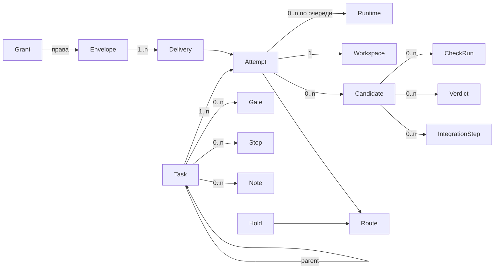
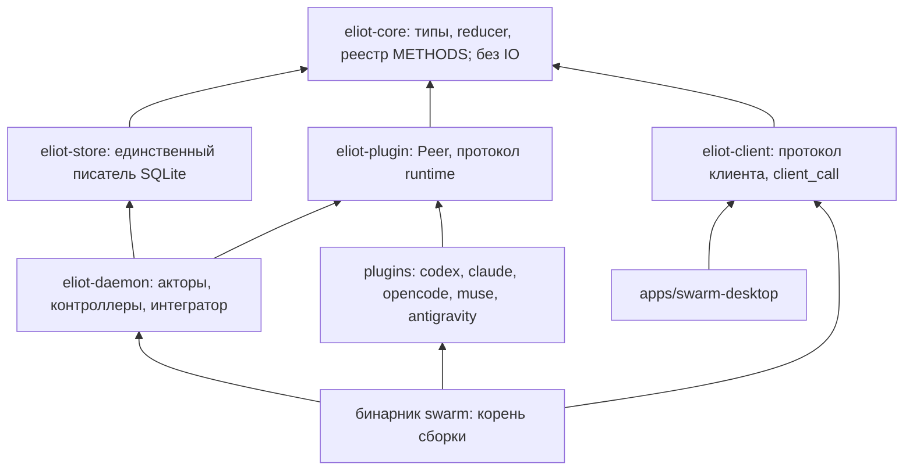
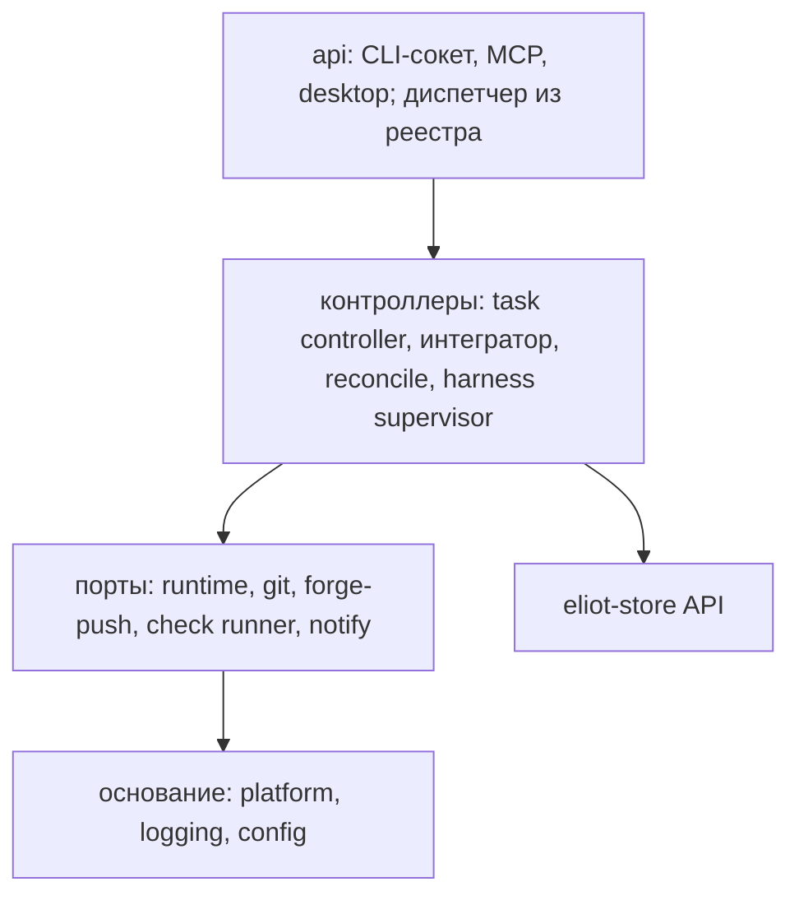

# Eliot Swarm Controller: целевая архитектура v2.6

Nov 27, 2026 · @Iurii

Версия 2.6 от 27.11. Это единая спецификация. В неё влиты [платёжные дополнения](https://claude.ai/artifact/KKbMunt8Bx1bVmh9XppEFX), [карта переиспользования кода](https://claude.ai/artifact/PMxvr7Ysh37ZhR9t3QCUJf), пункты [целостной проверки](https://claude.ai/artifact/AwuDpmeoBVk1Ghke3d9d9Y) и проверенные по коду пункты внешнего ревью v2.3. Те документы теперь обоснования: если они расходятся с этим, прав этот. Список проблем текущего кода остаётся в аудите. Решения D-12, D-14, D-18, D-21, D-28 и D-34 отменены, D-38 остаётся. Каждый механизм помечен «измерено» или «гипотеза» с планом замера.

Главное в 2.6: проверено, что ничего важного не потеряно. Шесть сверок прочитали старую документацию (около 400 строк возможностей): потерянное без решения возвращено (раздел 11а), остальное убрано с причиной (раздел 13б), сводка — приложение Г. Добавлены облачные исполнители и удалённый MCP (раздел 10а): Runtime без процесса, кандидат по OID из ветки провайдера, защита main правилами GitHub, проверка JWT на нашей стороне. Два новых враждебных ревью нашли 87 замечаний, из них 14 серьёзных; все сверены с кодом и закрыты: автоматы переписаны, и check.py теперь читает таблицы прямо из раздела 14, а не из своего списка. Исправлены три утверждения о Claude Code, которые v2.5 считал ненайденными, и найдено третье запрещённое ребро крейтов. Что изменилось по пунктам — Б.0.

Главное в 2.5: у каждого понятия одно имя и один модуль-владелец, всего 15 сущностей Store (раздел 1а); у Task 10 состояний вместо 13, всё ожидание не агента — одно состояние held с типом причины; скрипт нашёл в автоматах 2.4 девять необработанных событий, все закрыты, жизненные циклы есть у каждой сущности (раздел 14); построен граф сущностей, крейтов и слоёв демона с инвариантом на каждом ребре и правилами CI с храповиком, нынешний код измерен теми же скриптами (раздел 14а, приложение В); 61 утверждение о донорах сверено с исходниками, 5 неверных исправлены (приложение А).

В 2.4: первым делом в нынешнем Store появляется одна сущность Task с версией и попытками (Attempt), и она заменяет разнесённую политику задачи (Goal, сгенерированные правила назначения, аудит через switch, решения владельца, привязки задач в Git) сначала на одном сценарии, назначении задач из папки. Приёмка привязана к версии задачи и точному Git-кандидату; смена исполнителя ждёт подтверждённой остановки старого; доставка в харнесс имеет состояние «отправка начата»; ошибки SQLite разобраны по классам; интегратор доказывает результат достижимостью OID, а не трейлером; обещания изоляции сужены до того, что реально держится на каждой ОС. Миграция идёт законченными сценариями, старый владелец удаляется в том же шаге. Сквозные сценарии отказов — раздел 15, вердикты по ревью и история версий — приложение Б.

## 1. Суть: конвейер, а не память

Swarm — оркестратор харнессов. Это конвейер производства: у каждого участника своя роль и своё рабочее место, работа течёт по этапам, участник, который не справляется, заменяется, а работа остаётся на месте. Memory OS — отдельный проект; от неё в Swarm остаётся только Memory API (D-38) как внешний сервис.

Роли на конвейере:

- Менеджер (агент): держит цель, режет её на задачи с проверяемыми критериями и областью записи.
- Исполнитель (агент): делает одну задачу в своём worktree.
- Ревьюер (агент другой модели): проверяет дифф по критериям задачи перед merge, а не рассуждения исполнителя.
- Разборщик (агент другой модели или семьи): разбирает застрявшую задачу (повторное ложное «готово», «не могу», отказы ревью, шаг интегратора с неизвестным исходом) и решает, что дальше. Владелец называл это аудитом; в документе два слова, чтобы не путать: ревью проверяет дифф, разбор — застрявшую задачу.
- Интегратор (код демона, не LLM): очередь merge, squash, push, чистка. Единственный, кто меняет main.
- Супервизоры (код): следят за процессами и перезапускают их.
- Владелец (человек): ставит цели; в ручном режиме подтверждает переходы, на которых стоит gate = owner (раздел 11).

Двенадцать правил, из которых выведено всё остальное:

1. Правда о задаче одна: транзакция в Store (существующая SQLite-база демона; «queue.db» в документе — её логическое имя) на машине, которая задачу ведёт. Переход принят, когда он записан с synchronous=FULL. Определения задач с ревизиями (task.md, инструкции, workflow, routes) хранятся в локальном work-truth.git, который пишет демон: это определения, история и вид для человека, а не место, где решается, чья задача. Всё остальное — кэш.
2. Участники общаются только сообщениями. Общей изменяемой памяти между ними нет.
3. Сбой не чинят на месте. Упавший участник перезапускается с известного состояния (let it crash).
4. Падение одного агента, харнесса, демона или одной записи в очереди интегратора не останавливает остальных.
5. Агенты игнорируют инструкции. Всё важное проверяет код в момент действия.
6. Контроль не стоит на пути потока. Ход агента блокирует только Stop hook, и не больше 3 раз подряд без прогресса по задаче. Gate есть у каждого перехода с последствиями (раздел 11); по умолчанию владельца ждёт только deploy. От плохого merge защищают проверки, ревью и допуск на кандидата, а не gate. В ручном режиме владелец ставит owner на любой из них.
7. Исход «неизвестно» не равен «провал». Сначала читаем источник; что не прояснилось, идёт на разбор, а не на слепой повтор.
8. Задача живёт вне агента и харнесса. Любой агент подхватывает её в любой момент.
9. Один реестр команд, один конверт сообщения, один формат задачи.
10. Секрет живёт в одном месте. Агент не держит ни ключа провайдера, ни токена forge; код агента и его проверки никогда не исполняются в процессе, у которого есть токен. Исключения названы и не расширяются: учётный файл харнесса до шлюза (раздел 4) и облачный исполнитель, который по своей природе держит секреты у провайдера (раздел 10а).
11. В первую волну механизм попадает, только если без него задача не переживает сбой или его эффект измерен (ADA RUL-10). Никакой криптографии и церемоний: id сообщения, номер поколения и SHA коммита достаточно.
12. Параллелизм ограничен пропускной способностью интегратора и проверок (ADA RUL-05). Метрики считают принятый результат и полную цену, неизвестный исход остаётся неизвестным (ADA RUL-12).

### Статус механизмов (правило 11)

| Механизм | Статус | Зачем в первой волне или как мерим |
| --- | --- | --- |
| Store: SQLite, WAL, FULL; правда о Task и Attempt | измерено в песочнице: p99 17 мс при 1 тыс. сообщ./с через CLI, 0 потерь после трёх kill -9; ожидание писателя в нынешнем Store не измерено | без него промпты и переходы теряются при падении демона. Повторить на целевой машине; физическое разделение базы — только после замера (этап 9) |
| Локальный захват задачи | уже так в коде: work-truth.git локальный, ensure\_task без push (work\_truth.rs:1265-1332) | сохраняем; GitHub нужен только интегратору для push |
| Ревизия Task и допуск на кандидата | вывод из ревью кода: в 2.3 правка критериев не снимала одобрений | без него merge проходит по устаревшим критериям. Сценарий 12 раздела 15 |
| Узкий реестр команд | замер не нужен: удаляет дубли диспетчера, ролей и MCP | CLI-грамматику и обработчики реестр не генерирует |
| Интегратор с журналом шагов и проверкой достижимости OID | измерено на прототипе трейлерной версии: слепой повтор не завершил 29 из 100 merge (заблокированная очередь, не потеря данных Git), журнал с чтением origin — 0 потерь и 0 дублей | проверку достижимости OID перепрогнать; повторить на настоящем GitHub (этап 4–5) |
| Отсоединённый runtime агента, контракт A | обязателен: в прототипе ребёнок умер через 1 с после kill -9 родителя, код держит pipe | без него рестарт демона убивает агентов. Критерий этапа 6 на Linux и Windows; переживание смерти адаптера (контракт B) отложено |
| Перенос владения Windows Job в runtime | вывод по коду и документации Microsoft; запуском не проверено | без него смерть runtime оставляет писателей в worktree. Критерий этапа 6 |
| Остановка старого поколения: отзыв, запрос, подтверждение | вывод из ревью; не измерено | без неё WIP-коммит и handoff гоняются со старым процессом |
| Проверки в отдельном процессе | пустое окружение уже есть (scripts/process.rs:68); сеть не отрезана | этап 5: сеть на Linux через namespace, способ для macOS и Windows выбрать там же |
| gitleaks на каждом новом коммите агента до ревью и remote | замер не нужен | считаем находки и ложные срабатывания; секрет в контексте исполнителя до коммита не ловит |
| Ревью по каждому критерию | гипотеза | 20 задач с ревью и без, одна модель и бюджет (RUL-10); считаем дефекты после merge |
| Разбор застрявшей задачи другой моделью | требование владельца; польза не измерена | считаем, сколько разборов вернули задачу в работу и сколько закончились заменой |
| Автоматы без тупиков | проверено скриптом по таблицам раздела 14: у Task 82 перехода, 0 проблем, включая детерминизм условий; «0» в v2.5 был по построению — скрипт проверял свой список событий | этап 1: таблица переходов генерируется из reducer, скрипт в CI |
| Граф и храповик в CI | измерено исправленными скриптами на 541507c4: 3 запрещённых ребра крейтов, цикл из 32 модулей демона из 41, циклы в eliot-core, eliot-plugin и eliot-store, 41 таблица Store с 2+ писателями | этап 0: числа не растут, каждый срез уменьшает хотя бы одно |
| Детектор: no\_progress и 2 дедлайна | гипотеза; 5 мин тишины — как у kandev, остальные пороги наши | пересчитать пороги через 2 недели по записанным причинам остановок |
| Бюджет задачи порциями | вывод из ревью: без него бесконечное платное продолжение | считаем, сколько задач упёрлось в бюджет и чем закончились |
| Claude Code mask для ключа провайдера | по CHANGELOG, запуском не проверено; маска файлов только на Linux и WSL (с 2.1.221), на macOS вместо неё запрет чтения | этап 10: агент не видит ключа ни в окружении, ни в файлах |
| Шлюз подстановки ключа для остальных харнессов | отложено | после замера, работают ли Codex, OpenCode и Gemini CLI через прокси со своим CA |
| Перенос задачи между машинами, несколько демонов, outbox, cache.db | отложено | первая волна: одна машина ведёт задачи |
| Намерения плагина done, sleep, suspend | отложено | после того как узкий eliot-plugin/1 работает на двух харнессах |
| Параллельные попытки разными моделями | отложено | только после сравнения с одной дополнительной попыткой при том же бюджете |
| Ремонтник, выжимка journal.md моделью | убрано | сбой демона — уведомление и обычная задача «починить Swarm» |
| Облачный исполнитель и удалённый MCP | вторая волна, этап 11; ни один облачный продукт не запускался | облачный — только при ruleset на main; удалённый MCP — с проверкой JWT у нас (раздел 10а) |
| Плагин deploy | отложено, notify остаётся | владелец просил уведомления |

## 1а. Единая модель: шестнадцать сущностей

Правило одно: у каждого понятия одно имя, одна таблица и один модуль-владелец, который её пишет. Остальные модули вызывают функции владельца и не пишут в его таблицу. Новое понятие появляется, только если его нельзя выразить полем или состоянием уже существующей сущности. Во всех разделах ниже используются только эти имена.

### Сущности Store

| Сущность | Ключ | Пишет | Жизненный цикл | Главные инварианты | Что заменяет |
| --- | --- | --- | --- | --- | --- |
| Task | id, rev | task controller | ready → claimed → running → checking → review → queued → integrating → done; held; cancelled (раздел 14) | переход условный по (rev, gen); kind (change или report) и review — поля; parent и children дают дерево; depends без циклов; gate\_wait — какой переход ждёт Gate; pending — намерения во время шага интегратора; бюджет и счётчики — поля Task | Goal (цель = Task верхнего уровня), назначение и brief из папки (origin = folder), индекс git\_work\_tasks, manager\_budgets |
| Attempt | task, role, n | task controller | starting → running → stopping → stopped; lost → running при resume (раздел 14) | живой — starting или running; у Task не больше одного живого Attempt роли executor; смена харнесса — новый Attempt (gen+1); n роли executor — это поколение (gen); credential выдаётся на Attempt; ветка swarm/\<task>-g\<n> | рабочий агент и его поколения, отдельный счётчик attempt, сессия как сущность (теперь поле session\_ref), launch и resume intents |
| Runtime | runtime\_id | harness supervisor | alive → exited или unreachable | kind = local (процесс) или remote (сессия облачного провайдера, external\_ref, живость опросом); служит ровно одному Attempt; local переподключается по PID, времени старта и boot id | processes, custody\_binding, owned\_exits (часть) |
| Envelope | id (ULID) | Store, admission | один раз записан, дальше неизменен | kind = message или command; дедупликация по семантическому digest; полномочия из соединения | commands, messages; сигналы агента done, blocked, note становятся командами |
| Delivery | envelope, получатель | Store; runtime сообщает исход | stored → sending → applied; unknown; expired; rejected (раздел 14) | рестарт при sending — всегда unknown; повтор после unknown только у идемпотентного по id харнесса; ephemeral в Delivery не попадает | флаги доставки в messages и commands, restart\_deferred\_sends |
| Event | seq | только писатель Store | дописывается, не меняется | каждый переход Task и каждая пачка events.put — Event в той же транзакции | events и пачки источников (схема остаётся) |
| Candidate | task, rev, gen, base, tree | task controller создаёт, интегратор читает | неизменен; новый при новой ревизии, поколении или дереве | хранит commit и source (local или vendor); все допуски (проверки, ревью, gate) привязаны к кандидату; правило эквивалентности (раздел 6) | — (новое в 2.4) |
| CheckRun | tree, check, n | интегратор через check runner | queued → running → passed, failed или error | результат действует только для этого дерева | project\_check\_obligations, goal\_check\_history |
| Verdict | id | task controller | неизменен | kind = review или analysis; review — по каждому критерию для одного кандидата; analysis — один исход из списка (раздел 14) | результаты ревью, аудит через switch (store goals/audit.rs) |
| Gate | task, rev, kind | task controller | open → approved, rejected или superseded | auto тоже пишет Gate (decided\_by = auto): одна история решений; новая ревизия или кандидат делает открытый Gate superseded | owner inbox, решения владельца, snooze, флаг awaiting\_owner |
| Stop | id | task controller | неизменен | одна причина (reason) из закрытого списка раздела 14 и действие ping, steer, interrupt, resume, analysis или hold; origin — кто поставил | событие детектора, stop\_reasons, тип blocked, причины смены поколения |
| IntegrationStep | task, rev, gen, step, n | интегратор | planned → sending → done или failed; unknown; cancelled (раздел 14) | пишется до эффекта, sending — до вызова remote; в одной транзакции с переходом Task; unknown решается только чтением origin | git\_integration\_custody, намерения публикации, cleanup\_plans |
| Workspace | путь | интегратор; sweeper удаляет | active → archived → removed; quarantine | один пишущий Attempt на worktree; quarantine не удаляется до сверки; archive-ref до удаления | workspaces, git\_workspaces, git\_work\_state |
| Hold | route, reason | harness supervisor | действует до until или до снятия | route с Hold не выбирается для claim; причины quota, cooldown, breaker, auth; только по структурному сигналу харнесса, текст ошибки — подсказка; хранит версию харнесса | provider\_holds, harness\_auth\_holds и их \_new, \_next копии |
| Grant | principal | владелец через CLI | действует до expires или отзыва; rev растёт при правке | права удалённого принципала: projects и methods; только методы с флагом remote (раздел 10а) | общий токен cloud\_mcp.rs, который открывал весь реестр |
| Note | task, n | Store по команде note | дописывается | проходит детектор секретов до записи; экспорт в journal.md | context notes; пакет передачи не хранится, а собирается из сущностей по id |

Файлы, а не строки Store: workflow.toml (Workflow с ревизией; Task запоминает ревизию, по которой идёт), routes.toml (Route), instructions/\<роль>.md, task.md как экспорт ревизии Task.

Сопоставление со старыми таблицами — предложение. Точный список того, что сливается и удаляется, фиксируется на этапе 1, когда каждая таблица получает модуль-владельца. Нынешний Store: 87 таблиц, 93 файла в src; грубый подсчёт по запросам INSERT, UPDATE и DELETE показывает 41 таблицу из 96 упомянутых, которую пишут два и больше модулей (commands — 15 модулей, agents — 14, source\_state — 13). Это и есть распад, от которого защищает правило «один владелец».

### Что убрано как понятие

- Состояния auditing, blocked, paused, unknown, stuck. Ревью теперь состояние review; всё ожидание не агента — одно состояние held с причиной (Stop) и prev\_status. Было 13 состояний, стало 10.
- Вид конверта signal. Сигналы агента — команды с той же проверкой полномочий.
- Отдельный счётчик attempt рядом с gen. Номер Attempt роли executor и есть поколение; восстановление через resume — новый Runtime того же Attempt, бюджет попыток считает Attempt.
- Флаги awaiting\_owner и quarantine на Task. Первое — held(gate), второе — состояние Workspace. На Task остаётся один флаг hard.
- Goal как отдельный механизм. Цель — Task верхнего уровня; менеджер — Attempt роли manager на ней.
- Session как сущность, хранимый пакет передачи, GitPublishTrigger.

### Словарь: старое слово → имя в спецификации

| Слово в коде, CLI или разговоре | Имя |
| --- | --- |
| агент, исполнитель, сессия | Attempt (роль executor, reviewer, analyst или manager); session\_ref — поле Attempt |
| поколение, gen | n у Attempt роли executor |
| процесс харнесса, плагин агента | Runtime |
| сигнал, done, blocked, note | Envelope kind = command |
| ревью, аудит, разбор | Verdict kind = review или analysis |
| решение владельца, inbox | Gate |
| причина остановки, событие детектора | Stop |
| шаг интегратора, публикация | IntegrationStep |
| worktree, ветка задачи, архив | Workspace |
| cooldown, квота, breaker | Hold |
| цель, назначение, brief | Task |

## 2. Ядро: передача сообщений

### Конверт

Один внешний формат для всех сообщений участникам. Внутри поле kind различает две вещи: типизированную команду (stop, steer, interrupt, approve, cancel, сигналы агента done, blocked, note и операции реестра) и текст для агента. Факты (переходы, поток харнесса) — не конверты, а Event, которые пишет только Store. Полномочия команды берутся из аутентифицированного соединения, а не из текста: по одному body нельзя надёжно отличить stop от просьбы. Текст на естественном языке плагин харнесса переводит в API провайдера: Codex turn/start или turn/steer, ACP session/prompt, stdin и хуки Claude Code. Поэтому отправить задачу одинаково дёшево куда угодно: swarm send task:42 "текст". Структурные поля нужны для маршрутизации и повторов, модель их не читает. Поля — в разделе 14.

### Два класса сообщений

- Durable: промпты, команды, передачи задач, вердикты, переходы. Пишутся в Store до подтверждения и переживают падение демона.
- Ephemeral: статусы, прогресс, телеметрия, вывод. Идут только через память; при переполнении выбрасываются самые старые.

Живой вывод хода уже идёт через память, отдельно от Store: turn\_preview.rs держит до 64 ходов, до 32 КиБ текста на сообщение, склейка 100 мс (turn\_preview.rs:15-24, eliot-core/src/api/turn\_preview.rs:5). Остальные события пишутся в Store. Счётчика потока по классам в коде нет. 583 места store.lock().await — это число мест обращения, а не частота, длительность блокировки или доля времени, поэтому узким горлом их не считаем: ожидание writer меряем на настоящем пути (этап 9) и только потом меняем планирование записи.

### Store (логическое имя queue.db)

Правда о задачах и durable-сообщениях — нынешний SQLite Store eliot-store: таблицы commands, writes и events (состояния accepted, queued, dispatched, unknown, частичный индекс в schema.rs:507), настройка соединения и PRAGMA (lib.rs:686-720), commit\_transaction, пул читателей projection\_readers.rs, online\_backup.rs. Новую БД ради задач не заводим. «queue.db» в этом документе — логическое имя этой власти; выделение очереди в отдельный файл и cache.db — только после замера, если окупится.

Один поток-писатель. Групповая запись уже есть для пачек событий инструментов: put\_tool\_batch\_group (source\_batches.rs:863) пишет ограниченную пачку одной IMMEDIATE-транзакцией, со SAVEPOINT на элемент и отдельным результатом на каждый; обычная ошибка элемента откатывает только его, неизвестный исход commit прерывает всю пачку. Целевой писатель расширяет этот приём на остальные durable-записи: берёт всё, что успело накопиться (до 4096), пишет одной транзакцией со savepoint на операцию и подтверждает каждому отправителю его собственный результат только после COMMIT. Ошибка одной команды не делает всю пачку вечно повторяемой. Окна ожидания нет: пачка растёт сама, когда писателей много. Git, ожидание LLM и другие внешние действия внутри транзакции записи не выполняются.

Сначала один write\_tx вместо 188 ручных фенсов поверх существующих таблиц; новый формат не пишем.

Замеры (песочница, 4 vCPU, ext4): бенчмарк записи SQLite FULL с транзакцией на пачку — 4,3 / 78 / 161 тыс. сообщ./с при 1 / 64 / 1024 писателях; открытый цикл 1–20 тыс./с — p99 1,8–25 мс. Прототип полного пути CLI → демон → SQLite: новый процесс CLI на сообщение — p99 17 мс при 1 тыс./с, постоянное соединение — p99 2,8 мс и до 63 тыс./с. Это замеры прототипа, а не нынешнего демона. Процесс CLI на сообщение упирается примерно в 1,8 тыс./с, поэтому большие потоки идут через постоянное соединение runtime агента или плагина. Сырые данные — в файлах проекта, eliot-swarm-research. Окно group commit 2–5 мс из версии 2 убрано: при одном писателе оно снижало пропускную способность примерно в 18 раз. Подтверждение только после COMMIT с FULL: в WAL с NORMAL при потере питания откатываются последние коммиты (sqlite.org/wal.html).

### Идемпотентность

id (ULID) создаёт клиент и записывает в локальный файл до отправки, чтобы повтор после падения шёл с тем же id. Сравнение повтора идёт по digest нормализованного смысла запроса, который уже есть: command\_payload\_digest (admission.rs:52-107) строит семантический payload (цель, глагол, аргументы, ожидаемое поколение и ход, привязки) и считает canonical::digest; повтор с тем же id и другим principal, методом или digest получает id\_conflict (admission.rs:116-123). Хеш сырых транспортных байтов вместо него не вводим и canonical JSON с SHA для этих целей не удаляем: иначе изменённый повтор перестанет обнаруживаться. Ответы: created; exists — вернуть сохранённый результат; id\_conflict — ошибка клиента, а не тихий старый результат (как у TigerBeetle и Stripe); in\_progress — тот же id ещё выполняется, ждать.

Повтор после истечения срока хранения id (7 дней, допущение) получает id\_expired и проходит сверку, а не считается свежим эффектом.

### Доставка в харнесс: граница эффекта

Дедупликация очереди не делает вход харнесса идемпотентным. Между долговечной записью и вставкой в stdin или RPC харнесса два окна отказа: «записали доставлено, упали до передачи» теряет сообщение; «передали, упали до записи» может начать второй ход с тем же поручением. Поэтому у доставки шесть состояний, общие для всех адаптеров: stored → sending (записано до передачи) → applied (харнесс подтвердил: id хода или ответ RPC) или unknown; ещё expired и rejected. Рестарт runtime или демона при sending всегда даёт unknown, а не возврат в stored: иначе подтверждённое харнессом сообщение уйдёт вторым ходом. Runtime агента пишет sending в свой журнал с fsync до записи в харнесс и applied после нативного подтверждения; демон подтверждает курсор только после своего COMMIT (commit-before-ack, как сейчас для events.put, plugin-protocol.md:687-693). В unknown сначала читается нативное состояние (список ходов сессии, история треда), если харнесс это умеет; иначе автоматического повтора нет, решает супервизор задачи или разбор. Адресат task:\<id> или role:\<роль> фиксируется при первой попытке: повтор той же доставки не уходит молча другому исполнителю.

### Почтовые ящики и обратное давление

- У каждого актора ограниченный ящик (tokio bounded mpsc). У Erlang ящики неограниченные; мы ограничиваем сразу.
- Ephemeral при переполнении: выбросить самое старое.
- Durable ограничен не только каналом. У каждого получателя и у Store в целом есть предел незавершённых durable-сообщений по числу и байтам, у журнала runtime агента — по байтам. Сверх предела submit отвечает отказом с retry\_after: отправитель получает отсрочку, а не бесконечный приём работы.
- Отправитель никогда не ждёт ответа агента синхронно. У gen\_server таймаут вызова роняет только вызывающего, а сервер запрос выполняет (gen.erl, do\_call). Поэтому любой запрос несёт id, выполнение идемпотентно, ответ приходит отдельным сообщением.

### Гарантии и ошибки записи

- Доставка «хотя бы один раз» плюс идемпотентность по id у получателя. «Ровно один раз» не обещаем: в прототипе 54 записи зафиксированы, а подтверждение до клиента не дошло; клиент повторит.
- Повтор только после чтения состояния: если неясно, дошло ли сообщение или прошёл ли push, сначала смотрим журнал runtime или remote.

Ошибки SQLite разбираются по классам, потому что состояние транзакции после них разное (sqlite.org/lang\_transaction.html, раздел 3):

| Класс | Что значит | Действие |
| --- | --- | --- |
| BUSY, LOCKED | COMMIT не прошёл, транзакция остаётся активной или откатывается целиком | откат и повтор той же транзакции с backoff; эффекты не выпускаются |
| FULL, IOERR, NOMEM, INTERRUPT на операторе | откатывается оператор, а возможно и вся транзакция | проверить sqlite3\_txn\_state или autocommit; транзакция откатилась — повторить целиком; ошибка элемента пачки — откат его savepoint |
| неустановленный исход COMMIT | неизвестно, записан ли переход | закрыть новый dispatch и внешние эффекты (нынешний write\_faulted), переоткрыть соединение в том же процессе, прочитать результат по тем же id; записано — продолжить, не записано — повторить |
| повреждение (integrity\_check не прошёл) | данным нельзя верить | перестать принимать durable, уведомить владельца, восстановление из online backup плюс воспроизведение журнала команд владельца (раздел 4); агенты продолжают, сигналы копятся в журнале runtime |

Нынешний write\_faulted — флаг экземпляра Store, а не вечная защёлка: он ставится после неудачного COMMIT (lib.rs:453-466) и требует переоткрыть Store (lib.rs:757-765); сейчас переоткрывает только процесс-замена (router.rs:1341). Меняется путь восстановления: переоткрытие соединения и чтение по id внутри процесса, без рестарта демона. Проверка структуры базы сама не доказывает, что последний переход сохранён, поэтому зависимый внешний эффект выпускается только после чтения по id. После ошибки fsync повторяется вся транзакция, а не fsync (история PostgreSQL 2018). Как SQLite ведёт себя при ошибке fsync под нагрузкой, не проверяли.

### Агенты между собой

Агент пишет другому агенту или роли той же командой: swarm send role:reviewer "посмотри миграцию", swarm send agent:7 "я беру src/store, ты — src/api". Договорённости живут в треде задачи и попадают в journal.md. Mail, notices и completion digests заменяются этим путём по мере переноса сценариев (раздел 12), а не одним удалением. У durable-сообщения два хранилища: Store — основной путь; журнал runtime агента — запасной, пока демон мёртв (при adopt записи переносятся в Store, дубли по id отбрасываются).

## 3. Супервизия и восстановление

### Дерево

```
служба ОС (Windows Service, systemd --user; launchd не в первой волне): перезапуск с лимитом
└── daemon
    ├── store writer           критичный: его падение = перезапуск демона
    ├── integrator × репозиторий
    │   ├── check runner       отдельный процесс на проверку: пустое окружение; сеть отрезана там, где ОС позволяет
    │   └── forge-push         отдельный короткий процесс: единственный держатель токена forge
    ├── task controller        один владелец переходов задачи: назначение, продолжение, приёмка, замена
    ├── harness supervisor × харнесс
    ├── reconcile              очередь ключей с дедупликацией
    └── API: CLI-сокет, MCP, desktop; дедлайн на каждый обработчик
agent runtime × N            отсоединённые процессы, не дети демона; по одному на агента:
                             адаптер харнесса, stdio, журнал доставки, сокет, custody процессов
```

Своего swarm-guard нет: перезапуск с лимитом умеют службы ОС (StartLimitBurst и StartLimitIntervalSec у systemd, счётчик сбоев у Windows SCM). Для запуска из терминала остаётся режим разработки без службы. Служба запускает демон с явно выбранной учётной записью и средой пользователя: автоматический переход на другую service identity не считается равным нынешнему запуску.

### Runtime агента: какую гарантию покупаем

Сейчас процесс харнесса — ребёнок плагина, а плагин держится на pipe хоста: хост держит pipe плагина (plugin\_host/host.rs:2112-2114), плагин выходит по EOF (eliot-plugin/src/peer.rs:179-183). В прототипе ребёнок умер через 1 с после kill -9 родителя. Значит, рестарт демона сейчас убивает агентов, и это надо чинить на всех ОС.

Есть два контракта отказа, и цена у них разная:

| Контракт | Форма | Цена |
| --- | --- | --- |
| A. Пережить рестарт демона; при смерти runtime продолжить из нативной сессии и Git | один отсоединённый процесс на агента: нынешний per-agent плагин, вынесенный из-под демона; держит адаптер, stdio, сокет, журнал доставки и custody | отдельного моста shim ↔ плагин нет; смерть runtime = смерть харнесса, ход прерывается, задача продолжается через resume |
| B. Пережить ещё и смерть адаптера без остановки харнесса | независимый владелец процесса и транспорта плюс заменяемый адаптер | второй процесс — настоящая граница отказа: нужно восстановить незавершённые RPC и привязки ходов, обработать поздние ответы, определить unknown; сырых байтов stdio и PID для этого мало |

Первая волна — контракт A. Он закрывает найденный отказ (рестарт демона убивает агентов) и не требует второй границы. Контракт B откладывается, пока данные не покажут, что смерть адаптера при живом харнессе случается достаточно часто, чтобы окупить восстановление RPC. Требование v2.3 «kill плагина — харнесс жив» поэтому снято с критериев первой волны.

Runtime собирается из существующего платформенного кода: отсоединённый запуск (windows.rs:201-237), запасной путь без breakaway (windows.rs:476-491), suspend-assign-resume (custody.rs:567-612), остановка дерева через TerminateJobObject. Демон поднимается и переподключается к живым runtime по PID плюс время старта процесса (Windows creation FILETIME, windows.rs:824-852; Linux /proc starttime плюс boot id, unix.rs:358-374). Команды агента, пока демон лежит (done, note, send, blocked), runtime пишет в свой журнал с fsync на каждую запись.

Windows: владение Job переносится, KILL\_ON\_JOB\_CLOSE не удаляется. Сейчас Job принадлежит OwnedChild на стороне демона (custody.rs:30-34), флаг стоит в windows.rs:1219, а Drop у Job завершает семейство и закрывает handle (windows.rs:1298-1307). По документации Microsoft процессы Job завершаются, когда закрыт последний handle. Если единственный долговременный handle держит runtime, рестарт демона его не закрывает, а смерть runtime гасит потомков: это нужно, чтобы после смерти runtime никто не писал в worktree, который отдадут другому. Условия: runtime сам вне своей Agent Job, унаследованных и дублированных handle не осталось, отделение от внешней Job подтверждено. На Windows runtime запускается с DETACHED\_PROCESS, CREATE\_NEW\_PROCESS\_GROUP и CREATE\_BREAKAWAY\_FROM\_JOB; breakaway возможен, только если Job родителя разрешает JOB\_OBJECT\_LIMIT\_BREAKAWAY\_OK, а при вложенных Job может быть неполным, иначе демон предупреждает и предлагает запуск службой. На Unix смерть владельца сама потомков не гасит: process group даёт более слабую гарантию, и смерть потомков подтверждается чтением, а не предполагается. Убийство групп при рестарте демона (router.rs:1335-1340) убирается, в systemd-юнит демона добавляется KillMode=process. Сейчас его там нет: юнит из linux.rs содержит Restart=on-failure и StartLimitBurst, но не KillMode, поэтому systemctl restart гасит всю cgroup вместе с агентами; это пункт этапа 6. Это вывод по API и исходникам; квалификация на Windows — критерий этапа 6.

### Перезапуск по OTP

- Упал actor агента в демоне: перезапустить actor, переподключиться к runtime. Агент не заметит.
- Умер процесс харнесса или runtime: то же исполнение продолжается нативной сессией (Codex thread/resume, Claude --resume, ACP session/resume). Это восстановление, а не замена исполнителя; gen не меняется, если старое исполнение подтверждённо остановлено и сессия та же. Переход на другой харнесс — всегда замена: новый Attempt с gen+1.
- Перезагрузилась машина: то же для всех агентов.
- Интенсивность — скользящее окно, как в supervisor.erl (2281-2291): не больше 3 падений агента на задаче за 10 минут. Дальше тот же route не перезапускаем: пишется Stop restart\_limit, задача идёт в held(analysis), route получает Hold cooldown.
- Упал демон: служба ОС перезапускает его, не больше 5 раз за 5 минут. Дальше уведомление шлёт сама служба ОС (OnFailure= у systemd, действие восстановления SCM у Windows) командой swarm notify, которая не требует живого демона; при следующем старте в списке задач появляется обычная задача «починить Swarm» с логом падения. Текст паники возвращается в crash.rs:178, иначе причина падения теряется.

### Захват задачи, поколения, одна машина

Захват — одна IMMEDIATE-транзакция в Store: задача в ready переходит в claimed, создаётся Attempt, тут же вызывается admission команды запуска; события публикуются и команда планируется только после COMMIT. Так уже устроен запуск менеджера проекта (раздел 5, «Запуск Task»). Два агента одну задачу не возьмут: условие проверяет единственный писатель. GitHub для старта не нужен; нынешний код его и не требует: work-truth.git локальный, ensure\_task делает blob, tree, commit и update-ref без push (work\_truth.rs:1265-1332).

Каждое исполнение несёт SWARM\_TASK и SWARM\_GEN; ветка swarm/\<task>-g\<gen> несёт тот же номер. Это адресные метки. Кто вызывает, демон узнаёт из аутентифицированного соединения: authenticate связывает credential с агентом и поколением (router/auth.rs:20, около 157-186), права проверяются до обработчика (router.rs:839). Сообщения, сигналы и коммиты старого поколения не принимаются.

Смена поколения (замена исполнителя по вердикту разбора, отказ от resume) — три разных факта, а не один:

1. Отзыв разрешения: в Store gen+1, старые сигналы и коммиты отвергаются.
2. Запрос остановки: interrupt или cancel харнесса. В ACP v1 session/cancel — уведомление, подтверждение приходит результатом исходного prompt со stopReason cancelled; у каждого протокола свой признак.
3. Подтверждённая остановка: закончен ход, вышло семейство процессов в пределах custody, дочитан поток событий.

Только после третьего факта демон делает WIP-коммит незакоммиченной работы в старом worktree (после gitleaks), сохраняет ref refs/swarm/archive/\<task>-g\<n> и отдаёт работу дальше. Если остановка не подтверждена, старый worktree уходит в карантин как есть, новый исполнитель получает новый worktree от последнего согласованного SHA или archive-ref, а внешние действия старого поколения не повторяются только потому, что появился новый gen. Восстановление из резервной копии Store не оживляет старое поколение без сверки с runtime и Git.

На одной машине второй экземпляр демона не стартует: flock на Unix, LockFileEx на Windows (data\_dir.rs:363-383). В первой волне задачи ведёт одна машина; перенос задачи между машинами и несколько демонов над одним набором задач отложены.

### Сверка вместо доверия

Пробуждение контроллеров уже событийное: run\_goal\_driver (router/goals.rs:1350) подписан на события правил и watch, держит JoinSet, дедупликацию по агенту и отложенные продолжения, сверяет состояние при старте и при отставании канала; у него ещё 30-секундный тик для продолжений. Рабочий цикл правил (automation.rs:1388) ждёт события и ближайший дедлайн плюс периодическую сверку. Task controller берёт этот приём с ключом по задаче. watch — только сигнал перечитать состояние из Store: он хранит последнее значение, а не журнал. Сверка при старте и после отставания и ближайшие дедлайны нужны и дальше. Общий акторный фреймворк для этого не нужен.

Инварианты сверки, у каждого действие:

1. Каждый принятый переход задачи записан в Store; определение задачи с той же ревизией есть в work-truth.git. Нет ревизии — дописать.
2. Каждый squash-коммит интегратора в main достижим из origin/main, и задача отмечена done с этим OID. OID достижим, задача не done — закрыть задачу (ответ потерян после push). Трейлеры Swarm-Task и Swarm-Gen — индекс поиска, а не доказательство.
3. Задача done, а её OID недостижим из origin/main — тревога и разбор: историю переписали или задачу закрыли в обход.
4. Коммит в main без трейлера и не от человека — тревога: обход интегратора.
5. У задачи в claimed или running нет живого runtime текущего поколения. Сначала подтвердить остановку семейства процессов; затем то же исполнение продолжается resume. Замена исполнителя — только вердиктом разбора и через gate replace\_executor; без вердикта задача ждёт, а не переходит в ready сама.
6. Незавершённый шаг в журнале интегратора разрешается чтением origin (раздел 6).

Чекпоинт «main сверен до OID» хранится в Store, чтобы не читать всю историю на каждом проходе. Правда о жизни агента — живой runtime, а не таймер: пока демон лежал, сроки ожиданий не истекают. Дедлайны хода и инструмента, остаток wall-бюджета и daemon\_lost\_s держит сам runtime (раздел 14), поэтому зависший ход при лежащем демоне всё равно прерывается.

### Чего Rust не даёт из Erlang

- Нет изоляции куч между задачами tokio. Паника ловится как JoinError только с panic=unwind; каждая задача под супервизором.
- Блокирующий код (git, SQLite, файлы) — только в spawn\_blocking или выделенных потоках.
- Настоящая изоляция есть только у процессов ОС. Поэтому харнессы в отдельных runtime, проверки и push — отдельные процессы.
- Фреймворк: обычный tokio (bounded mpsc, JoinSet, watch) и свой супервизор со скользящим окном, несколько сотен строк. ractor, actix, kameo и bastion проверены по исходникам (приложение А): ни один не запускает и не супервизирует процессы ОС, а у kameo счётчик перезапусков со сбросом, а не скользящее окно. Поэтому супервизор свой.

## 4. Хранение: что где лежит

| Слой | Что лежит | Кто пишет | Если потерян |
| --- | --- | --- | --- |
| Store (SQLite, WAL, FULL; логически queue.db) | Task и Attempt с ревизией, допуски и кандидаты, durable-сообщения в пути, команды и нативные исходы, журнал шагов интегратора, факты времени работы (ходы, процессы, provider\_holds, worktree), счётчики и бюджеты | только писатель Store | восстановление из online backup плюс воспроизведение control.log; задачи вне бэкапа поднимаются из work-truth.git и журналов runtime, шаги интегратора — сверкой с origin |
| Git: work-truth.git (локальный) | определения задач с ревизиями: task.md, journal.md; инструкции, workflow.toml, routes.toml | демон одним писателем; владелец правит через swarm workflow edit, демон пишет коммит с ревизией | копия на приватном remote, если включена (опция, не условие работы) |
| Git: репозиторий проекта | код, ветки задач, коммиты | агенты коммитят в свой worktree; push веток и main — только процесс forge-push по команде интегратора | клон с remote |
| Память | живой вывод хода, прогресс для экрана | демон, ограниченно (turn\_preview.rs) | не нужен после рестарта |
| Журнал runtime агента | недоставленные факты и сигналы, состояние доставки | runtime, с пределом по байтам | Store подтверждает курсор, журнал чистится до него |
| Нигде | секреты, ключи, токены; полные транскрипты провайдеров | — | — |

Почему правда в Store, а не в Git, как в 2.2. Захват через push state.toml делал GitHub обязательным для старта, а факты времени работы (events, turns, processes, workspaces, provider\_holds) в Git не хранятся. Нынешний код такой ошибки не делает: Store уже власть над фактами времени работы, а work-truth.git локальный. Решение: транзакция в Store решает, Git хранит определения, историю и делает задачу читаемой человеком. Второго независимого писателя определения задачи нет: task.create и task.edit пишут ревизию через демон, Git её экспорт.

cache.db, полная реплика состояния в Git, общий outbox и перенос задачи между машинами (task.move) для первой волны не нужны: одна машина ведёт задачи. Их добавляем, когда появится конкретный потребитель. Git-реплика не восстанавливает недоставленный хвост, а экранный кэш не решает, разрешён ли эффект.

PostgreSQL не берём: на машину один демон, сервис не окупается.

### Журнал команд владельца

Подтверждённые команды владельца (cancel, stop, approve, edit, workflow edit) демон до ответа дописывает в control.log рядом со Store, с fsync, в формате конверта с тем же id. После восстановления из бэкапа журнал воспроизводится по id: команда, которая уже есть в Store, отвечает exists, остальные применяются заново. Без этого бэкап молча терял бы подтверждённую отмену, и отменённая задача снова доходила бы до merge. Журнал обрезается до id последнего бэкапа.

### Work-truth.git

```
tasks/<id>/task.md      исходный запрос владельца, цель, критерии, область записи, ограничения, ревизия
tasks/<id>/journal.md   заметки передачи с источником: что сделано, что дальше, что не сработало
instructions/<роль>.md  инструкции ролей и правила проекта
workflow.toml           этапы, проверки, gate, политика ревью и merge
routes.toml             харнессы, модели, аккаунты, приоритеты
```

Отдельный репозиторий, а не .swarm/tasks в ветке проекта: агент не испортит задачу своим коммитом, задачи не утекают в публичный репозиторий, история задач не засоряет историю кода. Нынешнее хранение (work\_truth.rs: один коммит без родителя, журнал обрезается на 128 КиБ) переходит на ревизии с историей; захват индекса, детекторы секретов (work\_truth.rs:533-604) и страж репозитория (work\_truth\_repo.rs:100-194) берутся из него. Нынешний индекс git\_work\_tasks уже хранит ревизии поручений по агенту и поколению, но не модель ready, claimed, accepted и Attempt: её добавляем (раздел 5).

Настройки: один записываемый источник. Сейчас это config.toml и settings.\*; если workflow.toml и routes.toml берут на себя часть настроек, соответствующие настройки удаляются в том же шаге, иначе появятся две правды.

При запуске демон кладёт копию task.md в worktree агента как .swarm/task.md (через .git/info/exclude). Обратно демон её не читает: правка копии критерии не меняет.

### Git не на горячем пути

В work-truth.git попадают ревизии задач и заметки, а не каждое сообщение: десятки коммитов в час. Длинная задача продолжается новой сессией из пакета передачи, journal.md держится короткой выжимкой с источниками.

### Передача задачи и компакция

Пакет передачи не синхронизируется отдельной копией, а собирается при передаче из владельцев по id: исходное поручение и его изменения; действующие ограничения; ревизия Task и номер Attempt; сохранённый Git SHA или WIP-коммит; проверки и вердикты, привязанные к этому SHA; незавершённые команды с unknown; следующая работа и причины прошлых отказов; ссылка на нативную сессию, если харнесс тот же. При смене харнесса нативная сессия остаётся ссылкой для диагностики, а не курсором новой.

ADA AUT-P64: продолжение с остаточного состояния без истории и сигнала ошибки снижало успех на 20,6–53,5 п.п. Это довод передавать ветку вместе с историей, а не довод выбрасывать работу. Поэтому если заметки swarm note нет, демон собирает факты сам (дифф, последний вывод проверок, причины остановок), и новый исполнитель продолжает с ветки. Старт с чистого main — вердикт разбора, а не умолчание. Выжимки моделью нет.

Инструкции доставляются через существующее представление: InstructionDeliveryView хранит путь, размер и SHA-256 источника и отдельно факт доставки с усечением и редактированием (eliot-core/src/api/instructions.rs:103-150); InstructionReadStatus отличает документированную возможность от доказательства чтения. Связываем его с Attempt. Хеш источника не доказывает, что файл целиком вошёл в контекст, и базы «агент прочитал» рядом не строим: обязательное проверяется по действию и артефакту.

Компакция — зона харнесса. По документации Claude Code после компакции заново загружает корневой CLAUDE.md и правила без области, правила по путям — по требованию; прежний контекст хуков сжимается, а SessionStart после компакции может добавить свежий (документация хуков: SessionStart получает source = compact). Codex на пути компакции пересобирает начальный контекст с developer\_instructions. Значит, общее «после компакции агент забывает задачу» неверно, но динамические детали задачи могут потеряться. Поэтому swarm hook на SessionStart(compact) отдаёт текущую ревизию task.md и остаток работы; для харнессов без такого события плагин ставит их первым сообщением следующего хода. Своего компактора и переписывания нативной истории нет.

### Секреты

Цель: ключ существует в одном месте, агент его не держит. Принцип взят у платёжных систем: область сужают, а не шифруют (PCI, токенизация). Ниже — что реально держится и где граница.

- Ключ провайдера, Claude Code. Режим mask: команды в песочнице видят заглушку, прокси Claude Code подставляет настоящее значение только для разрешённых хостов; маска файлов учётных данных появилась в 2.1.221 и работает на Linux и WSL, на macOS вместо неё запрет чтения файла; маска переменных и JWT требует network.tlsTerminate (2.1.224). Песочница Claude Code работает на macOS, Linux и WSL2; на нативном Windows команды идут без неё, и покрывает она только shell-команды: файловые инструменты, MCP и хуки идут вне её. Поэтому маска файлов — защита для Linux и WSL2; на macOS файл закрыт запретом чтения; на нативном Windows выбранной защиты нет. На нативном Windows ключ Claude остаётся в файле авторизации до шлюза (этап 10). Харнесс запускается с env\_clear и явным списком переменных (сохраняется host.rs:2098-2115); секретов в окружении агента нет.
- Остальные харнессы держат ключ в своём файле авторизации, и это остаётся риском до шлюза подстановки. Шлюз — опция после замера: локальный прокси демона через HTTPS\_PROXY со своим CA подставляет ключ только в заголовок авторизации и только для хоста провайдера и чистит ответы (SecretPolicy::redact\_\*, eliot-core/src/secrets.rs). Прототип показал, что без очистки ответа агент видит ключ, если провайдер его отражает. Работу Codex, OpenCode и Gemini CLI через такой прокси не проверяли. Универсальный TLS-прокси не предпосылка остального переписывания.
- Токен forge есть только у процесса forge-push. Это короткий процесс, который получает от интегратора команду «отправить такой-то OID в такую-то ветку» и выходит. Токен — токен установки GitHub App на один репозиторий, живёт 1 час. Закрытый ключ App лежит у отдельной учётной записи ОС, от которой запускается только forge-push; процесс демона и агенты его не читают. Интегратор-актор токена не держит. Агенты токена не видят: в их окружении его нет.
- Проверки из workflow исполняются в check runner. Пустое окружение уже есть: scripts/process.rs:68 env\_clear, затем список разрешённых переменных. Сети в нём сейчас не отрезано: на Linux добавляется сетевое пространство имён, на macOS и Windows способ выбирается на этапе 5. Команды, которые агент запускает сам внутри харнесса до проверки, check runner не покрывает. Их ограничивают нативная песочница харнесса там, где она есть, отсутствие токенов в окружении агента и проверка полномочий на каждом эффекте Swarm. Обещания «агент не может сделать ничего незапрошенного» документ не даёт.
- gitleaks прогоняется по каждому новому коммиту агента, как только демон его увидел, до ревьюера, разборщика и remote. Находка: коммит не идёт дальше, исполнитель получает сообщение без значения ключа и переписывает коммит; локальный коммит не покидает машину. Секрет, который уже попал в контекст самого исполнителя или в вывод инструмента до коммита, этим не ловится. Ветка облачного исполнителя (её имя выбирает провайдер, раздел 10а) сканируется сразу после fetch в refs/swarm/cloud/; находка — ветка удаляется с remote, ключ считается скомпрометированным, владелец получает уведомление.
- Текст swarm note и journal.md проверяется тем же детектором до записи.
- Push агентов. Worktree делят refs и конфигурацию репозитория, поэтому недействительный pushurl и отключённый помощник учётных данных — не неизменяемый запрет для агента с shell. Настоящий барьер — отсутствие токена у агента, ruleset на main с обходом только для GitHub App Swarm и GitHub push protection; сверка видит на remote SHA, которого интегратор не отправлял.
- Git-раннер демона уже отключает хуки и опасные переопределения: env\_clear, core.hooksPath на пустое устройство, core.fsmonitor=false, protocol.allow=never, обнулённые alias, merge-драйверы и filter (git\_monitor.rs:519-545, 1782-1855). HOME и XDG\_CONFIG\_HOME при этом передаются, и глобальный git config пользователя читается; пустой GIT\_CONFIG\_GLOBAL сейчас ставится только на пути просмотра (git\_monitor.rs:1630-1632), а раннер интегратора читает глобальный конфиг пользователя. Распространить пустой GIT\_CONFIG\_GLOBAL и GIT\_CONFIG\_NOSYSTEM на раннер интегратора — пункт этапа 5.
- В конфиге только ссылки на секреты (keyring ОС, переменная окружения, 1Password CLI). Демон маскирует известные значения в журналах, но на маскирование не полагаемся.
- Выход агента в сеть по белому списку (провайдер, реестры пакетов, перечисленное в конфиге) — опция проекта, не умолчание.
- Первым делом удаляется plugins/claude/src/quota.rs: он читает .credentials.json и CLAUDE\_CODE\_OAUTH\_TOKEN и ходит в api.anthropic.com/api/oauth/usage с чужим User-Agent. Квота берётся из rate\_limit\_event в потоке событий Claude (events.rs:1406-1450).
- Остаточные риски: ключ неизвестного формата gitleaks пропустит; ключ харнесса в файле авторизации до шлюза; секрет в контексте исполнителя до первого коммита; облачный агент может запушить ключ на remote провайдера до сканирования, это закрывает только push protection.

## 5. Цикл задачи до готовности

```
цель → задачи → попытка → результат → gitleaks → проверки → ревью → кандидат в очередь → цель достигнута?
          ↑                   │ не тот      │ упали     │ замечания   │ held               │ нет
          └───────────────────┴─────────────┴───────────┴─────────────┴→ разбор ────────────┴────
```

### Почему одна Task, а не ещё один механизм

Сейчас одну работу ведут несколько частичных владельцев: Goal продолжает и считает раунды (router/goals.rs, store goals.rs, GoalDefinition); разбор неудачи и передача другому идут через аудит и switch (router/goal\_audit.rs:293, store goals/audit.rs); назначение из папки создаёт правило-таймер запуска и правило завершения (automation/reload.rs:80, 97-98), выбирает brief (automation/assignment.rs:82-162), а занятость считает через столбец commands.assignment\_busy, представление и индекс (schema.rs:1232-1318); решения владельца живут в owner inbox; исходное поручение — в git\_work\_tasks по агенту и поколению. Каждый механизм по отдельности обоснован, вместе они требуют множества переходов и восстановлений происхождения. Это инженерный вывод из этих путей, а не доказанная единственная причина роста кода.

Поэтому Task controller — один владелец политики задачи, и он заменяет старых владельцев, а не встаёт рядом с ними. Первый объект замены — назначение задач из папки (раздел 12, этапы 2–3). Task не поглощает состояние процесса, нативного хода, команды и Git-публикации: у них свои сроки жизни и свои причины неизвестного исхода.

### Task и Attempt

- Task: id, ревизия, исходный запрос владельца, явные запреты и поправки владельца, обязательные источники, цель, критерии со ссылкой на запрос, область записи, входы проверки, вид результата, бюджет, текущий этап, флаги (hard, awaiting\_owner). Один (assignment key, brief) — одна Task. Принятая правка повышает ревизию и требует нового допуска; новой admission она не создаёт и приёмку старых критериев не наследует.
- Attempt: ревизия Task, роль, номер (у роли executor номер и есть поколение), Runtime, worktree, id команды запуска, привязка нативной сессии. Команды и нативные ходы остаются своими фактами, внутрь Task не копируются.

Поля переиспользуются, а не копируются: GoalDefinition уже держит замороженные text, check, check\_cwd, check\_timeout\_ms, scope и check\_inputs, любая правка повышает ревизию (eliot-core/src/api/goals.rs:227-259; ревизия в store goals.rs:767-770). Но тип целиком не равен Task: cadence\_ms, базовая стоимость сессии и эскалация настройки относятся к нынешнему Goal. Уже работающие правила переносятся с их условиями: GoalCounters::failure\_stage выбирает диагностику и эскалацию после повторных неудач (goals.rs:531); goal\_postcheck\_block проверяет пределы раундов, ходов и отсутствие прогресса (store goals.rs:4140); outside\_scope и changed\_check\_inputs проверяют область и неизменность входов проверки (router/goal\_scope.rs:227, 253); отсутствие прогресса считается по Git-отпечатку, а изменения, внесённые самой проверкой, работой агента не считаются (store goals.rs:3196-3224). Второго детектора рядом с Goal не строим.

### Запуск Task

Образец уже есть: launch\_project\_manager внутри change\_project\_assignment вызывает admission::submit\_tx и связывает назначение с принятой командой в одной IMMEDIATE-транзакции (store project\_assignment.rs:260-268, 336-375); роутер публикует события и планирует команду только после возврата Store (router/project\_assignment.rs:319-324). Для Task:

1. Вне транзакции подготовить профиль, worktree и входы для ожидаемой ревизии; нативных эффектов нет.
2. В одном методе Store: проверить сохранённый ответ операции claim (идентичность — Task, ревизия, principal, метод и запрошенная привязка запуска); затем проверить допустимость, полномочия и бюджет, занять Task, вызвать внутренний admission::submit\_tx, записать Attempt → команда и общий результат. Повтор с тем же id возвращает прежний результат; другой id занятую Task не займёт. Публичный submit\_with\_context внутри транзакции не вызывается, но его проверки контекста (полномочия, ёмкость, регистрация) сохраняются.
3. COMMIT, только затем публикация и планирование.
4. Поколение привязывается при dispatch: при admission у агента и команды поколение 0, dispatch\_launch\_tx ставит 1 перед нативным вводом-выводом (dispatch.rs:135-173). Attempt получает точное поколение в той же транзакции dispatch.
5. launch Applied значит «сессия готова», send Applied — «доставка установлена», turn.completed — повод проверить результат. Ни один из них Task не закрывает. Unknown или неподтверждённая привязка требуют сверки, а не новой попытки по таймауту.

### Ход работы

- План. Менеджер пишет task.md с проверяемыми критериями (команда проверки или чеклист для ревьюера), областью записи (glob путей) и видом результата. Исходный запрос владельца хранится в задаче рядом с критериями: если менеджер ошибся при нарезке, финальная проверка сравнивает с запросом, а не только с придуманными критериями. Задача без команды проверки идёт через ревью. Если область непонятна, сначала разведка только на чтение. Запись вне области отзывает допуск. В NP-Bench на детерминированных сценариях с заранее заданными областями было 9 чистых интеграций из 9 против 1 из 9 (ADA AUT-H19); гарантии для произвольного проекта это не даёт, а выводить области автоматически мы не умеем.
- Планировщик не запускает одновременно задачи с пересекающимися областями записи. Пересечение glob считается консервативно: если непересечение не доказано, задачи идут по очереди. Разведка без записи не ограничена.
- Исполнение. Один исполнитель на задачу в своём worktree и ветке.
- Результат. Три вида: change (дифф), no\_change (обоснованный no-op: проверки зелёные без правки и объяснение) и report (разведка, ревью, объяснение — артефакт в journal.md). Пустой дифф — ложное «готово» только для вида change. Иначе агенту выгодно сделать ненужный коммит ради детектора.
- «Готово». Агент говорит swarm done или останавливается. Демон словам не верит: gitleaks и проверки из workflow запускает сам в check runner на итоговом состоянии ветки. Упали — агент получает текст ошибки, Stop hook возвращает его к работе. Счётчик блокировок один, его ведёт демон в Store: после 3 блокировок подряд без прогресса hook отпускает ход, решает детектор. Прогресс — изменение Git-отпечатка вместе с изменением исхода проверок, а не новый коммит: косметический коммит счётчик не сбрасывает. Счётчикам харнессов не верим: у Claude Code вызов инструмента между блокировками сбрасывает предел (проверено запуском 2.1.332).
- Ревью. Назначается, когда проверки зелёные. Ревьюер — независимое задание, по возможности другая семья моделей. Получает task.md с ревизией и исходным запросом, уже просканированный дифф, раздел архитектуры, которому принадлежит изменяемый модуль, и затронутые вызывающие пути; рассуждения исполнителя не получает (ADA SYS-D62). Вердикт по каждому критерию, плюс пять вопросов к фактическому диффу: какая обязанность меняется и у кого остаётся единственное владение; какой существующий механизм использован, а если появился новый — какой старый путь удалён; нет ли второй копии состояния, независимого retry, скрытого fallback или обхода общего эффекта; не расширились ли публичный API, зависимости и полномочия сверх задачи; проверен ли вызывающий путь и сборка затронутых частей. Итог: принять, доработать с конкретикой, отклонить.
- Очередь merge. Принятый кандидат ставится в очередь интегратора (раздел 6).
- Проверка цели. Сверяет с исходным запросом владельца не менеджер, который резал цель. Не всё сделано — новые задачи.

Цена ролей видна: по умолчанию один исполнитель на задачу; ревью и проверка цели включаются политикой workflow.toml, а не на каждую задачу автоматически. Эффективность меряется по принятой работе: стоимость всех попыток и ролей, число возвратов и регрессий, время до интеграции, минуты ручного вмешательства. Дополнительный ревьюер сравнивается и с вариантом без него, и с одной дополнительной обычной попыткой при том же бюджете (ADA RUL-10, RUL-12).

### Детектор

Признаки отслеживает код. В первой волне четыре сигнала и два дедлайна; остальные отложены до данных. Обрыв хода ошибкой API ловится классификацией ошибок (раздел 7), а не детектором. Счётчики — повод для разбора, а не критерий качества.

| Признак | Как меряем | Порог | Действие |
| --- | --- | --- | --- |
| ложное «готово» | для change: пустой дифф или проверки упали после «готово» | 1-й раз; 2-й подряд | вернуть агенту текст ошибки; на 2-й — разбор |
| нет прогресса | ходы без изменения отпечатка и исхода проверок и без нового проверяемого артефакта | 15 ходов (стартово) | один steer; не помогло — разбор |
| тишина | нет событий от runtime и нет CPU | 5 мин пометка (как у kandev), 10 мин действие (наше допущение) | ping → interrupt → resume; не ожил — как смерть харнесса |
| ревью отклоняет | подряд | 2 | разбор |
| дедлайн хода | ход идёт дольше turn\_max\_min (стартово 60) | 1 | interrupt и resume; повтор на той же задаче — разбор |
| дедлайн инструмента | один вызов инструмента дольше tool\_max\_min (стартово 20) | 1 | interrupt; повтор — разбор |

Дедлайны ловят харнесс, который завис с загруженным CPU: детектор тишины его не видит.

Сброс счётчиков. false\_done считает подряд идущие ложные «готово» в текущем поколении и обнуляется, когда «готово» прошло проверки, и при новом поколении. Отказы ревью обнуляются, когда ревью приняло, и при новом поколении. История остаётся в stop\_reasons, так что повторное ложное «готово» у следующего исполнителя видно разборщику. Бюджет задачи при новом поколении не обнуляется.

Правила детектора: одно наблюдение — не признак застревания; пока идёт вызов инструмента, «нет прогресса» не считается, его ловит дедлайн инструмента (у OpenHands четыре одинаковых опроса с одинаковым выводом срабатывают, stuck\_detector.py:181-210); steer один раз на подтверждённую серию (OpenHands даёт подсказку ровно на пороге серии ошибок и не дважды на одно событие, stuck\_detector.py:374-391; у нас при resume окно наблюдения не обнуляет историю); «готово» принимается только от CLI с текущим gen и только вместе с проверками; отчёт агента о правке не принимается на веру, смотрим git diff. Причина каждой остановки записывается сущностью Stop с типом (список в разделе 14). Ослабление проверок (дифф выключает тесты, трогает CI или конфиги линтеров вне области) — не сигнал, а отказ интегратора. Основа — политика отсутствия прогресса нынешнего Goal. StuckState и publish\_liveness (owner\_decisions.rs:33-43, owner\_inbox.rs:322-345) — защита уведомлений owner inbox от шума двумя наблюдениями, а не детектор прогресса; в детектор задачи они не входят. Пороги — гипотеза, их научная обоснованность не установлена.

### Разбор

Разборщик — агент другой модели или семьи. Он получает task.md, journal.md, причины остановок, диффы и выводы проверок, всё после сканирования секретов. Вердикты: продолжить с конкретной подсказкой (steer); уточнить task.md (менеджеру, ревизия +1); заменить исполнителя (gen+1 через протокол остановки, раздел 3); пометить задачу трудной (флаг, этап не меняется); для шага интегратора unknown или stuck — предложить действие по прочитанному origin. Догадку о remote разборщик фактом done не делает: done ставит только интегратор по доказательству (раздел 6). В ручном режиме вердикт ждёт подтверждения владельца. Исполнителя меняют только по вердикту разбора; смерть процесса — это восстановление того же исполнения, а не замена.

### «Заблокирован»

Агент говорит swarm blocked и выбирает тип: нет доступа или ключа, нужен ответ владельца, ждёт другую задачу, задача неясна, «не могу». Первые три законные: задача уходит в held с этим типом, владелец получает уведомление, счётчики не растут. «Задача неясна» идёт менеджеру. «Не могу» дважды подряд без новой причины идёт на разбор. Ложно названный законный тип виден по ответу владельца; задача возвращается в работу с причиной blocked:false. Выход из held возвращает задачу в тот этап, из которого она ушла.

### Сроки ожиданий

У трёх состояний, где ждут не агента, есть срок и действие по сроку, и это действие — проверка, а не отмена (timeout\_behaviour из процессинга): review (review\_ttl) — назначить другого ревьюера; integrating (integrate\_ttl) — сверить шаг интегратора с origin; held (held\_ttl) — проверить, держится ли причина, и напомнить владельцу. Ещё два: claimed (claim\_ttl) — харнесс не начал ход, вернуть в ready; checking (check\_ttl) — раннер завис, перезапустить проверку. У running срока по часам нет: правду говорит живой runtime и дедлайны хода. Все сроки — по монотонным часам (раздел 14).

### Цель не бросается, но платные попытки конечны

Не бросать цель — требование владельца. Бесконечное автоматическое продолжение при этом не дешёвое: backoff снижает частоту, но не суммарную цену. Поэтому у каждой Task общий бюджет на исполнителя, ревью, разбор и повторы: число попыток, время и деньги, если цена известна. Смена поколения и разбиение на новые задачи бюджет не обнуляют; неизвестная стоимость не считается нулём. Когда точной цены нет, предел задают попытки и время; это инженерная политика, а не доказанный оптимум. Бюджет кончился — задача переходит в held с причиной budget с сохранённой целью, причиной и следующим шагом, владелец получает предложение «продлить на N попыток» (gate budget\_extend, по умолчанию auto с конечной порцией). После трёх замен задача помечается трудной, работа продолжается с пониженным приоритетом и растущей паузой (cooldown в Store). Если все routes в cooldown, задачи ждут, а не теряются. Параллельные попытки разными моделями отложены.

Явные переходы, которых не было в 2.3: отмена владельцем из любого рабочего этапа; завершение без изменений (no\_change и report); выход из blocked в прежний этап; held(budget) и возврат после продления. В 2.5 добавлены: возврат claimed → ready при сбое запуска, checking → queued при выключенном ревью, held(dependency) при отменённой зависимости, правка и отмена во время шага интеграции (раздел 14).

### Изменения общих правил

Задача может предложить патч к инструкциям, skill или маршрутизации, когда найден конкретный повторяемый отказ. Такой патч — обычная задача со своим ревью; действующий исполнитель не меняет собственные полномочия, критерии и проверки, чтобы получить done. Постоянного агента, который переписывает общий harness после каждого отказа, нет.

## 6. Интегратор: ветки, squash, merge, чистка

### Устройство

Детерминированный актор демона, по одному на репозиторий. Собирается из существующего, а не пишется заново. git\_integration.rs уже держит замороженные регистрацию, базу и OID ветки (FrozenGitIntegrate, git\_integration.rs:88-100, перепроверка перед исполнением 845-935), скретч-worktree с приватным индексом (1054), проверку итогового дерева после проверок (1218-1229) и условный fast-forward через update-ref с ожидаемым старым значением (707-750). Барьер писателей по common\_dir репозитория уже есть: repo\_git\_write\_conflicts\_tx (store lib.rs:5169) не пускает второго Git-писателя в linked worktree того же репозитория; независимые репозитории общей блокировки не требуют. Проверки идут через общий раннер: run\_policy\_check → project\_checks::run\_argv\_with\_index → run\_integration\_process или run\_owned\_process (git\_integration.rs:527, project\_checks.rs:1659, scripts/process.rs:173-216). Второй process runner и check-плагин не нужны. Добавки: Task-ревизия в кандидате, долговечные шаги, проверка секретов перед add --all (publication.rs:405), восстановленный обход first-parent для squash (удалён в f39dd4ef), Unix-вариант удаления worktree и стража записи (сейчас только Windows, cleanup.rs:2068-2072).

### Кандидат интеграции

Один замороженный кандидат связывает ревизию Task, поколение, базовый OID и итоговое дерево и коммит. Проверки, ревью и одобрение владельца относятся к кандидату, а не к ветке вообще. Правка задачи (новая ревизия) или включённый ручной gate снимают затронутые допуски. Текущий запрет владельца проверяется непосредственно перед эффектом. Правило эквивалентности явное: squash меняет SHA, но если дерево и база те же, а ревизия задачи и gate не менялись, повторять проверки и ревью не нужно. Пересборка на свежий main меняет дерево, и проверки идут заново (ADA AUT-H20); ревью повторяется, если изменились затронутые им файлы.

swarm merge только ставит кандидата в очередь. Интегратор сам проверяет предусловия на кандидате: gitleaks чист, проверки зелёные на этом дереве, ревью приняло этот кандидат той же ревизии, gen совпадает со Store, дифф в пределах области и не ослабляет проверки, запрета владельца нет. Чего-то нет — отказ с причиной, задача возвращается.

Модель rust-lang/bors: последовательная очередь, одна проверка за раз, затем fast-forward main ровно на проверенный OID без force; bors сверяет одобренный SHA с head перед стартом тестовой сборки (sanity\_check\_pr, merge\_queue.rs:607-627) и продвигает ветку на commit\_sha собранного кандидата без force (merge\_queue.rs:276-291); перед самим fast-forward сверку не повторяет. Мы повторяем: rev, gen и запрет владельца проверяются непосредственно перед push main. При 5–50 merge в день (допущение) пакеты и bisect не окупаются. Новые задачи не стартуют, если кандидатов больше, чем очередь проходит за час (RUL-05).

### Журнал шагов

Каждый внешний шаг (rebase, проверки, squash, push ветки, push main, PR, чистка) пишется в Store до выполнения, в одной транзакции с переходом задачи: задача, ревизия, gen, шаг, remote, ref, ожидаемый старый OID, новый OID кандидата, состояние planned, done, unknown, failed. После рестарта незавершённый шаг не повторяется вслепую.

Классы исхода шага вместо счётчика попыток:

- Сеть, 5xx, занятый GitHub — повтор с backoff и jitter.
- Красная проверка — один повтор от нестабильного теста, затем задача возвращается исполнителю.
- Push не fast-forward — не ошибка, а новый круг от свежего main.
- Исход неизвестен — интегратор читает origin и проверяет достижимость нового OID из целевой ветки (git merge-base --is-ancestor). Вершина ветки не годится: следующая задача могла уже продвинуть main. Достижим — шаг выполнен, отметить done. Целевая ветка всё ещё на ожидаемом старом OID — шаг не выполнен, повторить. Иначе — задача уходит в held(integration\_unknown). Трейлеры Swarm-Task и Swarm-Gen помогают найти коммит, но доказательством не считаются.
- Неожиданное (исключение, непонятный ответ) — задача уходит в held(integration\_unexpected) без повтора.

Задача в held(integration\_\*) выходит из очереди и идёт на разбор с указанием шага; следующая задача пересчитывается от фактического origin/main. Это работает, только когда remote доступен и прочитан. Если remote недоступен или неизвестно, какой внешний эффект ещё выполняется, очередь merge встаёт до сверки: удаление записи из очереди не даёт следующей задаче безопасной базы. Агенты при этом работают.

В прототипе (локальный bare-репозиторий, без сетевых сбоев) слепой повтор не завершил 29 из 100 merge: после падения сразу за push повтор давал пустой squash, запись застревала и блокировала очередь. Это потерянные merge и заблокированная очередь, а не потеря данных Git; дублей не было, потому что squash того же содержимого пуст, а у GitHub merge API или деплоя такой защиты нет. Журнал плюс чтение origin: 0 потерь и 0 дублей.

Если красный сам main, интегратор ставит задачу на починку main с наивысшим приоритетом; ждут только merge, агенты работают.

### Один писатель на worktree

Каждый пишущий агент получает свой worktree и ветку swarm/<task>-g<gen>; дочерние агенты тоже свой (сейчас делят родительский, hierarchy.rs:434-456). Область записи проверяется на каждом коммите через git diff --name-only и ещё раз при merge. Защищённые пути (CI, конфиги линтеров, скрипты проверок, workflow) правит только задача, которая их объявила. Команды проверок интегратор берёт из main и work-truth.git, а не из ветки агента.

### Идемпотентность внешних шагов

- push ветки: --force-with-lease=<ветка>:<ожидаемый SHA>; перед повтором ls-remote.
- push main: только fast-forward на проверенный OID; после потери ответа — проверка достижимости.
- PR: перед созданием ищем PR по head-ветке (так уже делает publication.rs:1455 перед 826).
- merge: доказательство — достижимость OID кандидата из origin/main.
- deploy: только через плагин с ключом (задача, OID); плагин сначала читает версию на цели; компенсация — предыдущая версия.
- API без ключа идемпотентности: маркер в теле объекта, поиск по маркеру перед повтором (предложение, поведение поиска GitHub под нагрузкой не проверено).

### Публикация: переписать вход, сохранить эффекты

Нынешняя публикация собирает результат заново из агента, события проверки и рабочего каталога: FrozenGitPublish привязан к агенту и поколению, к прошедшей проверке и к отпечатку грязного worktree (publication.rs:126-229, 1103), и push\_project\_publish принимает именно его (git\_actions.rs:630-633). Когда интегратор выдаёт один проверенный кандидат, вход публикации меняется на Task и ревизию, OID кандидата, цель, ref и ожидаемый старый OID, ревизию регистрации и одобренный endpoint. Переиспользуются проверки endpoint и одобрения владельца, push с чтением remote (git\_actions.rs:804, 921), поиск PR перед созданием и классификация неизвестного исхода; меняется их привязка. FrozenGitPublish, freeze и execute как готовую универсальную реализацию не переносим. После переноса вызывающих удаляются публикация из грязного worktree, её GitPublishTrigger и авто-правило. Это обычные функции в существующих модулях, без нового сервиса публикации.

Squash: принятый кандидат пересобирается на свежий main, проверки идут ещё раз, затем squash с сообщением из заголовка task.md и трейлерами, push через forge-push. Конфликт уходит исполнителю задачей «перебазируй» (у агентных PR текстовые конфликты в 27,67% случаев, ADA ORG-E99).

### Если агент обошёл правила

- Закоммитил в main локально: интегратор переносит коммиты в ветку задачи и сбрасывает локальный main.
- Сделал push, найдя машинные учётные данные: сверка видит на remote SHA, который интегратор не отправлял, прогоняет gitleaks, уведомляет владельца; main защищён ruleset.
- Поменял чужие файлы или ослабил проверки: отказ на ближайшем коммите или при merge.
- Поправил .swarm/task.md: ни на что не влияет.
- Вызвал swarm merge до проверок: кандидат не пройдёт предусловия.
- Прислал сигнал от чужого имени: полномочия берутся из аутентифицированного соединения, а не из SWARM\_TASK.

### Чистка

После merge — удалить ветку локально и на remote, git worktree remove, prune. Ветки задач в работе после gitleaks периодически уходят на remote, чтобы потеря диска не теряла работу. Брошенные worktree удаляет sweeper; несмёрженную работу сохраняем ref refs/swarm/archive/<task>-g<n> (архив перед удалением из cleanup.rs:3410-3530). Worktree в карантине (остановка старого поколения не подтверждена) sweeper не трогает до сверки. Журналы runtime ротируются по размеру и возрасту.

## 7. Смена провайдера и харнесса

Route — тройка (харнесс, модель, аккаунт). Путь отказа провайдера один для всех харнессов: плагин переводит ошибку в событие error {class} по общей таблице в SDK; демон обновляет предохранитель route и cooldown в Store; супервизор задачи решает, продолжать или переключать. Таблица ошибок сейчас продублирована в каждом плагине; сводим в одну поверх ProviderRestrictionKind (eliot-core/src/routing.rs:487-493), добавив Network и ProcessDied. Класс причины и исход эффекта — разные поля: ошибка с effect = unknown (запрос мог дойти до провайдера или харнесса) не переводится на другой route, пока исход не прочитан. Классы:

- Временная (лимит, 5xx, сеть, смерть процесса): backoff на том же route или следующий route. Исходный retry\_after вендора сохраняется (provider\_holds.rs:1568-1577). Бюджет переключений считается по окну времени. Без явного разрешения в routes.toml запасной route берётся только в пределах того же аккаунта: тихой смены аккаунта нет.
- Постоянная (авторизация, неверный запрос): смена провайдера не лечит (ADA AUT-R19). Законная блокировка, исполнитель не меняется.
- Качество (ложное «готово», нет прогресса): детектор и разбор, раздел 5.

Где харнесс отдаёт ошибку только текстом (Antigravity «Individual quota reached», Muse «API error 429»), шаблон живёт в той же общей таблице и помечен хрупким. Текст — только подсказка: он ставит Stop provider и проверку, но Hold и смену route делает только структурный сигнал (код ошибки, rate\_limit\_event, статус RPC). Квоту Claude берём из rate\_limit\_event, а не из quota.rs.

Тот же харнесс — нативное продолжение сессии. Другой — новая сессия из пакета передачи. Если нативную сессию продолжить нельзя, это явный переход на пакет, а не тихий старт с нуля (acpx). Возврат на старую нативную сессию имеет смысл в пределах часа. Ошибку провайдера детектор узнаёт по событиям runtime и харнесса, а не по коду выхода и не по Stop hook: «процесс завершился чисто» не считается исходом хода.

## 8. CLI-маршрутизатор и малый MCP

### Один реестр

Реестр уже есть: router/discovery.rs:40 METHODS, 144 записи со схемами schemars, флагами мутаций и примерами; имена из матча диспетчера в нём есть, кроме diagnose и who, которые диспетчер обрабатывает отдельно (router.rs:1066, 1147) и которые становятся записями реестра. У записи есть флаг remote: удалённому принципалу видны только такие методы. CLI-грамматики и тел обработчиков в METHODS нет. Из десктопа в eliot-core поднимается трейт Checked (apps/swarm-desktop/src/client.rs:84, макрос на 55 методов). Реестр узкий: в первой волне из него генерируются матч диспетчера, список допустимых principal (сейчас вручную в router/auth.rs:242-287) и MCP; CLI и клиент desktop переходят на сгенерированное постепенно. Разбор аргументов CLI, обработчики и UX реестр не генерирует. Сейчас 144 метода повторены вручную в четырёх слоях: каталог 144, диспетчер 144, CLI 112, desktop 76; во всех четырёх — 63. Новая операция — одна запись. Плагины добавляют операции через describe. Ядро — eliot-core: в нём уже нет tokio, файлов и процессов, новый крейт swarm-core не нужен.

Коды ошибок сейчас строка (lib.rs:2005, 66 кодов, около 272 строковых сравнений); переводятся на enum шагами, строки на проводе сохраняются.

### CLI — универсальный интерфейс

```
swarm send task:42 "текст"            сообщение
swarm spawn --role worker --task 42   новый агент
swarm console agent:7                 консоль через runtime
swarm check task:42                   прогнать проверки
swarm done | swarm blocked <тип>      команды агента
swarm note "что сделано, что дальше"  запись в journal.md
swarm merge task:42                   поставить в очередь интегратора
swarm inbox | swarm approve <id>      ручной режим: ожидающие переходы
swarm help <запрос>                   поиск команд
swarm stop | interrupt | steer | resume <task>   команды владельца
swarm cancel <task> | why <task>      отмена; почему задача стоит
swarm diagnose | who | doctor          диагностика, кто где работает, проверка окружения
swarm workflow edit                    правка workflow.toml с ревизией
```

CLI не думает: разбирает команду по реестру, формирует вызов и отдаёт нужному актору. Если демон мёртв, сигнальные команды агента (done, note, send, blocked) пишутся в журнал runtime и доставляются после рестарта. CLI прикладывает SWARM\_TASK и SWARM\_GEN; демон сверяет их со Store. Это метка вызова, а не защита от злонамеренного агента: подделка чужого номера ничего не даёт, потому что проверки и ревью идут по ветке задачи. Кто вызывает, демон знает из аутентифицированного соединения: authenticate связывает credential с агентом и поколением (router/auth.rs:20), права по типу principal проверяются до вызова обработчика (router.rs:839) (ADA AUT-H18: успех атак AgentTrap с 36,3% до 5,5%).

У каждого обработчика RPC дедлайн (по умолчанию 30 с, операция может объявить свой). Сейчас ограничено только чтение строки запроса, сам обработчик ждётся без срока (daemon.rs:2297). По дедлайну клиент получает timeout с id; операция идемпотентна, повтор тем же id вернёт результат или in\_progress.

### MCP — два инструмента

По схеме Cloudflare (2 500+ эндпоинтов в двух инструментах): swarm\_search(query) поверх существующего api.help и swarm\_run(command, args) поверх api.methods. Нынешний инструмент swarm с method и params без схем (mcp.rs:67) уходит. Мы не исполняем присланный код, а вызываем команды реестра, поэтому песочница не нужна. Удалённому клиенту swarm\_search и swarm\_run показывают только методы с флагом remote из его Grant (раздел 10а).

## 9. Hooks и injects: доставка, даже если агент не хочет

Порядок доставки от мягкого к жёсткому:

1. На следующем ходе. Сообщение ждёт в ящике и добавляется к входу следующего хода.
2. В текущий ход. Способ у каждого харнесса свой, таблица ниже.
3. Принудительно. Interrupt и новый промпт с сообщением.
4. Крайний случай. Остановить процесс и продолжить нативную сессию с этим сообщением первым.

Сверено по исходникам (коммиты в приложении А) и документации на 27.11.2026:

| Харнесс | Вход в текущий ход | Не дать закончить | Interrupt | Продолжение сессии |
| --- | --- | --- | --- | --- |
| Codex (app-server) | turn/steer с expectedTurnId; без активного хода ошибка -32600 «no active turn to steer» (turn\_processor.rs:1264); thread/inject\_items добавляет элементы в историю треда без нового хода (документация app-server; поведение во время хода не описано); turn/interrupt завершает ход статусом interrupted. Пути файлов здесь — в репозитории Codex afe555b (приложение А), а не в нашем | Stop hook: decision block или exit 2, флаг stop\_hook\_active; таймаут по умолчанию 600 с | turn/interrupt {threadId, turnId} | thread/resume из \~/.codex/sessions |
| Claude Code | additionalContext из PreToolUse, PostToolUse, PostToolBatch попадает в следующий запрос модели в том же ходе; в SDK потоковый вход с приоритетом | Stop и SubagentStop: block или exit 2, причина возвращается модели; в CHANGELOG 2.1.143 назван предел 8 (CLAUDE\_CODE\_STOP\_HOOK\_BLOCK\_CAP), в документации хуков его нет; запуском 2.1.332 без инструментов ход оборвался после 4-го вызова хука, с вызовом инструмента между блокировками — 6 блокировок без обрыва | interrupt в SDK | --resume, транскрипты в \~/.claude/projects |
| OpenCode | POST /api/session/:id/prompt, delivery по умолчанию steer, иначе queue (session-inbox.ts:11) | плагинный хук idle продолжает сессию синтетическим входом (packages/core/src/plugin/goal.ts:140) | POST /api/session/:id/interrupt | сессии на сервере; при старте сервер продолжает осиротевшие ходы (packages/core/src/session/execution/restart.ts) |
| Gemini CLI | AfterTool additionalContext или переписывание запроса в BeforeModel | AfterAgent deny или block: причина становится новым промптом; предел 100 ходов на промпт (client.ts:86, 1004) | новый ACP-промпт прерывает текущий ход | ACP session/load |
| ACP | v1: нет; v2 (статус Preview): session/prompt во время работы | — | session/cancel | v1 session/load и session/resume; v2 session/resume с replayFrom |

Конкретика доставки:

- Codex steer — гонка: ход может закончиться между проверкой и вызовом. На ошибку -32600 доставка переходит на turn/start с тем же сообщением.
- По заголовку issue OpenCode, хук idle может продолжать сессию после остановки пользователем (тело не прочитано, не проверено). Поэтому «стоп» для OpenCode — это interrupt плюс снятие агента с задачи в Store (новое поколение по трём фактам, раздел 3), после чего swarm hook отвечает пусто, а не только снятие хука.

Stop hook (Claude Stop, Codex Stop, Gemini AfterAgent, OpenCode idle) не даёт агенту закончить ход, пока есть непрочитанные durable-сообщения, красные проверки или нет записи swarm note за этот ход. Блокировки считает демон, счётчик лежит в Store: 3 блокировки подряд без прогресса — хук отпускает, дальше решает детектор (раздел 5). На встроенные пределы харнессов не опираемся: у Claude Code счётчик сбрасывается вызовом инструмента (раздел 13а), у остальных не проверено.

Все хуки — одна команда swarm hook <харнесс> <событие>. Она идёт в сокет runtime своего агента, runtime — в демон; ответ — в формате харнесса. Если демон мёртв, runtime отвечает из своего журнала: непрочитанные durable, последняя ревизия task.md, иначе пусто. Таймаут хука 2 секунды (по умолчанию харнессы ждут 600 с у Claude Code и Codex, 60 с у Gemini). После компакции Claude Code вызывает SessionStart с source = compact (документация хуков); хук заново отдаёт task.md, критерии и последнюю swarm note. У харнессов без такого события runtime ставит то же первым сообщением следующего хода. Каждый хук — новый процесс; при ×10 нагрузке это тот же предел около 1,8 тыс. процессов/с на 4 vCPU. Замер — критерий этапа 8; если не держит, хук становится тонким клиентом постоянного соединения runtime.

Поведение при ошибке хука разное. В Claude Code с 2.1.295 у command и HTTP хуков есть onFailure: "block", с 2.1.328 и у mcp\_tool-хуков (по CHANGELOG); по документации onFailure не действует на Stop, SubagentStop, TaskCompleted, TeammateIdle и асинхронные хуки. Остальные харнессы при ошибке или таймауте продолжают работу. Поэтому Stop hook — способ вернуть агента к работе, а не барьер, и даже block в onFailure не делает хук защитой: агент с shell может обойти его побочным путём. Всё обязательное делают демон и интегратор; то, что хуки потеряли, подбирает reconcile.

Ни один харнесс не гарантирует, что модель послушает. Поэтому то, что обязательно (стоп, смена задачи, отзыв), делается действием: interrupt, снятие агента с задачи (новое поколение в Store), отказ интегратора. Просьба в тексте — только дополнение. Текст — это данные, а не разрешение (ADA AUT-R20).

Claude Code 2.1.332 проверен запуском (раздел 13а): Stop hook возвращает агента к работе, предел блокировок срабатывает только без вызовов инструментов, additionalContext из PostToolUse доходит до модели в том же ходе. Codex, OpenCode и Gemini CLI сверены только по исходникам: в песочнице их нет. Известные проблемы, только по заголовкам issue (тела не читались, GitHub отсюда закрыт): Claude Code #96148, #96496; Codex #54884; OpenCode #62050, #62917; Gemini #30114, #30129. Перед реализацией каждого плагина — короткий прогон на установленной версии харнесса.

## 10. Плагины

Плагин — отдельный процесс, NDJSON по stdio; в первой волне это и есть runtime агента (раздел 3, контракт A). Новый протокол и новый SDK не пишем. Общая реализация уже есть, и её сохраняем: Peer используют все пять плагинов (codex, claude, opencode, antigravity, muse), общие PendingCalls (native\_transport.rs:895), EarlyEventBuffer (event\_buffer.rs:27), native\_lifecycle, capabilities и retry::wait\_until (retry.rs:10) живут в eliot-plugin. Остаются соединение и буфер событий, рамки протокола (protocol.rs:51-174), crash-nonce и подъём плагина хостом (host.rs:2085-2148).

Подтверждения не удаляются. В 2.3 было написано, что уходят «events.put, settle, readback и proof». Это ошибка: settle, readback и proof — не методы протокола, а имена функций (retry::settle\_readiness, stop\_readback::settle); методы протокола — events.put, source.state, source.health, source.gap, source.handoff, process.put, child (plugin-protocol.md:584-598). events.put с commit-before-ack (plugin-protocol.md:687-693) и квитанции источников (source\_state: курсор, id, digest и границы последней пачки, schema.rs:532-546, source\_batches.rs:1722-1735) — это и есть граница эффекта между плагином и Store. Её смысл сохраняется; повторный код подтверждений сводим в общий runtime, а не удаляем. Сейчас при потерянном подтверждении клиент выводится из работы и возвращает unknown без повтора (peer.rs:442-445): это правильное поведение, его и оставляем.

Сокращаем за счёт общих рамок, порядка жизненного цикла, ACK и курсора, доставки. Нативные id сессий, подтверждение interrupt и неподдержанные операции остаются в адаптере: HTTP/SSE OpenCode, JSON-RPC Codex и stream-json Claude требуют разных правил перевода. Проверка мелкого «упрощения» дала отказ: общий тип TerminalDeadline обернул бы Option<Instant>, ожидание уже вынесено в retry::wait\_until, а моменты старта и прогресса у адаптеров разные; refresh\_terminal\_deadline остаётся локальным.

Сообщения протокола в целевом виде: describe (имя, версия, kind local или remote, возможности конкретной версии харнесса, операции для реестра), start, send(конверт), cancel, status, events.put и поток событий; судьба нынешних методов — таблица в разделе 14. Возможности согласуются: resume, steer, approval у харнессов разные, и неподдержанное остаётся явным отказом, а не тихим no-op. Намерения (intents) вместо команд — позже, когда они понадобятся двум плагинам.

Граница с харнессом: Swarm владеет задачей, назначением и допуском внешнего результата; харнесс — диалогом, циклом инструментов и компакцией. Его собственный retry не дублируется повторной отправкой Swarm.

Вердикты по харнессам: общий ACP-плагин — базовый путь для всех, кто реализует ACP; нативный плагин Codex — ради turn/steer, turn/interrupt и thread/inject\_items; нативный плагин Claude Code — ради хуков и режима маски секретов на macOS, Linux и WSL2; облачный плагин — задача наружу, результат ветка провайдера, которую интегратор забирает в refs/swarm/cloud/ и сканирует gitleaks до того, как она станет кандидатом (раздел 10а).

| Тип | Примеры | Что делает | Волна |
| --- | --- | --- | --- |
| harness | общий ACP-адаптер; нативные Codex, Claude, OpenCode; во второй волне Muse Code и Antigravity CLI | runtime агента, продолжение сессии, доставка сообщений, события в общем виде | первая |
| check | cargo, clippy, линтеры, тесты, любой CLI | не плагин, а команда в workflow.toml через общий раннер | первая |
| forge | GitHub | PR, ruleset, выдача короткоживущих токенов; внутри интегратора | первая |
| notify | Telegram, почта и т.п. | уведомить владельца | первая |
| cloud agent | Claude Code on the web, Jules; Copilot после решения о токене | отправить задачу наружу; результат — ветка, кандидат по OID | вторая (раздел 10а) |
| deploy | любой | действие с ключом идемпотентности и чтением состояния цели | позже |

Облачный агент с результатом-веткой не заменяет удалённого MCP-клиента (cloud\_mcp.rs): этот путь сохраняется отдельно, с проверкой JWT и Grant (раздел 10а).

ACP уже реализуют Gemini CLI, OpenCode, Goose, а Claude Code и Codex — через адаптеры. Один ACP-плагин покрывает базовый путь: запуск, промпт, отмена, продолжение сессии. В ACP v1 нет входа в текущий ход, в v2 есть (Preview, объявлен 20.11.2026). Поэтому нативные плагины нужны там, где ACP мало: turn/steer, turn/interrupt и inject\_items в Codex, хуки Claude Code (additionalContext, Stop) и квоты провайдера.

Проверки — просто команды в workflow.toml, без Rust-кода на каждый линтер. Там же гейты ручного режима, сроки и бюджет (значения стартовые, допущение). workflow.toml настраивает поддерживаемый конвейер (проверки, роли, gates); произвольно программировать любой граф работы он не умеет, и это отдельная функция со своей ценой.

```toml
[checks.rust]
run = "cargo clippy -p {crate} -- -D warnings && cargo test -p {crate}"

[review]
enabled = true                # политика проекта, а не обязательство каждой задачи
reviewer = "other-family"     # другая семья моделей, если доступна

[merge]
mode = "squash"

[gate]                         # auto | owner
claim = "auto"                 # старт задачи
replace_executor = "auto"      # замена исполнителя
accept_review = "auto"         # принять вердикт ревью
merge = "auto"                 # push main
cleanup = "auto"               # удаление веток и worktree
deploy = "owner"
analysis_verdict = "auto"      # вердикт разбора
budget_extend = "auto"         # продление бюджета задачи на одну порцию

[budget]                       # на задачу, все роли и попытки вместе
attempts = 6
wall_hours = 8
usd = "unknown"                # число или "unknown" (подписка): тогда предел задают попытки и время

[limits]
turn_max_min = 60
tool_max_min = 20
claim_ttl_min = 10
check_ttl_min = 30
review_ttl_min = 120
integrate_ttl_min = 30
held_ttl_min = 240
```

Весь конвейер описан файлами work-truth.git (идея WORKFLOW.md из Symphony): роли, этапы, проверки, гейты, политика ревью и merge. Чтобы развернуть другое производство — документацию, данные, — меняются workflow, роли и проверки, а не код.

## 10а. Облачные агенты и удалённый MCP

Два разных пути, и их нельзя смешивать. Облачный исполнитель получает задачу от Swarm и сдаёт результат веткой; процесса на нашей машине у него нет. Удалённый MCP — обратный путь: внешний агент сам вызывает Swarm через интернет. Первый — плагин типа cloud agent, второй — вход в реестр с отдельной аутентификацией.

Факты о продуктах ниже взяты из официальных страниц на 27.11.2026 и запуском не проверены (13а). Где документации нет, так и сказано.

### Облачный исполнитель как Attempt без процесса

Модель та же: Task, Attempt роли executor, Candidate, IntegrationStep. Меняется только Runtime.

- Runtime kind = remote: поля vendor, external\_ref (id сессии или задачи у провайдера), poll\_cursor, last\_seen. PID, boot id и custody нет. Живость — опросом или вебхуком, где он есть: alive — провайдер вернул нетерминальное состояние; exited — терминальное (completed, failed, cancelled, timed\_out); unreachable — опрос не удался. unreachable не значит смерть: после N неудачных опросов Attempt уходит в lost, а не в stopped (раздел 14).
- Облачный плагин — обычный процесс плагина по контракту A, но он обслуживает много удалённых Attempt и ничего не помнит сам: всё, что нужно для переподключения, лежит в Store (external\_ref). Рестарт демона или плагина удалённую сессию не трогает; после рестарта плагин опрашивает провайдера по external\_ref.
- Задача внутрь — Delivery. Ни у одного из четырёх продуктов не найден ключ идемпотентности. Поэтому отправка «не больше одного раза»: sending пишется с fsync, затем вызов API; ответ потерян — unknown. Перед повторной отправкой плагин ищет у провайдера сессию с маркером swarm:\<task>:g\<n> в заголовке или первом сообщении; повтор только если поиск доказал, что сессии нет. Сообщения в уже идущую сессию — тоже Delivery; applied означает «провайдер принял», а не «модель выполнила».
- Результат наружу — не сообщение, а ветка или PR провайдера с его префиксом (copilot/, claude/, ветка из outputs.pullRequest у Jules). Контракт «облако пушит в swarm-cloud/\<task>» из v2.5 отменён: провайдеры выбирают ветку сами. Swarm делает fetch ветки провайдера в refs/swarm/cloud/\<task>-g\<n>, сразу прогоняет gitleaks и замораживает Candidate по OID с source = vendor и base = merge-base с origin/main. Проверки идут в нашем check runner на замороженном дереве, merge делает наш интегратор.
- Пока удалённая сессия жива, провайдер может дописывать ветку (автоисправления, ответы на комментарии). Поэтому задача из облака уходит в queued только после терминального состояния сессии; новый push провайдера до этого — новый Candidate и проверки заново; push после терминального состояния игнорируется (кандидат — OID, а не имя ветки).
- Отмена. У большинства продуктов остановки по API нет (таблица ниже). Swarm cancel переводит Task в cancelled сразу; Attempt идёт в stopping, а без отмены у провайдера — в lost с пометкой orphan. Ветки orphan не принимаются. Владелец получает уведомление, что удалённая сессия продолжает тратить его квоту. Когда провайдер сообщит терминальное состояние, Attempt — stopped.
- Сроки. Жёсткие пределы провайдера (Copilot — 59 минут на сессию) становятся turn\_max\_min этого route. Тишина удалённой сессии — нет смены состояния за N опросов.
- Квоты. Hold(quota) — только из структурированного ответа провайдера (HTTP 429 с retry-after и т. п.). Текст ошибки — подсказка для разбора, а не Hold (раздел 7).

### Защита main от облачных агентов

Облачный агент пушит своим токеном провайдера, а не нашим, поэтому «у агента нет токена» здесь не работает. Барьер — правила GitHub на стороне remote: ruleset на main, в котором обходить запрет может только GitHub App Swarm (интегратор), а запрет force-push и удаления действует для всех. Пока такого ruleset нет, облачный плагин для репозитория не включается: демон проверяет ruleset через API при включении плагина и раз в сутки. Сверка (раздел 3, инвариант 4) остаётся вторым рубежом и ловит то, что прошло мимо правил.

### Учётные данные провайдеров

Ключи облачных провайдеров держит только облачный плагин, по ссылкам на секреты (keyring ОС, 1Password CLI), в Store и task.md их нет. Исключения из правила 10, записанные явно:

- Copilot coding agent принимает только пользовательский токен (PAT или OAuth user-to-server), а не токен установки GitHub App. Значит, плагин Copilot держит токен владельца с минимальными правами на один репозиторий; это токен уровня владельца у провайдера, и ruleset на main обязателен.
- Claude Code on the web запускается через claude --cloud и требует входа в claude.ai, а не API-ключа. Плагин использует вход владельца в CLI; Swarm сам учётные данные не читает.
- Секреты внутри облачных сред (переменные окружения, network secrets) задаются у провайдера, живут дольше Attempt и видны агенту. Swarm их не передаёт и не контролирует; это остаточный риск, gitleaks ловит только то, что попало в ветку.

### Продукты: что поддерживаем

| Продукт | Задача внутрь | Сообщение в сессию | Отмена | Результат | Статус API | Решение |
| --- | --- | --- | --- | --- | --- | --- |
| Claude Code on the web | claude --cloud (вход claude.ai) | claude -p --cloud \<id> | не описана, только архивирование | ветка claude/ или PR | CLI; запуск по расписанию — research preview | облачный плагин, вторая волна |
| Jules (Google) | Jules API v1alpha: создать сессию | sendMessage, approvePlan | нет | outputs.pullRequest | alpha, только опрос | облачный плагин, вторая волна |
| GitHub Copilot coding agent | REST agent tasks (preview) или назначение issue | комментарий @copilot, подтверждения API нет | состояние cancelled есть, эндпоинта нет | одна ветка copilot/, draft PR | public preview; 59 минут на сессию | после решения по пользовательскому токену |
| OpenAI Codex cloud | API задач не найден; codex cloud в CLI экспериментальный | не описано | не найдено | diff, codex apply | — | не поддерживаем, пока нет API |
| Muse (muse.ai, хостинг) | API задач не найден | — | — | — | — | не поддерживаем |
| Muse Code (локальный) | — | — | — | — | — | не облако: харнесс-плагин, раздел 11а |
| Cloudflare Sandbox | контейнер на сессию; готовые раннеры для Claude Code, Codex, OpenCode | через Worker | остановка контейнера | ветка, которую пушит наш интегратор | Agents SDK; McpAgent заменён на createMcpHandler | позже: способ запускать наши харнессы удалённо как Runtime kind = remote |

Пометка «вторая волна» значит: после того как первая волна (локальные харнессы) прошла критерии этапов 6–8. Плагин cloud agent обязан согласовать возможности в describe: cancel, follow\_up, webhook, max\_session\_min. Неподдержанное — явный отказ, а не тихий no-op.

### Удалённый MCP: внешний агент вызывает Swarm

Путь: внешний клиент → Cloudflare Access (Managed OAuth для MCP-клиентов или MCP server portal, GA с 24.09.2026) → туннель cloudflared (исходящее соединение с нашей машины, входящих портов нет) → HTTP MCP на 127.0.0.1 (нынешний cloud\_mcp.rs) → реестр.

- Проверка на нашей стороне, а не только у Cloudflare. Каждый запрос несёт Cf-Access-Jwt-Assertion; MCP-сервер проверяет подпись по JWKS команды (кэш, перечитать при неизвестном kid), aud = AUD приложения Access, iss = домен команды, exp и nbf с допуском на часы. Нет JWKS — 503; неверный токен — 401. Сервер слушает только loopback; моста без аутентификации нет.
- Принципал. Из токена (sub, email) получается принципал remote:\<id>. Для него swarm\_run открывает не весь реестр METHODS, а только методы с флагом remote = true, в которых этот принципал есть в principals (раздел 14, запись реестра). Методы владельца (approve, workflow edit, cancel чужих задач, настройки) удалённо не доступны по умолчанию.
- Делегированный менеджер. Право удалённого агента — запись Grant {principal, projects, methods, rev, expires} в Store, выдаёт владелец. MCP-сессия привязана к sub токена; другой sub в той же сессии — 401. Правка Grant поднимает rev, старые сессии перечитывают права.
- Аудит. Каждая мутация удалённого принципала — Event с principal и id запроса; идемпотентность та же, что у локальных вызовов (id ставит клиент).
- Версии. cloudflared закреплён не ниже 2026.10.0: с этой версии меняется нормализация путей для правил ingress с Access, включение по умолчанию запланировано на 08.02.2027. Критерий этапа: правило Access на /mcp не обходится вариантами пути.
- Кто может прийти. Пользовательский коннектор claude.ai — вероятно, через Managed OAuth, не проверено. Локальный Muse Code умеет streamable\_http с OAuth 2.1 (muse mcp login) — по документации Muse, с Access не проверено. Хостинговый Muse подключает сторонние коннекторы только через платформу Meta с ревью, а не пользовательской настройкой: не поддерживаем. Адрес обратного вызова Meta из старой документации (agent.meta.ai/…/oauth/callback) на официальных страницах не найден и в allowed\_uris не вносится, пока не увиден в настоящем потоке авторизации.

## 11. Ручной и автоматический режим

Каждый переход с последствиями имеет в workflow.toml gate = auto или owner. auto — переход делает система. owner — переход ждёт владельца: задача уходит в held(gate) с открытым Gate, запись появляется в swarm inbox и в desktop, владелец отвечает swarm approve \<id> или swarm approve \<id> --reject "причина". Решение пишется в Store как обычный переход, с тем же id и идемпотентностью.

- Гейты стоят на старте задачи, замене исполнителя, принятии ревью, постановке в merge и самом push main, чистке веток и worktree, deploy, вердикте разбора и продлении бюджета.
- Одобрение относится к кандидату той же ревизии. Новая ревизия задачи снимает его; запрет владельца проверяется прямо перед эффектом, а не только в момент постановки в очередь.
- swarm cancel \<id> — отмена задачи владельцем: остановка поколения, ветка в archive-ref, задача cancelled.
- Полностью ручной режим — owner на всех гейтах. Полностью автоматический — auto на всех. По умолчанию auto везде, кроме deploy.
- Ожидание владельца не останавливает остальное: агенты на других задачах работают, ждёт только эта задача. Ожидание само не истекает; раз в held\_ttl владелец получает напоминание.
- Детектор и разбор работают и в ручном режиме, но их вердикты приходят в inbox как предложения.
- Режим меняется командой swarm workflow edit без рестарта: демон пишет новую ревизию workflow, новое значение действует со следующего перехода; задача, уже взятая по старой ревизии, доходит по ней, если владелец не указал иное. Ручная правка файла мимо демона видна сверке и отклоняется.
- Ручные действия владельца в Git (свой коммит в main, закрытая вручную ветка) видит сверка (раздел 3, инварианты 2–4) и отражает в Store, а не воюет с ними.

## 11а. Эксплуатация и возвращённые возможности

Инвентаризация старой документации и кода (приложение Г) нашла возможности, которые v2.5 потерял без решения. Здесь те, что возвращаются, каждая одним правилом и местом в модели. Отказы с причиной — в приложении Г и разделе 13б.

### Команды владельца

```
swarm stop <агент|задача>        остановить исполнение; сохраняется после рестарта
swarm interrupt <агент|задача>   прервать текущий ход, сессия остаётся
swarm steer <агент|задача> "…"   сообщение в текущий ход (где харнесс умеет) или в следующий
swarm resume <агент|задача>      продолжить остановленное
swarm cancel <задача>            отменить задачу
swarm approve <id> [--reject "причина"]
swarm why <задача>               цепочка переходов со Stop, Verdict и доказательствами
swarm diagnose                   состояние демона, runtime, Store, Hold, диска; только чтение
swarm who <путь>                 какие задачи сейчас работают с этой областью и чьи последние коммиты
swarm doctor [харнесс]           версии, вход, песочница, доверие проекта
swarm workflow edit              правка workflow.toml через демон с новой ревизией
```

stop пишет в Store намерение owner\_stop на задачу или агента. После рестарта демон такие исполнения не продолжает, пока владелец не скажет resume. stop не отменяет задачу: она уходит в held(blocked:owner\_stop).

### Права агентов и харнессов

- Роли и доступ. executor пишет в свой worktree; reviewer и analyst получают копию дерева кандидата только для чтения, без push и без сети, кроме провайдера модели. Права нового исполнителя не шире прежних: замена не расширяет область задачи.
- MCP у рабочих агентов — minimal по умолчанию: виден только MCP Swarm. inherit (все MCP-серверы пользователя) включается ролью явно. Конфиги MCP харнесса, которые открывают транспорты владельца, агенту не передаются.
- Нативные субагенты харнессов (подзадачи Claude Code, субагенты Codex) по умолчанию запрещены настройками харнесса там, где они есть: они обходят бюджет, захват области и гейты. Нужна параллельность — менеджер создаёт дочерние Task. Где харнесс запрета не даёт, это остаточный риск, записанный в doctor.
- Запросы разрешений харнесса Swarm сам не одобряет никогда. Агенты запускаются в режиме, где разрешения заданы заранее (песочница, список разрешённого). Пришедший запрос — отказ агенту и Stop blocked:permission владельцу.
- Доверие проекта Codex и готовность песочницы Windows проверяет doctor до первого claim на этом route; не готово — route получает Hold(auth) с причиной.
- Личность владельца агентам не передаётся: в окружении и инструкциях агента нет его учётных данных, токена владельца и адреса удалённого MCP.

### Рамки протокола

Кадр NDJSON от плагина к демону — не больше 8 МиБ, от демона к плагину — 1 МиБ. Превышение — отказ кадра с классом permanent. Большие данные идут ссылкой на файл в рабочем каталоге, а не в кадре.

### Квоты, маршруты и аккаунты

- Hold ставится только по структурированному сигналу: rate\_limit\_event Claude Code, HTTP-статус с retry-after, код ошибки протокола. Квотные поля Codex в документации не найдены, поэтому для Codex Hold только по классу ошибки с retry\_after. Где харнесс отдаёт только текст (Antigravity «Individual quota reached», Muse «API error 429»), текст — подсказка: Stop provider, решает разбор или владелец, автоматического Hold нет.
- Чтение квот заменяет plugins/claude/src/quota.rs, который удаляется на этапе 0: квота берётся из событий харнесса, файлы учётных данных Swarm не читает.
- Смена маршрута не меняет аккаунт молча. В routes.toml у route есть account; автоматическая замена разрешена только на route того же account из списка fallback, который владелец записал явно. Другой аккаунт — только через gate или ручную правку. Нет разрешённой замены — held(provider).
- Ёмкость: max\_live на аккаунт (одновременные сессии) и reserve — сколько сессий оставлено владельцу для ручной работы. claim не берёт route сверх max\_live − reserve.
- Hold без until снимается пробой: раз в probe\_min дешёвый запрос через тот же харнесс; успех — hold\_lifted.
- Модель и effort на ходу меняются только командой владельца или workflow, с записью в Attempt; список разрешённых моделей — в routes.toml.
- Локальные модели — обычный route с account = local; на Windows через WSL2 — только если doctor видит модель.

### Харнессы: версии, вход, Muse и Antigravity

- Версии закреплены: routes.toml хранит проверенную версию харнесса, doctor сверяет установленную. Харнесс обновился сам — route получает Hold(version) до прогона doctor; таблица проверенных версий — в 13а.
- Вход в харнесс делает владелец: swarm doctor --login \<харнесс> запускает собственный вход харнесса. Swarm файлов учётных данных не читает.
- Muse Code — харнесс-плагин второй волны: локальный процесс по MSP поверх @muse-code/sdk в паре с закреплённой версией muse. SDK — Developer Preview до 1.0, хост обновляется сам, поэтому пара версий закреплена и проверяется doctor; проверка модели (что отвечает заказанная модель) остаётся из старого адаптера.
- Antigravity CLI (agy) с 18.06.2026 заменил Gemini CLI для бесплатных пользователей и Google One. Плагин второй волны: headless -p со stream-json, хуки с таймаутом 30 с. Gemini CLI остаётся для тех, у кого он работает, через общий ACP-плагин.

### Дочерние задачи и пробуждение

- Менеджер создаёт дочерние Task с parent. Пределы: глубина не больше 3, у родителя не больше 10 открытых дочерних, бюджет дочерних вырезается из бюджета родителя, роли дочерних — из разрешённого списка родителя, область — не шире родительской. Перенос дочерней к другому родителю — task.edit с проверкой тех же пределов.
- Пробуждение. Завершение или отмена дочерней — сообщение родительскому Attempt (kind = command). Ответ на сообщение (reply\_to) и такое сообщение будят агента: если сессия простаивает, доставка начинает новый ход.
- Фоновые процессы агента: swarm bg \<команда> запускает процесс под custody runtime; выход процесса — сообщение агенту с кодом и хвостом вывода. Агент не опрашивает сам.

### Триггеры: расписание и события

Старые правила и таймеры возвращаются в минимальном виде: triggers.toml в work-truth.git, два вида. cron — создать Task из шаблона по расписанию; on\_event — на Event заданного вида с фильтром по полям создать Task или отправить сообщение. Скриптового движка нет: действие триггера — только создание Task или сообщение, всё остальное делает обычный конвейер. Триггер с ошибкой отключается и даёт уведомление.

### Наблюдение и атрибуция

- Наблюдение нативных сессий (вторая волна): discover читает каталоги сессий харнессов на машине и показывает их в desktop только для чтения. Взять сессию под управление — swarm adopt: создаётся Task и Attempt с gen 1, дальше обычный цикл. Процессы, которые Swarm не запускал, он не сигналит никогда.
- Атрибуция: WIP-коммиты агента несут трейлеры Swarm-Task и Swarm-Gen; swarm who \<путь> показывает задачи, чья область включает путь, и последние коммиты с трейлерами.

### Проекты и полномочия

- Проект регистрируется: swarm project add \<путь>. Запись хранит корни, где агентам разрешено работать, и список запрещённых команд (удаление вне worktree, правка .git, push), который передаётся в правила разрешений харнесса, где они есть.
- Каталог данных Swarm — права 0700, символические ссылки в нём не принимаются; токен владельца — отдельный файл, которого нет в окружении агентов.
- Шаги подготовки рабочего места (setup) фиксируются в workflow с sha256 скрипта; изменённый скрипт без новой ревизии не запускается.

### Учёт, хранение и диск

- Расход: Attempt хранит usage (токены вход и выход, стоимость, если известна), число ходов и исход хода (success, failed, interrupted) из структурированных событий харнесса.
- Хранение: Event — 30 дней; Stop, Verdict и Gate — без срока; Delivery в финале — 7 дней; id внешних вызовов — 7 дней, повтор старше окна получает id\_expired, а не исполняется заново; журнал runtime ограничен по байтам, при переполнении CLI агента получает ошибку, а не ложный успех.
- Диск: свободного места меньше 5 % — новые claim не берутся, владелец получает уведомление. Чекпоинт хода: на turn\_end, если worktree грязный, runtime делает WIP-коммит с трейлером Swarm-Turn; откат хода — reset к предыдущему.
- Падение: текст паники и последние события пишутся в crash-запись (возврат в crash.rs:178), на старте — Event crash.

### Рестарт, обновление, откат, упаковка

- Обновление: swarm upgrade — дренаж (новые claim не берутся, текущие шаги интегратора доходят до исхода), остановка демона (runtime живут по контракту A), замена бинарника, старт, сверка. Прежний бинарник сохраняется. Миграции схемы Store только вперёд; перед миграцией — онлайн-бэкап. Откат — прежний бинарник и восстановление бэкапа до миграции с воспроизведением журнала команд (раздел 4).
- Неудачный старт: демон не поднялся после обновления — служба запускает прежний бинарник и уведомляет владельца.
- Linux в контейнере (вторая волна): Dockerfile с закреплёнными версиями CLI харнессов; учётные данные монтируются только для чтения на харнесс, в образ не запекаются.
- Внешний CI: forge-плагин читает check runs GitHub по запушенному кандидату в CheckRun с source = ci; workflow может требовать их как обязательные.

## 12. Путь из текущего кода и что удаляется

Каждый этап — вертикальный срез: он заменяет одну старую функцию целиком, переносит её вызывающих и сразу удаляет старый путь. Старое не удаляется раньше, чем появилась и подключена замена: в 2.3 этап 2 вырезал owner inbox, settle и canonical JSON до того, как этапы 3–7 добавляли то, что их заменяет, и сборка между ними стояла бы без функции. Первый срез — назначение по папке (раздел 5): там политика задачи сейчас размазана сильнее всего.

Процент удаляемого кода из 2.3 (около 65%) снят: он посчитан по строкам, а не по функциям, и не учитывал, что часть «удаляемого» — граница эффекта (квитанции источников, семантический digest, публикация с чтением remote). Вместо него после каждого среза меряем чистую разницу строк (удалено минус добавлено) и число старых путей, у которых не осталось вызывающих.

| Этап | Что делаем | Что удаляется в том же этапе | Критерий приёмки |
| --- | --- | --- | --- |
| 0. Правила, тесты, опасное | AGENTS.md под правила раздела 1; узкие тесты: reducer переходов eliot-core и Store на временном SQLite; desktop перестаёт запускать и держать демон; в CI — deps.py, scc.py и check.py из приложения В с порогами по текущим числам (храповик); desktop ходит в демон через новый крейт eliot-client | plugins/claude/src/quota.rs (читает учётные данные Claude) — первым; запрет тестов; отменённые D-12, D-14, D-18, D-21, D-28, D-34 | тесты и три скрипта проходят в CI; desktop не зависит от eliot-daemon; в коде нет чтения файлов авторизации харнессов; в AGENTS.md нет запрета тестов |
| 1. Узкий реестр | трейт Checked в eliot-core; таблица переходов Task генерируется из reducer и проверяется check.py; у каждой таблицы Store назван модуль-владелец, тест «один писатель» с сокращающимся списком исключений; clippy disallowed-methods на запуск процессов; из METHODS генерируются матч диспетчера, список ролей (по principal) и MCP (search, run); коды ошибок в enum, строки на проводе те же | ручной список ролей в router/auth.rs, нынешний MCP-инструмент без схем | новая операция добавляется одной записью и видна в RPC и MCP; CLI и desktop переходят на сгенерированное постепенно; CLI-грамматика, обработчики и UX из реестра не генерируются |
| 2. Task и Attempt для брифа папки | в существующем Store: Task с ревизией, исходным запросом, kind, бюджетом; Attempt с поколением; захват одной IMMEDIATE-транзакцией с admission (как launch\_project\_manager); task.edit пишет новую ревизию и экспорт в work-truth.git | — (старый путь ещё работает для остальных брифов) | бриф папки создаёт Task; правка задачи даёт новую ревизию; захват двумя процессами — один исполнитель |
| 3. Task controller для этого сценария | контроллер с ключом по задаче на событиях Store (приём run\_goal\_driver); result kinds change, no\_change, report; детектор no\_progress; разбор; blocked возвращает к прежнему этапу; бюджет порциями и held(budget) | для мигрированных брифов: правила таймера и завершения (reload.rs:80, 97-98), assignment\_busy (schema.rs:1232-1318), привязка через Goal, переключение аудита (goal\_audit.rs:293) | задача брифа доходит до кандидата без старых правил; ложное «готово» дважды уходит на разбор; исчерпанный бюджет ставит held(budget), а не продолжает |
| 4. Кандидат и журнал интегратора | кандидат (ревизия, gen, база, дерево и коммит) с правилом эквивалентности; журнал шагов с remote, ref, ожидаемым старым и новым OID; доказательство merge-base --is-ancestor; очередь встаёт, если remote не читается | ветвь интеграции по трейлерам как доказательство | 10 merge подряд без ручного шага; kill -9 интегратора на каждом шаге — 0 потерь и 0 дублей; правка критериев после ревью снимает допуск |
| 5. Публикация и проверки | вход публикации — кандидат; forge-push с токеном GitHub App, ключ App у отдельной учётной записи; ruleset на main с обходом только для App; пустой GIT\_CONFIG\_GLOBAL в раннере интегратора; gitleaks на каждом новом коммите агента; сеть check runner отрезана на Linux, способ для macOS и Windows выбран | публикация из грязного worktree, её GitPublishTrigger и авто-правило; выдача токенов forge агентам | против настоящего GitHub: потеря ответа после push закрывается проверкой достижимости; канарейка с ключом не доходит ни до ревьюера, ни до remote; push в main с токеном пользователя отклонён ruleset |
| 6. Runtime агента и служба ОС | отсоединённый runtime по контракту A; KillMode=process в юните systemd; дедлайны хода и остаток wall-бюджета в runtime; владение Windows Job в runtime; переподключение по PID и времени старта; остановка поколения: отзыв, запрос, подтверждение, карантин; второй харнесс | убийство групп при рестарте демона, пометка агентов lost до проверки, loss\_recovery в нынешнем виде | kill -9 демона и systemctl restart при 3 живых агентах на Linux и Windows: все 3 подхвачены, ни один не заменён; при остановленном на час демоне зависший ход прерван runtime; смерть runtime гасит потомков; смена поколения не теряет незакоммиченное и не пишет WIP поверх живого процесса |
| 7. Владелец, Fluent, завершение миграции | gate, swarm inbox, swarm approve, budget\_extend; экраны Fluent на новых данных; оставшиеся брифы и цели на Task | old owner inbox, mail notices, completion digests, старые таблицы holds, attention, incidents — когда у них не осталось вызывающих; экраны Material заморожены | при всех gate = owner ни один необратимый переход не случается без approve; поиск по коду: у старых путей нет вызывающих |
| 8. Хуки | swarm hook через runtime; Stop hook со счётчиком в Store; перевыдача задачи после компакции; onFailure там, где харнесс его поддерживает | — | агент с красными проверками возвращается к работе, на 4-й раз решает детектор; SessionStart(compact) отдаёт текущую ревизию task.md; хуки держат ×10 нагрузки (замер) или переведены на постоянное соединение |
| 9. Эволюция писателя Store | замер ожидания писателя в нынешнем Store; по результату — групповая фиксация шире пачек инструментов, физическое разделение базы, cache.db | глобальные блокировки там, где замер показал очередь | решение по замеру, а не по счёту store.lock; p99 подтверждения ≤ 50 мс на целевой машине |
| 10. Секреты второго уровня | маска файлов Claude Code на Linux и WSL2, запрет чтения на macOS; шлюз подстановки для остальных харнессов — только после замера | файлы авторизации с сырым ключом там, где шлюз встал | в окружении и файлах агента нет настоящего ключа провайдера; отражённый провайдером заголовок вычищен из ответа |
| 11. Облако и удалённый MCP | облачный плагин для Claude Code on the web и Jules: Runtime kind = remote, маркер сессии, кандидат по OID из refs/swarm/cloud/; удалённый MCP через Access и cloudflared с проверкой JWT и Grant | общий токен удалённого MCP, открывавший весь реестр | облачный push в main отклонён; потерянный ответ отправки не даёт второй сессии; принципал remote не видит методов без флага remote; без JWKS — 503 |
| 12. Вторая волна и эксплуатация | плагины Muse Code и Antigravity CLI; триггеры cron и on\_event; наблюдение сессий; учёт расхода; хранение и диск; обновление с откатом; Docker | остатки старых триггеров и watchers | каждый пункт раздела 11а работает на одном проекте; откат версии без потери задач |

Canonical JSON и sha256 команд не удаляются: на них стоит семантический digest admission (command\_payload\_digest, admission.rs:52-107) и ответ id\_conflict (admission.rs:116-123). Квитанции источников (source\_state) и events.put с commit-before-ack остаются границей эффекта плагина (раздел 10).

### Что сохраняется, что откладывается, что исключено

| Функция | Решение | Где живёт |
| --- | --- | --- |
| Обычный чат с агентом без Git-задачи | сохраняется | существующий путь сообщений; Task не создаётся |
| Удалённый MCP-клиент (cloud\_mcp.rs) | сохраняется, с проверкой JWT и Grant | этап 11, раздел 10а |
| Нативные approval и настройки харнессов | сохраняются | в адаптерах, через согласованные возможности |
| Справедливость между проектами | сохраняется | модуль scheduler в eliot-daemon |
| Экраны Fluent | переносятся на этапе 7 | desktop через реестр |
| Экраны Material | заморожены | удаляются, когда Fluent покрыл их функции |
| Memory API (D-38) | сохраняется вне ядра | внешний сервис |
| Перенос задачи между машинами, несколько демонов, outbox, cache.db | отложено | после конкретного потребителя |
| Контракт B runtime (пережить смерть адаптера) | отложено | после данных о частоте |
| Произвольный движок workflow | исключено из первой волны | workflow.toml настраивает поддерживаемый конвейер |
| Облачный исполнитель | вторая волна | этап 11, раздел 10а |
| Плагин deploy | отложено | после первой волны |

Правила и решения, чей эффект не измерен, удаляются на этапе 0. Desktop остаётся клиентом через тот же реестр. Размер: 609 файлов .rs, около 420 тыс. непустых строк, из них около 288 тыс. в crates (пересчитано на 541507c).

## 13. Принятые допущения

Это не вопросы владельцу, а выбор по умолчанию. Любой пункт меняется одной строкой конфига или этого документа.

- Windows и Unix поддерживаются на равных; всё, что зависит от ОС (runtime, владение Job, служба, fsync, изоляция проверок), проверяется на обеих.
- Правда о задачах — в существующем Store; work-truth.git локальный, его копия на приватном remote — опция. GitHub не нужен ни для старта задачи, ни для работы до кандидата; без него не идут только push веток и merge.
- Один демон на машину (блокировка файла) и одна машина ведёт задачи. Перенос задач между машинами, outbox и cache.db отложены.
- Демон запущен как служба ОС с явно выбранной учётной записью и средой пользователя.
- Runtime агента — контракт A: переживает рестарт демона; при смерти runtime ход прерывается и задача продолжается resume. Переживание смерти адаптера отложено.
- Агенты не делают push и не видят токен forge. Токен — короткоживущий токен GitHub App на один репозиторий, только у процесса forge-push. Облачные агенты пушат в ветки провайдера; в main их не пускает ruleset, без которого облачный плагин не включается; ветка сканируется gitleaks до того, как станет кандидатом.
- Проверки из workflow исполняются в check runner с пустым окружением; сеть отрезается на этапе 5. Команды, которые агент запускает сам внутри харнесса, check runner не покрывает.
- Маска файлов Claude Code — только Linux и WSL2, на macOS файл закрыт запретом чтения; на нативном Windows ключ остаётся в файле авторизации до шлюза.
- Доставка «хотя бы один раз» с дедупликацией по id, который ставит клиент; «ровно один раз» не нужна. Потерянное подтверждение даёт unknown, а не повтор.
- Цикл задачи работает до готовности в пределах бюджета: бюджет выдаётся порциями, исчерпанная порция ставит held(budget), продление — gate budget\_extend. Повторное ложное «готово» или «не могу» идёт на разбор другой моделью; замена исполнителя — только по вердикту разбора.
- По умолчанию один исполнитель на задачу; ревью — по политике проекта.
- Ревью диффа и разбор застрявшей задачи — разные роли с разными входами. Обе — другая семья моделей, когда она доступна; иначе та же семья в отдельной сессии с независимым заданием.
- По умолчанию все гейты auto, кроме deploy. Полностью ручной режим — одна правка workflow.toml.
- Акторы и супервизор свои, на tokio; готовый акторный фреймворк в первой волне не берём.
- Пороги детектора, сроки ожиданий и размер порций бюджета стартовые и уточняются по типизированным причинам остановки.
- Нагрузочные цифры (1 тыс. сообщ./с, 5–50 merge в день) — наши допущения; владелец их не называл.
- Облачный исполнитель — недоверенный внешний харнесс: его заявлениям не верим, результат принимаем только как OID ветки после наших проверок; секреты, которые провайдер держит у себя, — его зона, и они перечислены (раздел 10а).
- Memory OS — вне Swarm; D-38 остаётся как внешний API.
- Старые правила и решения, которые противоречат этому документу, отменены.

## 13а. Что проверено запуском и что остаётся гипотезой

Проверки 27 ноября 2026: прототип v2.2 в песочнице (4 vCPU, ext4, Linux, Claude Code 2.1.332; папка eliot-swarm-research/2026-11-27-v2.2-verify), три прототипа платёжного разбора на Python, git и SQLite (папка eliot-swarm-research/2026-11-27-payments), прототип ревью для отсоединённого процесса, пересчёт по коду репозитория, документация Microsoft и GitHub.

| Утверждение | Статус | Чем проверено |
| --- | --- | --- |
| CLI → демон → SQLite держит 1 тыс. сообщ./с с p99 ≤ 50 мс | доказано в песочнице | прототип на Rust (unix socket, WAL + FULL, транзакция на пакет, подтверждение после COMMIT): новый процесс CLI на каждое сообщение — p50 8,9 мс, p99 17 мс, p99.9 30 мс; постоянное соединение — p99 2,8 мс, до 63 тыс. сообщ./с |
| Процесс CLI на каждое сообщение при больших потоках | ломается выше \~1,8 тыс./с на 4 vCPU | упирается в запуск процессов; большие потоки идут через постоянное соединение runtime |
| kill -9 демона не теряет подтверждённое | доказано в песочнице | 3 убийства под нагрузкой: 218 569 подтверждено, 0 потеряно, integrity\_check ok; от рестарта до первого подтверждения 5 мс |
| Доставка ровно один раз | нет, и не нужна | 54 записи зафиксированы, а подтверждение до клиента не дошло; поэтому id ставит клиент |
| Тот же id с другим телом отличается от повтора | доказано в прототипе | SQLite WAL + FULL: ответы created, exists, exists\_with\_different\_payload, как у TigerBeetle; в коде и в спецификации этот ответ называется id\_conflict |
| Один исполнитель на задачу при конкуренции | доказано в прототипе | 16 процессов × 200 захватов: 3200 попыток, 88 отказов по конфликту, 0 ошибок SQLITE\_BUSY |
| Журнал шагов интегратора и чтение origin | доказано в прототипе, не на GitHub | 10 прогонов × 10 задач, 70 падений в случайной точке: слепой повтор не завершил 29 из 100 merge (застрявшая запись блокировала очередь; данные Git не терялись); журнал + чтение origin/main — 0 потерь, 0 дублей. Локальный bare-репозиторий, без сетевых сбоев. В 2.4 доказательство меняется с трейлера на достижимость OID; прототип по-новому не перепрогнан |
| Харнесс умирает вместе с цепочкой демон → плагин | доказано | прототип ревью: харнесс в своей группе процессов умер через 1 с после kill -9 родителя; код: host.rs:2112-2114, peer.rs:179-183. Отсюда отсоединённый runtime обязателен на всех ОС |
| Шлюз подстановки ключа и очистка ответа | доказано в прототипе | чужой хост ключ не получил, в окружении агента ключа нет; без очистки ответа агент увидел ключ через отражённый заголовок, с очисткой — нет |
| Сбой питания, fsync на целевом диске, Windows | не проверено | в песочнице невозможно; критерии этапов 6 и 9 на целевой машине |
| Stop hook Claude Code возвращает агента к работе | доказано | exit 2 с причиной: модель выполнила 6 заданий хука подряд |
| Счётчик Stop-блокировок Claude Code сбрасывается вызовом инструмента | доказано | без инструментов ход оборвался после 4-го вызова хука; с вызовом инструмента между блокировками — 6 блокировок без обрыва; поэтому счётчик ведёт демон |
| Сообщение доставляется в текущий ход | доказано для Claude Code | additionalContext из PostToolUse: модель повторила внедрённое кодовое слово |
| SessionStart после компакции и маска Claude Code | документация и CHANGELOG | SessionStart получает source = compact (документация хуков); маска файлов только Linux и WSL; network.tlsTerminate назван экспериментальным; запуском не проверено, критерии этапов 8 и 10 |
| Хуки, steer и interrupt Codex, Gemini CLI, Antigravity CLI, OpenCode; Codex inject\_items во время хода; работа через прокси со своим CA | не проверено; сверено с документацией на 27.11 | их CLI в песочнице нет; только исходники; критерии этапов 8–10 |
| Изоляция сети check runner на Windows и macOS | не проверено | на Linux — сетевой namespace; на других ОС способ выбирается на этапе 5 |
| Windows breakaway | частично | документация Microsoft: нужен JOB\_OBJECT\_LIMIT\_BREAKAWAY\_OK; что Windows Terminal и VS Code держат процессы в Job, официально не найдено |
| Copilot cloud agent: 59 минут на сессию | только документация | docs.github.com: жёсткий предел 59 минут; исходников нет |
| Gemini CLI: 100 ходов | проверено по коду | client.ts:86, 958, 1004: предел на один запрос пользователя; предел на сессию — model.maxSessionTurns, по умолчанию выключен (config.ts:1258); для бесплатных аккаунтов и Google One Gemini CLI заменён Antigravity CLI с 18.06.2026 |
| 144 метода в 4 слоях | подтверждено | каталог discovery.rs 144, диспетчер 144, CLI 112, desktop 76, во всех четырёх 63 |
| Циклы опроса | 20 | 18 в eliot-daemon; ещё 36 ограниченных ожиданий внутри операций |
| Размер кода | 288 тыс. и 421 тыс. строк | непустые строки |
| Пороги детектора и сроки ожиданий | гипотеза | открытые траектории агентов отсюда недоступны; уточняются по причинам остановки на своих задачах (этап 7) |
| Хуки при ×10 нагрузке | гипотеза | вывод из предела \~1,8 тыс. процессов/с; замер этапа 8 |
| Перенос владения Windows Job в runtime | вывод по коду и документации | custody.rs:30-34, windows.rs:1219, 1298-1307; документация Microsoft о KILL\_ON\_JOB\_CLOSE; запуском не проверено, критерий этапа 6 |
| Остановка поколения по трём фактам | вывод | признаки подтверждения у протоколов разные (ACP v1 cancel — уведомление); проверка на каждом харнессе при его плагине |
| Состояния доставки и unknown | частично в коде | клиент при потерянном подтверждении выводится из работы и возвращает unknown (peer.rs:442-445); состояние sending — новое |
| Ожидание писателя Store | не измерено | счёт store.lock не показывает очереди; замер этапа 9 |
| onFailure хуков Claude Code | только CHANGELOG | block для command и HTTP с 2.1.295, для mcp\_tool с 2.1.328; по документации не действует на Stop, SubagentStop, TaskCompleted, TeammateIdle и асинхронные хуки |
| Граф и автоматы | проверено скриптами | deps.py, scc.py, check.py (приложение В); check.py читает таблицы раздела 14, поэтому полнота проверяется по документу, а не по списку в скрипте |
| Облачные исполнители | только документация | Claude Code on the web, Jules, Copilot coding agent, Codex cloud по официальным страницам на 27.11; ни один не запускался; критерий этапа 11 |
| Удалённый MCP через Access и cloudflared | только документация | проверка JWT на нашей стороне; связка с claude.ai и Muse Code и адрес обратного вызова Meta не проверены |
| KillMode в юните systemd | проверено по коду | linux.rs: Restart=on-failure и StartLimitBurst есть, KillMode нет; пункт этапа 6 |
| Доноры | проверено по коду | 61 утверждение по локальным клонам с коммитами: 36 верно, 18 частично, 5 неверно, 1 только CHANGELOG, 1 не найдено (приложение А) |

Вывод: ядро — очередь с идемпотентностью, восстановление после kill -9, журнал интегратора, Stop hook и доставка в Claude Code — работает в прототипах. Не доказаны остальные харнессы, облачные исполнители и удалённый MCP, Windows и владение Job, сбой питания, изоляция сети вне Linux, режим маски, интегратор против настоящего GitHub, ожидание писателя Store и пороги детектора; каждое стоит критерием приёмки своего этапа.

## 13б. Решения, которые меняют старые правила

Старая документация говорит иначе в нескольких принципиальных местах. Чтобы это не выглядело тихой подменой, каждое изменение записано здесь с основанием. «Слова владельца» — его формулировки 26–27 ноября 2026 года; «наш выбор» — решение архитектуры, которое владелец может отменить одной строкой.

| Старое правило | В v2.6 | Основание |
| --- | --- | --- |
| Правда о работе — в Git | правда о задаче — транзакция в Store; Git хранит определения, историю и вид для человека | слова владельца: задачи и инструкции живут вне агентов и харнесса, хранение изучить; выбор по замеру v2.2 (раздел 4) |
| Движок задач и регистр готовности — вне целей | есть Task controller, Verdict и Gate | слова владельца: цикл до готовности, аудит ложного закрытия другим агентом |
| merge — по решению владельца | gate merge = auto по умолчанию, owner — одной правкой | слова владельца: ручной или полностью автоматический режим; умолчание — наш выбор |
| Тестов нет | узкие тесты reducer и Store на этапе 0 | решение владельца 26.11.2026 |
| Хуки никогда не держат агента | Stop hook может вернуть агента к работе, не больше 3 раз подряд без прогресса | слова владельца: хуки и инжекты, чтобы сообщение дошло; агент может игнорировать инструкции |
| Признак жизни — только вывод агента | вывод, вызовы инструментов и CPU процесса вместе; тишина — когда нет ни одного | наш выбор: долгие сборки без вывода не должны считаться зависанием |
| Ошибки провайдера по тексту не разбираются | восстановлено: Hold только по структурированному сигналу; текст — подсказка для разбора | v2.5 ослабил запрет без основания; v2.6 его вернул (раздел 11а) |
| Автоматическая смена аккаунта запрещена | восстановлено: замена route только в пределах account из явного списка владельца | v2.5 разрешал «следующий route»; v2.6 вернул запрет (раздел 11а) |
| Убийство групп процессов при рестарте демона | убрано | контракт A: runtime переживает рестарт демона, убийство групп его бы ломало |
| Общие переменные с CAS и рекомендательные захваты | убрано | координация через depends, захват области и сообщения; потребности не измерено; вернуть можно отдельной сущностью |
| Почта, сводки, wait | убрано | заменены сообщениями Envelope, notify-плагином и пробуждением (раздел 11а) |
| Произвольный движок правил и скриптов | не возвращается; есть минимальные триггеры cron и on\_event | наш выбор: триггер только создаёт Task или сообщение |
| Облачный агент пушит в swarm-cloud/\<task> | любая ветка провайдера, кандидат по OID, main защищён ruleset | провайдеры сами выбирают ветку (раздел 10а) |
| Хостинговый Muse подключается своим коннектором | не поддерживается | на официальных страницах есть только платформа коннекторов Meta с ревью (раздел 10а) |

## 14. Контракты

Здесь форматы и переходы, на которые ссылаются разделы 2–11. Имена полей — целевые; точные типы фиксируются в реестре на этапе 1.

### Модули

| Модуль | Что в нём | На чём строится |
| --- | --- | --- |
| eliot-core | типы, reducer переходов, трейт Checked, METHODS, таблица ошибок провайдера; без tokio, файлов и процессов | нынешний eliot-core |
| eliot-store | Store: commands и admission, events, Task и Attempt, кандидаты, журнал интегратора, бюджеты | нынешний eliot-store; схема сокращается по мере срезов |
| eliot-daemon | акторы и супервизор, task controller, scheduler (выбор задачи и route, справедливость между проектами), интегратор, reconcile, API, проверка JWT и Grant | нынешний демон, срез за срезом |
| agent runtime | отсоединённый процесс на агента: адаптер харнесса, stdio, журнал доставки, сокет, custody и владение Job, дедлайны; для kind = remote — облачный плагин без своего состояния | нынешний per-agent плагин плюс custody.rs, windows.rs, unix.rs |
| swarm (CLI) | разбор команды, swarm hook | ручной разбор; вызов через сгенерированный диспетчер |
| eliot-plugin | общий Peer, PendingCalls, EarlyEventBuffer, native\_lifecycle, retry | нынешний eliot-plugin/1 |
| eliot-client | протокол клиента, client\_call и client\_call\_typed, разбор кадров RPC; единственный путь CLI, MCP и desktop в демон | выносится из eliot-daemon на этапе 0 |
| forge-push, check runner | короткие процессы интегратора | git-раннер git\_monitor.rs, scripts/process.rs, publication.rs |

### Конверт

```toml
id = "01JD..."            # ULID, ставит клиент до отправки
kind = "message"          # message | command — тип, а не догадка по полям; факты пишет Store как Event
class = "durable"         # durable | ephemeral
from = "agent:7"
to = "task:42"            # task:<id> | agent:<id> | role:<роль> | owner
task = "T-42"
rev = 5                   # ревизия Task, к которой относится сообщение
gen = 3                   # поколение отправителя, если он агент
ttl_s = 3600              # для ephemeral и steer; ephemeral не создаёт Delivery
body = "текст на естественном языке"
```

Адрес разрешается в момент доставки: task:\<id> — текущий владелец из Store, role:<роль> — свободный агент роли или новый по workflow.toml. Отпечаток команды — семантический digest существующей admission (command\_payload\_digest, admission.rs:52-107), а не sha256 сырых байтов: повтор с тем же id и тем же смыслом — exists, с другим — id\_conflict (admission.rs:116-123). Ephemeral не пишется на диск, не создаёт Delivery и теряется при рестарте. Текст из внешних источников (issue, письмо, вывод инструмента) runtime передаёт харнессу в ограждении «цитируемые данные»: это данные, а не поручение. Полномочия отправителя берутся из аутентифицированного соединения, а не из полей from, task и gen.

### task.md

```
+++
id = "T-42"
rev = 5
goal = "G-7"
kind = "change"                     # change | report: ждём ли изменения кода
scope = ["crates/eliot-store/**"]   # пусто = сначала разведка только на чтение
checks = ["cargo test -p eliot-store"]
review = true                       # по политике проекта, можно выключить для задачи
depends = ["T-40"]
+++
# Исходный запрос
Слова владельца как есть.
# Цель
Что должно быть сделано и зачем.
# Критерии
- C1: проверяемое утверждение
- C2: ...
```

Критерии имеют id, чтобы ревьюер ставил вердикт по каждому. task.md — экспорт ревизии Task из Store в work-truth.git; копия в .swarm/task.md внутри worktree только для чтения агентом.

### Состояние задачи (строка Task в Store)

```toml
status = "running"   # ready | claimed | running | checking | review | queued | integrating | held | done | cancelled
rev = 5
kind = "change"               # change | report: что задача сдаёт
review = true                 # нужно ли ревью; по политике проекта, задача может переопределить
prev_status = "running"       # куда вернуться из held
held_reason = ""              # причина из списка Stop, если status = held
gate_wait = { kind = "", to = "", gen = 0 }   # переход, который ждёт решения Gate
pending = []                  # отложенные намерения во время шага интегратора: cancel | edit | budget
gen = 3                       # n текущего Attempt роли executor
parent = "T-7"                # родитель: цель или задача, которую разделили
children = []                 # дочерние задачи после split
depends = ["T-40"]
workflow_rev = 12             # ревизия workflow.toml, зафиксированная при claim
route = "codex/gpt-x/acct-1"
branch = "swarm/T-42-g3"
candidate = { rev = 5, gen = 3, base = "c3d4...", tree = "e5f6...", commit = "a1b2...", source = "local" }
hard = false
budget = { attempts_left = 2, wall_left_min = 180, usd_left = "unknown" }   # usd_left = число или "unknown" (подписка)
counters = { false_done = 0, review_rejects = 0, stop_blocks = 0, replacements = 0, no_progress = 0, silence = 0, restarts_10min = 0, cant = 0 }
merged_oid = ""
```

Время. Все сроки (TTL, дедлайны хода, wall-бюджет) считаются по монотонным часам процесса, который их держит; в Store пишется прошедшее время на момент записи, а не стенное время истечения. Скачок системных часов сроки не сдвигает. После рестарта демона срок продолжается от записанного остатка.

Группы состояний в таблице: АГЕНТ = claimed, running, checking, review, queued; РАБОЧИЕ = АГЕНТ и integrating; НЕФИНАЛЬНЫЕ = ready, РАБОЧИЕ и held. «=» — состояние не меняется (переход записывается как Stop или Event). «prev» — значение prev\_status. «игнор» — событие принято и записано в Event, состояние не меняется, причина в последней колонке. Строка с gate в режиме owner вместо целевого состояния ведёт в held(gate:\<вид>) и пишет gate\_wait; одобрение выполняет записанный переход.

### События Task

| Событие | Кто порождает | Где может прийти |
| --- | --- | --- |
| `claim` | планировщик | ready |
| `launch_ok` | runtime: харнесс начал первый ход | claimed |
| `launch_failed` | runtime или supervisor | claimed |
| `claim_ttl` | таймер claim\_ttl | claimed |
| `result_change` | агент: swarm done для kind = change | running |
| `result_no_change` | агент: swarm done --no-change с обоснованием | running |
| `result_report` | агент: swarm done для kind = report | running |
| `checks_red` | check runner или gitleaks | checking |
| `checks_green` | check runner | checking |
| `check_infra` | раннер упал или вышел check\_ttl | checking |
| `review_accept` | ревьюер | review |
| `review_reject` | ревьюер | review |
| `review_ttl` | таймер review\_ttl | review |
| `queue_turn` | очередь интегратора | queued |
| `step_merged` | интегратор: OID достижим из origin/main | integrating |
| `step_rejected` | интегратор: конфликт или красная проверка после одного повтора | integrating |
| `step_lease_lost` | интегратор: push --force-with-lease отклонён, main сдвинулся | integrating |
| `step_cancelled` | интегратор: шаг был planned и отменён по pending | integrating |
| `step_unknown` | интегратор: исход неизвестен после сверки | integrating |
| `step_unexpected` | интегратор: ответ вне известных классов | integrating |
| `integrate_ttl` | таймер integrate\_ttl | integrating |
| `edit` | task.edit владельца или менеджера | НЕФИНАЛЬНЫЕ |
| `cancel` | swarm cancel владельца | НЕФИНАЛЬНЫЕ |
| `blocked` | агент: swarm blocked \<тип> | running |
| `budget_exhausted` | task controller | РАБОЧИЕ |
| `dep_cancelled` | task controller: зависимость cancelled | ready, held |
| `provider_hold` | supervisor: Hold на route, разрешённой замены нет | claimed, running |
| `runtime_died` | supervisor: runtime или харнесс умер, остановка подтверждена | АГЕНТ, integrating, held |
| `silence` | детектор | running |
| `no_progress` | детектор | running |
| `turn_deadline` | runtime или демон: дедлайн хода | running |
| `tool_deadline` | runtime или демон: дедлайн инструмента | running |
| `gate_approved` | владелец или auto | held |
| `gate_rejected` | владелец | held |
| `unblocked` | владелец или событие: причина blocked снята | held |
| `budget_extended` | Gate budget\_extend | held |
| `dep_resolved` | Gate dependency: зависимость убрана или задача поправлена | held |
| `hold_lifted` | supervisor: Hold снят | held |
| `verdict` | разборщик (Verdict kind = analysis) | held |
| `children_done` | task controller: все дочерние done | held |
| `child_cancelled` | task controller: дочерняя cancelled | held |
| `reconcile_reachable` | сверка: OID кандидата достижим | held |
| `reconcile_absent` | сверка: ref на ожидаемом старом OID | held |
| `infra_fixed` | владелец или проба раннера | held |

### Переходы Task

| Из | Событие | Условие | В | Gate | Что пишется |
| --- | --- | --- | --- | --- | --- |
| ready | `claim` | все depends в done; область не пересекается с идущими; есть route без Hold и в пределах max\_live; attempts\_left > 0; обратное давление в норме | claimed | claim | одна транзакция: Task, Attempt n+1 в starting, admission запуска, workflow\_rev |
| claimed | `launch_ok` | — | running | — | Attempt → running |
| claimed | `launch_failed` | — | ready | — | Attempt → lost; n использован, attempts\_left не списан (хода не было); Hold на route только при ошибке класса route (auth, quota) |
| claimed | `claim_ttl` | — | ready | — | Attempt → stopping; runtime, поднявшийся позже, получает отказ по gen |
| running | `result_change` | есть новый коммит на ветке поколения | checking | — | Candidate {rev, gen, base = merge-base с origin/main, tree, commit}; пишет task controller |
| running | `result_change` | нового коммита нет | = | — | Stop false\_done, steer «коммита нет»; false\_done+1 |
| running | `result_no_change` | — | review | — | ревью обязательно для no\_change при любом review |
| running | `result_report` | review = true | review | — | Candidate не создаётся; ревью читает отчёт |
| running | `result_report` | review = false | done | accept\_review | приёмка по gate |
| checking | `checks_red` | false\_done < 2 после этого | running | — | Stop false\_done; false\_done+1; агент получает вывод проверок без секретов |
| checking | `checks_red` | false\_done = 2 после этого | held(analysis) | — | Stop false\_done, action = analysis; Attempt → stopping |
| checking | `checks_green` | review = true | review | — | CheckRun passed на candidate.commit |
| checking | `checks_green` | review = false | queued | — | то же |
| checking | `check_infra` | первая ошибка на кандидате | = | — | новый CheckRun |
| checking | `check_infra` | вторая ошибка | held(infra) | — | Stop infra; владелец получает уведомление |
| review | `review_accept` | kind = change | queued | accept\_review | Verdict review на этом кандидате |
| review | `review_accept` | kind = report или result = no\_change | done | accept\_review | Verdict review |
| review | `review_reject` | review\_rejects < 3 после этого | running | — | Stop review\_rejected; замечания уходят агенту |
| review | `review_reject` | review\_rejects = 3 после этого | held(analysis) | — | Stop review\_rejected, action = analysis; Attempt → stopping |
| review | `review_ttl` | — | = | — | другой ревьюер |
| queued | `queue_turn` | candidate.base = origin/main или merge-tree без конфликта и проверки результата зелёные | integrating | merge | IntegrationStep planned |
| integrating | `step_merged` | pending пуст | done | — | merged\_oid |
| integrating | `step_merged` | в pending есть edit | done | — | merged\_oid; правка становится новой задачей с parent; владелец получает уведомление |
| integrating | `step_merged` | в pending есть cancel | done | — | merged\_oid; отмена не применяется (main не откатываем); уведомление |
| integrating | `step_rejected` | pending пуст | running | — | причина агенту; Candidate снят |
| integrating | `step_rejected` | в pending есть cancel | cancelled | — | ветка в archive-ref |
| integrating | `step_rejected` | в pending есть edit (без cancel) | running | — | rev+1 |
| integrating | `step_lease_lost` | pending пуст | queued | — | в конец очереди; кандидат перепроверяется на новом main |
| integrating | `step_lease_lost` | в pending есть cancel | cancelled | — | ветка в archive-ref |
| integrating | `step_lease_lost` | в pending есть edit (без cancel) | running | — | rev+1 |
| integrating | `step_cancelled` | в pending есть cancel | cancelled | — | шаг до sending снят |
| integrating | `step_cancelled` | в pending только edit | running | — | rev+1 |
| integrating | `step_unknown` | — | held(integration\_unknown) | — | задача выходит из очереди |
| integrating | `step_unexpected` | — | held(integration\_unexpected) | — | задача выходит из очереди |
| integrating | `integrate_ttl` | — | = | — | сверка шага с origin |
| ready, claimed, running | `edit` | правка не добавляет невыполненных depends | = | — | rev+1; допуски сняты; running получает команду revision.changed с ack и обязательной перечиткой task.md |
| claimed, running | `edit` | правка добавляет невыполненную зависимость | игнор | — | отказ клиенту: сначала остановить или дождаться; правка не применена |
| checking, review, queued | `edit` | — | running | — | rev+1; Candidate, CheckRun и Gate superseded; проверки и ревью заново |
| integrating | `edit` | — | = | — | pending += edit; применяется после исхода шага |
| held | `edit` | held\_reason = blocked:unclear | prev | — | rev+1; если prev — checking, review или queued, то running |
| held | `edit` | held\_reason = gate:\<вид> | prev | — | rev+1; открытые Gate superseded; если prev — checking, review или queued, то running |
| held | `edit` | другие причины | = | — | rev+1; причина остаётся |
| ready, claimed, running, checking, review, queued, held | `cancel` | — | cancelled | — | Attempt → stopping (из starting тоже), ветка в archive-ref |
| integrating | `cancel` | — | = | — | pending += cancel; применяется после исхода шага |
| running | `blocked` | не «не могу» второй раз подряд | held(blocked:\<тип>) | — | Stop blocked:\<тип>; сессия сохраняется для resume |
| running | `blocked` | «не могу» второй раз подряд | held(analysis) | — | Stop blocked:cant, action = analysis; Attempt → stopping |
| claimed, running, checking, review, queued | `budget_exhausted` | — | held(budget) | — | Stop budget; для running ход доигрывается до конца, затем остановка с сохранением сессии |
| integrating | `budget_exhausted` | — | = | — | pending += budget; после исхода шага, если задача не в финале, — held(budget) |
| ready | `dep_cancelled` | — | held(dependency) | — | Gate dependency владельцу |
| held | `dep_cancelled` | — | = | — | причина меняется на dependency, если была другая, prev сохраняется |
| claimed | `provider_hold` | — | ready | — | Attempt → stopping; n использован |
| running | `provider_hold` | — | held(provider) | — | ход прерывается, сессия сохраняется; другой аккаунт сам не выбирается (раздел 7) |
| claimed | `runtime_died` | — | ready | — | как launch\_failed |
| running | `runtime_died` | restarts\_10min < 3 после этого | = | — | resume той же сессии тем же Attempt (lost → running), новый Runtime |
| running | `runtime_died` | restarts\_10min = 3 после этого | held(analysis) | — | Stop restart\_limit; route получает Hold cooldown |
| checking, review, queued, integrating, held | `runtime_died` | — | игнор | — | агент в этом состоянии не нужен; Attempt восстанавливается при возврате в running |
| running | `silence` | silence < 2 после этого | = | — | Stop silence, action = ping |
| running | `silence` | silence = 2 после этого | = | — | Stop silence, action = interrupt, затем resume |
| running | `silence` | silence = 3 после этого | held(analysis) | — | Stop silence, action = analysis |
| running | `no_progress` | no\_progress < 2 после этого | = | — | Stop no\_progress, action = steer |
| running | `no_progress` | no\_progress = 2 после этого | held(analysis) | — | Stop no\_progress, action = analysis |
| running | `turn_deadline` | — | = | — | Stop turn\_deadline, action = interrupt, затем resume с сообщением |
| running | `tool_deadline` | — | = | — | Stop tool\_deadline: группа процессов инструмента снимается, агент получает сообщение |
| held | `gate_approved` | held\_reason = gate:\<вид> | gate\_wait | — | выполняется записанный переход; для replace\_executor — gen+1 через протокол остановки |
| held | `gate_rejected` | вид claim или budget\_extend | cancelled | — | причина владельца в Stop |
| held | `gate_rejected` | вид accept\_review или merge | running | — | причина агенту; Candidate снят |
| held | `gate_rejected` | вид replace\_executor | running | — | тот же gen, resume; причина в Stop |
| held | `gate_rejected` | вид analysis\_verdict | held(analysis) | — | вердикт отклонён, нужен другой разборщик |
| held | `unblocked` | held\_reason = blocked:\<тип> | prev | — | ответ владельца доставляется агенту |
| held | `budget_extended` | held\_reason = budget | prev | — | budget += порция |
| held | `dep_resolved` | held\_reason = dependency | ready | — | depends исправлены; если была правка — rev+1 |
| held | `hold_lifted` | held\_reason = provider | prev | — | resume на том же route |
| held | `infra_fixed` | held\_reason = infra | checking | — | новый CheckRun |
| held | `verdict` | Verdict = continue, edit, mark\_hard | running | analysis\_verdict | continue: steer с подсказкой; edit: rev+1; mark\_hard: hard = true |
| held | `verdict` | Verdict = replace или restart\_clean | running | replace\_executor | gen+1 через протокол остановки; restart\_clean — новая ветка от main, старая в archive-ref |
| held | `verdict` | Verdict = split | held(children) | analysis\_verdict | дочерние задачи с parent; Attempt → stopping |
| held | `verdict` | Verdict = cancel | cancelled | analysis\_verdict | ветка в archive-ref |
| held | `verdict` | held\_reason = integration\_\*, Verdict = requeue | queued | analysis\_verdict | действие по прочитанному origin |
| held | `children_done` | held\_reason = children | done | — | done родителя без собственного OID |
| held | `child_cancelled` | held\_reason = children | held(dependency) | — | Gate dependency: убрать дочернюю, поправить или отменить |
| held | `reconcile_reachable` | held\_reason = integration\_unknown | done | — | merged\_oid по доказательству |
| held | `reconcile_absent` | held\_reason = integration\_unknown | queued | — | шаг не дошёл до remote |

Финальные состояния: done и cancelled. События, пришедшие в финальное состояние, — игнор с записью Event (запоздалые сигналы, старый gen). Переходы со старым gen или старой ревизией отвергаются до таблицы. hard — флаг после 3 замен: любой следующий Stop с action = analysis идёт к разборщику другой семьи моделей, бюджет продлевается только через budget\_extend в режиме owner.

done ставят три пути, и других нет: интегратор по доказательству достижимости OID (kind = change), приёмка по gate accept\_review (kind = report и no\_change), task controller для родителя, у которого все дочерние done. Разборщик done не ставит.

Разбор всегда идёт через held(analysis): исполнитель останавливается до вердикта, поэтому в worktree во время разбора нет второго писателя.

Зависимости. depends проверяются на циклы при task.create и task.edit. Зависимость в held — просто ожидание. Правка задачи в done не допускается: продолжение — новая Task с parent.

Виды Gate — закрытый список: claim, accept\_review, merge, replace\_executor, budget\_extend, dependency, analysis\_verdict, cleanup, deploy. Добавление вида — правка спецификации и check.py.

Смена workflow. Task при claim фиксирует workflow\_rev. Правка workflow.toml идёт через swarm workflow edit: демон пишет новую ревизию в work-truth.git; открытые Gate пересчитываются по новому режиму (auto ↔ owner), задача получает новый workflow\_rev на следующем переходе. Прямая правка файла в work-truth.git не читается.

Verdict → переход (одна таблица вместо двух словарей): continue, edit и mark\_hard — running с тем же gen; replace и restart\_clean — running с gen+1 через gate replace\_executor; split — held(children); cancel — cancelled; requeue — только для held(integration\_\*). Stop.action (ping, steer, interrupt, resume, analysis, hold) — это реакция детектора и runtime на событие, а не исход разбора.

### Жизненные циклы остальных сущностей

Живой Attempt — в состоянии starting или running. stopping не живой: он не мешает создать gen+1, но Workspace не отдаётся новому Attempt, пока старый не stopped или Workspace не ушёл в quarantine. Инвариант: не больше одного Runtime в running на Workspace.

#### Переходы Attempt

| Из | Событие | Условие | В | Gate | Что пишется |
| --- | --- | --- | --- | --- | --- |
| starting | `launch_ok` | — | running | — | Runtime {kind, pid или external\_ref} |
| starting | `launch_failed` | — | lost | — | причина запуска |
| starting | `stop_requested` | — | stopping | — | отмена во время запуска; runtime, поднявшийся позже, получает отказ по gen |
| running | `runtime_restarted` | — | = | — | новый Runtime того же Attempt после resume |
| running | `stop_requested` | — | stopping | — | отзыв разрешения записан до запроса |
| running | `runtime_unreachable` | — | lost | — | local: runtime не отвечает; remote: опрос провайдера не удаётся N раз |
| stopping | `stop_confirmed` | — | stopped | — | ход закончен, процессы вышли, поток дочитан; remote: провайдер вернул терминальное состояние |
| stopping | `stop_timeout` | — | lost | — | Workspace → quarantine; remote без отмены — сессия помечена orphan |
| lost | `resumed` | старые процессы подтверждённо вышли, сессия та же, gen не отозван | running | — | новый Runtime, тот же n |
| lost | `confirmed_gone` | — | stopped | — | сверка: процессов нет (local) или провайдер вернул терминальное состояние (remote) |

#### Переходы Delivery

| Из | Событие | Условие | В | Gate | Что пишется |
| --- | --- | --- | --- | --- | --- |
| stored | `pick` | — | sending | — | runtime пишет sending в свой журнал с fsync до записи в харнесс |
| stored | `stale` | старый gen или ревизия | rejected | — | — |
| stored | `deadline` | у сообщения есть deadline, и он прошёл | expired | — | — |
| sending | `harness_ack` | — | applied | — | id хода или ответ RPC; для облака — «провайдер принял» |
| sending | `ack_lost` | — | unknown | — | — |
| sending | `runtime_restarted` | — | unknown | — | после рестарта нельзя знать, ушла ли запись; повтор — новая Delivery с тем же id envelope, и только если протокол харнесса идемпотентен по id |

Ephemeral-сообщения (прогресс, подсказки) в Delivery не входят: они живут в памяти runtime, при переполнении отбрасываются, в Store не пишутся.

#### Переходы IntegrationStep

| Из | Событие | Условие | В | Gate | Что пишется |
| --- | --- | --- | --- | --- | --- |
| planned | `send` | — | sending | — | маркер sending с fsync до сетевого вызова |
| planned | `pending_cancel` | в Task pending есть cancel или edit | cancelled | — | шаг не начат |
| sending | `ok` | — | done | — | новый OID |
| sending | `rejected_known` | конфликт, красная проверка, lease\_lost | failed | — | класс исхода |
| sending | `no_answer` | — | unknown | — | — |
| unknown | `origin_reachable` | — | done | — | OID достижим из origin/main |
| unknown | `origin_at_old` | ref на ожидаемом старом OID | failed | — | шаг не дошёл до remote |
| unknown | `remote_unreadable` | — | = | — | очередь стоит |

Классы исхода шага и переход Task: ok — step\_merged; conflict и red — step\_rejected; lease\_lost — step\_lease\_lost; auth и network без ответа — step\_unknown после сверки; всё прочее — step\_unexpected.

#### Переходы Gate

| Из | Событие | Условие | В | Gate | Что пишется |
| --- | --- | --- | --- | --- | --- |
| open | `approve` | — | approved | — | кто решил: auto или владелец |
| open | `reject` | — | rejected | — | причина |
| open | `superseded` | новая ревизия, кандидат или gen | superseded | — | — |

| Сущность | Состояния | Переходы | Финальные |
| --- | --- | --- | --- |
| CheckRun | queued, running, passed, failed, error | error (раннер упал или вышел check\_ttl) даёт один новый CheckRun; failed после одного повтора — красная проверка; source = local или ci | passed, failed, error |
| Workspace | active, quarantine, archived, removed | active → archived (archive-ref) → removed; active → quarantine (остановка не подтверждена); quarantine → archived после сверки; kind = local (worktree) или remote (ветка провайдера, заморожена по OID) | removed |

### Проверка автоматов

Скрипт check.py (приложение В) читает таблицы «События Task» и «Переходы …» прямо из этого раздела, поэтому список событий не составляется отдельно и не может разойтись с текстом. Проверки: достижимость каждого состояния; выход из каждого нефинального; отсутствие переходов из финальных; путь к финалу из любого состояния; полнота — каждое событие из таблицы событий в каждом состоянии, где оно может прийти, имеет строку перехода или игнор; детерминизм — для пары (состояние, событие) условия разных строк различны, и строка без условия не соседствует со строкой с условием; переходы через Gate и prev разворачиваются в рёбра held. Результат на 27.11:

| Автомат | Состояний | Строк | Проблем |
| --- | --- | --- | --- |
| Task v2.6 | 10 | 82 | 0 |
| Attempt v2.6 | 5 | 10 | 0 |
| Delivery v2.6 | 6 | 6 | 0 |
| IntegrationStep v2.6 | 6 | 8 | 0 |
| Gate | 4 | 3 | 0 |

Что скрипт не ловит: смысл условий (он сравнивает их как строки) и событие, которого нет в таблице событий. На этапе 1 обе таблицы генерируются из reducer в eliot-core, и тот же скрипт в CI сверяет код со спецификацией.

### Запись реестра

```rust
#[derive(Checked)]
#[method(name = "task.edit", mutates = true, principals = ["owner", "manager"], remote = false, deadline_s = 30)]
struct TaskEdit { task: TaskId, expected_rev: u64, patch: TaskPatch }
// из одной записи: строка METHODS со схемой schemars, матч диспетчера, проверка principal, swarm_search/swarm_run
```

### Протокол runtime агента (NDJSON по stdio и сокет)

- describe → имя, тип, версия харнесса, kind (local | remote), операции для реестра, согласованные возможности (resume, steer, approval, hooks, mask; для remote — cancel, follow\_up, webhook, max\_session\_min).
- start {task, rev, gen, route, worktree, env\_allowlist, deadlines} → {runtime\_id, session\_id | external\_ref}. deadlines = {turn\_max\_s, tool\_max\_s, wall\_left\_s, daemon\_lost\_s}: runtime сам держит дедлайны хода и инструмента и остаток wall-бюджета по монотонным часам и прерывает ход по истечении, даже если демон лежит (сессия сохраняется для resume). Демон недоступен дольше daemon\_lost\_s (по умолчанию 10 минут) — runtime даёт доиграть текущий ход и останавливает харнесс до возвращения демона.
- send {конверт} → stored; дальше Delivery: stored → sending → applied | unknown (раздел 14, переходы Delivery). Runtime сообщает исход событиями delivery.applied {id, turn} и delivery.unknown {id}.
- cancel {mode: interrupt | stop} → запрос; подтверждение остановки — отдельное событие stopped {turn, processes\_exited, stream\_drained}.
- status → {alive, session\_id | external\_ref, last\_event\_at}.
- events.put {пачка} → ACK только после COMMIT в Store; квитанция источника в source\_state.
- События: turn\_start, turn\_end {usage, outcome}, tool\_start, tool\_end, commit, delivery.applied, delivery.unknown, error {class, retry\_after, structured}, stopped, exit {code, stderr\_tail}. Класс ошибки — из общей таблицы: transient, permanent, quality, network, process\_died; отдельно поле effect: none | applied | unknown; structured = true, только если класс взят из кода или поля протокола, а не из текста.
- Сокет (unix socket или named pipe): attach (поток событий с курсора), write (stdin харнесса), signal (interrupt, stop), hook (запрос swarm hook), console.
- Журнал: сигналы агента, пока демон мёртв, fsync на каждую запись, предел по байтам; демон дочитывает после переподключения и подтверждает курсором. Запись не удалась (диск полон, предел журнала) — CLI агента получает ошибку, а swarm done не считается принятым; ложного успеха нет.
- Хуки отвечает runtime из своего журнала и кэша, не дожидаясь демона: непрочитанные durable-сообщения лежат в журнале runtime, поэтому Stop hook укладывается в свой таймаут и под нагрузкой. Таймаут хука записывается как Event hook\_timeout; сообщение уходит первым входом следующего хода.

Методы нынешнего протокола плагинов (plugin-protocol.md:584-598) и их судьба:

| Сейчас | В v2.6 |
| --- | --- |
| events.put | сохраняется, commit-before-ack |
| source.state, source.gap | сохраняются внутри events.put как квитанция источника и признак разрыва |
| source.health | заменяется status |
| source.handoff | заменяется пакетом передачи при resume и replace (раздел 4) |
| process.put | событиями tool\_start и tool\_end с pid группы |
| child | дочерние Task (раздел 11а); нативные субагенты запрещены |

### API Store для задач и сообщений

- submit(конверт) → created | exists(result) | id\_conflict | id\_expired | in\_progress | backlog\_full(retry\_after). Подтверждение только после COMMIT. id старше окна дедупликации (7 дней) получает id\_expired и не исполняется повторно; клиент ставит ULID, время в нём и даёт возраст.
- next(ящик, курсор) → сообщения; ack(id) помечает доставленным. Получатель идемпотентен по id.
- transition(task, event, rev, gen, guard) — условный переход в одной транзакции по таблице раздела 14.
- Пределы durable-очереди: на ящик и на агента по числу и байтам; при превышении — backlog\_full с retry\_after, а не рост без края.
- Удаление: доставленные сообщения старше 7 дней удаляются пачками; id для дедупликации держится тот же срок.
- Ошибки SQLite по классам:

| Класс | Примеры | Что с транзакцией | Действие |
| --- | --- | --- | --- |
| занято | BUSY или LOCKED на BEGIN или на COMMIT | нынешний код откатывает транзакцию (lib.rs:453-466) | откат и повтор всей транзакции с backoff; клиенту in\_progress |
| откат оператора или транзакции | FULL, IOERR, NOMEM, INTERRUPT | может откатиться оператор или вся транзакция | проверить состояние (autocommit), повторить всю транзакцию с начала |
| конфликт данных | CONSTRAINT, id\_conflict | транзакция откатывается | ответ клиенту, без повтора |
| порча | CORRUPT, NOTADB, провал integrity\_check | запись невозможна | остановить запись, восстановление из бэкапа и журнала команд (раздел 4) |

Защёлка write\_faulted сейчас держится на экземпляре соединения и снимается только переоткрытием (lib.rs:453-466, 757-765); на практике переоткрывает заменяющий процесс (router.rs:1341). Целевое поведение — классы выше вместо одной защёлки.

### Журнал интегратора

```toml
task = "T-42"
rev = 5
gen = 3
step = "push_main"     # merge_test | checks | squash | push_branch | push_main | pr | cleanup
remote = "origin"
ref = "refs/heads/main"
expected_old_oid = "c3d4..."
new_oid = "a1b2..."
candidate = { base = "c3d4...", tree = "e5f6...", commit = "a1b2..." }
state = "planned"      # planned | sending | done | failed | unknown | cancelled
outcome = ""           # ok | conflict | red | lease_lost | auth | network | unexpected
attempt = 1
```

squash строит коммит из candidate.tree поверх origin/main только если candidate.base = origin/main. Если main сдвинулся, шаг merge\_test считает git merge-tree кандидата и нового main: конфликт — outcome conflict; без конфликта новое дерево проходит обязательные проверки в той же задаче, и только оно отправляется. Непроверенное дерево в main не уходит. Отказ push --force-with-lease — outcome lease\_lost: задача в конец очереди.

Main защищён ruleset: прямой push в main может делать только GitHub App Swarm как bypass actor; force-push и удаление main запрещены всем. Это пункт этапа 5 с критерием «push в main чужим токеном отклонён».

### Stop (причина остановки)

```toml
id = "S-901"
task = "T-42"
attempt = 3
reason = "false_done"  # закрытый список ниже
value = 2
action = "analysis"    # ping | steer | interrupt | resume | analysis | hold
origin = "detector"    # detector | agent | owner | runtime | integrator | reconcile | provider
evidence = "красные проверки после swarm done, кандидат a1b2"
stderr_tail = ""       # последние 4 КиБ stderr харнесса, если причина в процессе
```

| reason | Кто ставит | action | Переход Task |
| --- | --- | --- | --- |
| false\_done | task controller | steer; на 2-й раз analysis | running или held(analysis) |
| review\_rejected | ревью | steer; на 3-й раз analysis | running или held(analysis) |
| no\_progress | детектор | steer; на 2-й раз analysis | = или held(analysis) |
| silence | детектор | ping, interrupt, на 3-й раз analysis | = или held(analysis) |
| turn\_deadline | runtime или демон | interrupt, resume | = |
| tool\_deadline | runtime или демон | interrupt инструмента | = |
| harness\_died | supervisor | resume | = (тот же gen) |
| restart\_limit | supervisor: 3 падения за 10 минут | analysis | held(analysis) |
| blocked:\<тип> | агент; blocked:permission и blocked:owner\_stop — Swarm | hold | held(blocked:\<тип>) |
| budget | task controller | hold | held(budget) |
| dependency | task controller | hold | held(dependency) |
| provider | supervisor: Hold без разрешённой замены; или текстовая подсказка | hold | held(provider) |
| infra | check runner: две ошибки раннера | hold | held(infra) |
| gate:\<вид> | task controller | hold | held(gate:\<вид>) |
| children | task controller после split | hold | held(children) |
| integration\_unknown | интегратор | hold | held(integration\_unknown) |
| integration\_unexpected | интегратор | analysis | held(integration\_unexpected) |
| hook\_timeout | runtime | — | =, только запись |

Названия действий: ping — короткое сообщение «ты здесь?» без смены задачи; steer — подсказка в текущий или следующий ход; interrupt — прервать ход, сессия остаётся; resume — продолжить сессию; analysis — остановить исполнителя и поставить задачу разборщику; hold — ждать снятия причины.

## 14а. Граф: сущности, модули и правила против распада

### Связи сущностей



| Ребро | Инвариант | Кто проверяет |
| --- | --- | --- |
| Task → Attempt | не больше одного живого Attempt роли executor; его n = Task.gen | условие перехода в Store |
| Attempt → Runtime | Runtime служит одному Attempt; новый Runtime только после подтверждённой смерти старого; remote — после терминального состояния сессии провайдера или пометки orphan | harness supervisor, сверка по identity процесса или по external\_ref |
| Grant → Envelope | команда удалённого принципала принимается, только если метод с флагом remote есть в действующем Grant | admission |
| Attempt → Workspace | один пишущий Attempt на worktree; quarantine не отдаётся другому | интегратор, sweeper |
| Candidate → CheckRun, Verdict | допуск действует только для своего (rev, gen, base, tree) | интегратор перед эффектом |
| Candidate → IntegrationStep | шаг записан до эффекта; unknown решается чтением origin | интегратор, сверка |
| Task → Gate | открытый Gate старой ревизии или кандидата становится superseded | task controller |
| Envelope → Delivery → Attempt | доставка старому gen отвергается; полномочия из соединения | Store, runtime |
| Hold → Route | route с действующим Hold не выбирается | планировщик |

### Крейты: целевой граф



Правила:

- eliot-core ни от чего внутреннего не зависит и не делает IO.
- rusqlite есть только в eliot-store. Сейчас eliot-daemon объявляет rusqlite в dev-dependencies, но ни в коде, ни в тестах его не использует: строка удаляется, и правило deps.py распространяется на dev-dependencies.
- CLI, MCP и desktop ходят в демон только через eliot-client. Это новый маленький крейт: туда переезжают client\_call, client\_call\_typed и разбор кадров RPC.
- Бинарник swarm — единственный корень сборки: он связывает демон, плагины и клиент и поэтому может зависеть от всех.

Нынешнее состояние (541507c4), измерено скриптами из приложения В:

| Что | Сейчас | Цель |
| --- | --- | --- |
| Запрещённые рёбра крейтов | 3: eliot-daemon → rusqlite (dev, не используется); swarm-desktop → eliot-daemon (desktop берёт из демона VendorLoginConsole, prepare\_vendor\_login\_console, stored\_settings\_section, save\_settings\_for\_repair, read\_settings\_for\_repair, client\_call\_typed); swarm-desktop → eliot в цели Windows (profile\_vocabulary, register\_harness\_capabilities) | 0: строка rusqlite удалена; client\_call\_typed в eliot-client, настройки, консоль входа и словарь профилей — методы API из реестра |
| Самый большой цикл модулей в eliot-daemon | 32 из 41 модуля, 238 рёбер (в 2.5 скрипт не видел use crate::{…} и super:: и насчитал 31 и 192) | без циклов между слоями; храповик: число только уменьшается |
| Циклы в других крейтах | eliot-core: цикл из 4 (api, context, presentation, routing); eliot-plugin: из 5 (native\_cli, native\_lifecycle, native\_stdio, native\_transport, session); eliot-store: из 4 (agent\_lifecycle, cleanup, coordination, provider\_holds), 117 рёбер | 0 |
| router | 55 914 непустых строк в 65 файлах; 30 исходящих зависимостей, 13 модулей лезут внутрь (daemon.rs → router::discovery, automation.rs → router::launch\_queue, git\_integration.rs → router::project\_checks и т.д.) | распиливается по срезам; никто, кроме слоя API, не импортирует router |
| Таблицы, которые пишут 2+ модулей Store | 41 из 96 (грубый подсчёт по SQL в коде) | 0: у каждой таблицы модуль-владелец |

### Слои внутри демона



Зависимости идут только вниз. Контроллеры не знают про api; порты не знают про контроллеры; platform ни от чего в демоне не зависит (сейчас у platform 25 входящих связей и он внутри большого цикла). Контроллеры общаются через Store и события, а не прямыми вызовами друг друга: так устроен нынешний run\_goal\_driver, и так же строится task controller.

### Как граф держится в CI

| Правило | Механизм | Этап | Сейчас |
| --- | --- | --- | --- |
| Крейты только по целевому графу | deps.py по Cargo.toml (приложение В) в CI; при желании дублируется cargo-deny bans с wrappers (синтаксис сверить с версией cargo-deny) | 0 | 2 нарушения: desktop → daemon, desktop → eliot (Windows) |
| rusqlite только в eliot-store | то же правило deps.py для внешнего крейта | 0 | 1: dev-зависимость в eliot-daemon |
| Циклы модулей не растут | scc.py с порогом: порог = текущему размеру, при уменьшении порог в CI тоже уменьшается | 0 | daemon 32, core 4, plugin 5, store 4 |
| Автоматы без тупиков | check.py по таблице переходов, которую генерирует reducer | 1 | v2.6: 0 проблем по таблицам раздела 14 |
| Таблицу пишет один модуль | тест в eliot-store: INSERT, UPDATE и DELETE по таблице встречаются только в модуле-владельце; список исключений только сокращается | 1 | 41 таблица |
| Процессы запускают только runtime и раннеры | clippy disallowed-methods на std::process::Command::new и tokio::process::Command::new; разрешение через allow только в модулях runtime, check runner, forge-push и git-раннера | 1 | не мерили |
| Старые имена не возвращаются | grep в CI по новому коду: auditing, paused, stuck, accepted, awaiting\_owner, blocked\_ttl, swarm-cloud, kind = signal, Goal как тип | 2 | — |

Храповик — главное: правило не требует сразу чистого кода, но не даёт стать хуже. Каждый срез миграции (раздел 12) обязан уменьшить хотя бы одно число в этой таблице или не трогать его.

## 15. Сквозные сценарии: проверка v2.6

Одиннадцать сценариев из независимого ревью v2.2, четыре из ревью v2.3, два из проверки автоматов (16 и 17) и девять новых из ревью v2.5, облака и удалённого MCP (18–26) прогнаны по этому документу. Последний столбец — что ещё не проверено запуском.

| Сценарий | Что происходит в v2.6 | Раздел | Что не проверено |
| --- | --- | --- | --- |
| 1. Агент умер посреди задачи | runtime сообщает exit; если остановка семейства подтверждена — восстановление: resume той же сессии, gen не меняется; не больше 3 падений за 10 мин, дальше разбор. Замена исполнителя только по вердикту разбора: отзыв, запрос, подтверждённая остановка, затем WIP-коммит после gitleaks и archive-ref; без подтверждения — карантин старого worktree | 3 «Перезапуск», «Захват»; инвариант 5; 14 «Переходы» | резервный путь resume на не-Claude харнессах |
| 2. Демон упал, агенты работают | runtime отсоединён (контракт A), сигналы агента копятся в его журнале; переподключение по PID и времени старта; владение Windows Job у runtime, KILL\_ON\_JOB\_CLOSE остаётся; убийство групп при рестарте убрано, KillMode=process | 3 «Runtime агента»; 14 «Протокол runtime» | Windows breakaway и вложенные Job (этап 6) |
| 3. Демон упал посреди merge | журнал шагов в Store пишется до шага с remote, ref, ожидаемым старым и новым OID; после рестарта интегратор проверяет достижимость нового OID из origin/main; целевая ветка на старом OID — повтор; иначе unknown, задача выходит из очереди; remote не читается — очередь встаёт | 6 «Журнал шагов»; инварианты 2 и 6; 14 «Журнал интегратора» | против настоящего GitHub и сетевых сбоев (этап 4–5) |
| 4. Ложное «готово» три раза | 1-й: текст ошибки и Stop hook; 2-й подряд: разбор другой моделью. Счётчик обнуляется при прошедших проверках и при новом поколении; история — в stop\_reasons | 5 «Детектор», «Разбор»; 14 «Переходы» | пороги — гипотеза |
| 5. Отказ провайдера | одна таблица ошибок поверх ProviderRestrictionKind плюс Network и ProcessDied; класс причины и исход эффекта — разные поля; эффект unknown не уходит на другой route; cooldown route в Store | 7 | текстовые шаблоны ошибок хрупкие |
| 6. Харнесс завис | тишина ловит молчащий; зависший с загрузкой CPU ловят turn\_max\_min и tool\_max\_min; повтор — разбор | 5 «Детектор» | числа дедлайнов — стартовые |
| 7. Два агента правят одни файлы | планировщик не запускает одновременно задачи с пересекающимися областями; область проверяется на каждом коммите и при merge; дочерние агенты получают свой worktree | 5; 6 «Один писатель» | сколько параллелизма теряется из-за консервативного пересечения |
| 8. Секрет в выводе или диффе | gitleaks на каждом новом коммите агента до ревью, разбора и remote; секрет в контексте исполнителя до коммита этим не ловится. Проверки в check runner с пустым окружением, сеть отрезается на этапе 5; команды агента внутри харнесса покрывает только песочница харнесса. Токен только у forge-push | 4 «Секреты»; 12 этапы 0, 5, 10 | ключ неизвестного формата; сеть check runner на Windows и macOS; маска только macOS, Linux и WSL2 |
| 9. Нагрузка ×10 | пределы durable-очереди по числу и байтам с backlog\_full и retry\_after; сброс ephemeral; WIP ограничен очередью merge; хуки через runtime, замер на этапе 8 | 2; 9; 14 «API Store» | объём владельца не назван; ожидание писателя Store не замерено |
| 10. GitHub недоступен | захват — локальная транзакция в Store (так уже в коде); задачи стартуют и работают до кандидата; ждут только push веток и merge, очередь merge встаёт до сверки | 3 «Захват»; 4; 6 | критерий этапа 5 |
| 11. Владелец хочет ручной режим | gate = auto или owner на каждом переходе с последствиями, включая budget\_extend; swarm inbox и swarm approve; запрет владельца проверяется прямо перед эффектом | 11; 10 пример workflow.toml; 14 «Переходы» | — |
| 12. Критерии поменяли после ревью | task.edit пишет rev+1; допуски кандидата прежней ревизии снимаются; проверки и ревью идут заново; интегратор не примет кандидата старой ревизии | 5; 6 «Кандидат»; 14 «Переходы» | — |
| 13. Потеряно подтверждение доставки | состояние доставки stored → sending → unknown (рестарт при sending — всегда unknown); повтор только там, где протокол харнесса идемпотентен по id; иначе — проверка по событиям хода и пометка unknown, а не слепая повторная отправка | 2; 10; 14 «Протокол runtime» | поведение Codex и OpenCode при обрыве — по исходникам |
| 14. Владелец отменил задачу | swarm cancel: остановка поколения по трём фактам, ветка в archive-ref, задача cancelled; внешние шаги журнала в planned не исполняются | 11; 14 «Переходы» | — |
| 15. Бюджет кончился | задача уходит в held(budget); во время integrating исчерпание записывается в pending и применяется после исхода шага; дедлайны хода держит runtime; gate budget\_extend даёт ещё одну порцию или останавливает; бесконечного платного продолжения нет | 5 «Бюджет»; 10 workflow.toml | размер порций — допущение |
| 16. Отменили задачу, от которой зависит другая | зависимая уходит в held(dependency) и открывает Gate: убрать зависимость, поправить или отменить | 14 | — |
| 17. Владелец правит или отменяет задачу во время merge | правка и отмена пишутся в pending; шаг planned — отменяется (step\_cancelled), задача cancelled; шаг sending — ждём исхода; merge прошёл — задача done со старой ревизией, правка становится новой задачей, отмену применить нельзя, владелец получает уведомление | 14 | — |
| 18. Облачный исполнитель | Attempt с Runtime kind = remote; задача уходит Delivery; ответ потерян — поиск сессии по маркеру swarm:\<task>:g\<n>, повтор только при доказанном отсутствии; результат — ветка провайдера: fetch, gitleaks, Candidate по OID; проверки у нас; queued после терминального состояния сессии; merge делает наш интегратор | 10а; 14 | ни один облачный продукт не запускался |
| 19. Облачный агент пушит в main | ruleset отклоняет push всех, кроме GitHub App Swarm; без ruleset облачный плагин не включается; если правила сняли — сверка (инвариант 4) поднимает тревогу | 10а; 3 «Сверка» | критерий этапа 11 |
| 20. Отмена облачной задачи без API отмены | Task сразу cancelled; Attempt lost с пометкой orphan; ветки orphan не принимаются; владелец узнаёт, что сессия ещё тратит квоту | 10а; 14 «Переходы Attempt» | — |
| 21. Удалённый агент вызывает Swarm | Access → cloudflared → MCP на loopback; подпись, aud, iss, срок JWT; принципал remote видит только методы с флагом remote из своего Grant; без JWKS — 503 | 10а | связка с claude.ai и Muse Code не проверена |
| 22. Порча Store после подтверждённой отмены | восстановление из бэкапа плюс воспроизведение control.log: отмена применяется заново по тому же id; задачи вне бэкапа поднимаются из work-truth.git и журналов runtime, шаги интегратора — сверкой с origin | 4 | восстановление не прогонялось |
| 23. Демон остановлен на час | runtime держит дедлайны хода, инструмента и остаток wall-бюджета; через daemon\_lost\_s доигрывает ход и останавливает харнесс; сроки ожиданий стоят; после старта сверка | 3; 14 «Протокол runtime» | критерий этапа 6 |
| 24. Тишина в running | 1-я — ping, 2-я — interrupt и resume, 3-я — held(analysis) с остановкой исполнителя; каждая — Stop с причиной | 14 «Переходы Task», «Stop» | пороги — стартовые |
| 25. Задачу разделили | Verdict split: родитель в held(children), дочерние с parent и пределами глубины и числа; все дочерние done — родитель done без своего OID; дочерняя отменена — Gate dependency | 11а; 14 | — |
| 26. Владелец правит критерии во время работы | rev+1; агент получает команду revision.changed с ack и перечитывает task.md; допуски сняты | 14 «Переходы Task» | — |

## Приложение А. Доноры: что проверено по коду и что берём

В версии 2.5 каждое утверждение о доноре сверено с исходниками по локальным клонам (коммит указан), без сети. Вердикты: **верно** — код говорит то же; **частично** — суть верна, деталь была неточной, ниже исправленная формулировка; **неверно** — код говорит другое, утверждение убрано или заменено; **только документация** — исходников нет, опираемся на документацию или CHANGELOG; **убрано** — донор больше ни на что не влияет.

Итог по 61 утверждению: верно 36, частично 18, неверно 5, только CHANGELOG 1, не найдено 1. Неверные: beads хранит задачи в Dolt, а не в JSONL плюс SQLite; у kandev нет «сторожа 10 мин» и нет «около 100 файлов восстановления»; crystal продолжает Codex через resume; «kameo строже OTP» не подтверждается. Не найдено: значение source = compact у SessionStart Claude Code; внутри частичных ещё «conmon переживает podman».

### Супервизия и акторы

| Донор, коммит | Утверждение | Вердикт и что в коде | Берём |
| --- | --- | --- | --- |
| Erlang/OTP e0a69e74c0 | интенсивность перезапусков — скользящее окно | верно: метки времени каждого перезапуска, старые выбрасываются (supervisor.erl:2281-2291); по умолчанию 1 за 5 с (:112) | скользящее окно в своём супервизоре |
| Erlang/OTP | таймаут gen\_server:call роняет только вызывающего | верно: demonitor и exit(timeout), серверу ничего не шлётся, поздний ответ отбрасывается (gen.erl:263-287) | дедлайн обработчика отменяет саму работу, а не только ответ |
| Erlang/OTP | max\_heap\_size убивает процесс с распухшим ящиком | верно с оговоркой: ящик входит в кучу при message\_queue\_data = on\_heap (по умолчанию), проверка при GC (erlang.erl:8303-8381; по документации, C-кода в клоне нет) | ограниченные ящики вместо убийства по памяти |
| ractor 064c9fa | factory перезапускает воркеров | верно: на любое завершение, включая нормальное, и без предела интенсивности в этом блоке (factoryimpl.rs:1013-1041) | — |
| actix 4fed979 | ящик по умолчанию на 16 | верно (mailbox.rs:11), меняется set\_mailbox\_capacity | — |
| kameo 1b6bffb | окно перезапусков строже, чем у OTP | неверно как общее утверждение: счётчик со сбросом после паузы длиннее окна, не скользящее окно (links.rs:350-367); по умолчанию 5 за 5 с — мягче OTP; в отдельных сериях может отказать раньше | — |
| bastion 48d4c73 | заброшен с января 2022 | верно для локального HEAD (2022-01-07) | — |
| все четыре | супервизируют процессы ОС | неверно: ни один не запускает и не ждёт дочерние процессы, все супервизируют задачи Rust | свой супервизор процессов ОС; фреймворк не берём |
| containerd 59228e1 | демон переподключается к живым shim | верно: LoadExistingShims при старте, AnonReconnectDialer (task\_manager.go:139, shim.go:121, 367-368); один shim на контейнер, если нет sandbox API (shim\_manager.go:207-261) | runtime на агента, переподключение по identity |
| conmon d37a16c | один монитор на контейнер держит stdio и код выхода, переживает движок | частично: stdio, журнал и код выхода — да, один на контейнер — да; «переживает podman» не написано, написано «отсоединяется от родителя» (README:18-29) | то же для runtime |
| sandbox-driver 6e48f88 | поколения, проверка identity, неясный вызов не повторяется | верно: «never replays an uncertain call», замена с другим namespace отвергается (docs/design.md:377-388; client/v3.rs:329-330; supervisor.rs:1) | поколения и запрет слепого повтора |
| kandev 5fbc6dbe | identity процесса, таймаут не равен смерти, ACP resume | частично: identity = PID, группа и birth token (processidentity.go:23-27); живость Alive, Dead, Unknown, и Unknown нельзя считать смертью (resume\_safety.go:12-24); восстановление — доказательство смерти и сверка, а не «подхват» процессов; session/load есть | identity с меткой рождения; Unknown ≠ смерть |
| kandev | тишина 5 мин, сторож 10 мин | частично: 5 мин без событий — пометка раз на поколение (stall\_timing.go:17); сторожа 10 мин нет | 5 мин пометка; действие через 10 мин — наше допущение |
| kandev | около 100 файлов восстановления worktree | неверно: 16–68 файлов в зависимости от подсчёта | убрано |

### Хранение и лог

| Донор, коммит | Утверждение | Вердикт и что в коде | Берём |
| --- | --- | --- | --- |
| NATS 4d45963 | fsync раз в 2 минуты по умолчанию | верно для одного узла: defaultSyncInterval = 2 мин, fsync на запись только при sync always (filestore.go:345, 438, 9134); у кластерных потоков другая настройка (:705-741) | подтверждать только после fsync |
| Kafka fe9e7f0 | нет fsync на сообщение по умолчанию | частично: оба порога (число и время) по умолчанию Long.MAX\_VALUE, а не «не задано» (ServerLogConfigs.java:101-109; UnifiedLog.java:1300; LogManager.java:1810); «надёжность через репликацию» — вывод, код этого не говорит | то же |
| Redpanda d994487 | fsync на каждый пакет до подтверждения | частично: да для acks = all при выключенном write caching (по умолчанию) (configuration.cc:1359; consensus.cc:911); для leader\_ack и no\_ack и при включённом write caching подтверждение раньше диска | подтверждение после записи на диск |
| Restate a2d478d | один писатель | частично: единственный sequencer на loglet (сегмент лога), а не на весь лог (sequencer.rs:101-102) | один писатель Store |
| Temporal c2ec24c | предел истории 10 240 и 51 200 событий, 10 и 50 МиБ | верно, путь common/dynamicconfig/constants.go:483-507 | предел истории, продолжение новой сессией с пакетом передачи |
| beads 0c9c8e6 | задачи в JSONL в Git плюс SQLite-кэш | неверно: правда в Dolt, JSONL — экспорт для просмотра (README:162, 170); SQLite остался только как старый backend | — |
| beads | атомарный claim | верно: условный UPDATE с row\_lock в транзакции (issueops/claim.go:136-160) | claim одной условной транзакцией (у нас так уже в Store) |
| beads | конфликты при параллельных правках | частично: Dolt сливает по ячейкам; merge-драйвер в репозитории только для CHANGELOG | — |
| Gas Town 94cc822 | worktree на агента; «сдал» и «смёржено» различаются; Dolt | частично: worktree на polecat — да (polecat/manager.go:544); submitted, done и merged — значения трёх разных полей, а не одного автомата | у нас один автомат Task: review, queued, integrating, done |

### Сверка и merge-очередь

| Донор, коммит | Утверждение | Вердикт и что в коде | Берём |
| --- | --- | --- | --- |
| client-go 96596e7 | backoff на ключ 5 мс–1000 с плюс общий bucket | верно: MaxOf(экспонента 5 мс–1000 с, bucket 10 в секунду, всплеск 100) (default\_rate\_limiters.go:50-55) | очередь reconcile с этими значениями как стартом |
| client-go | дедупликация, один ключ не обрабатывается дважды одновременно | верно: множества dirty и processing (queue.go:246-321) | то же для ключа задачи |
| controller-runtime 1e19b8e | ключ по имени, повтор с backoff, решения по отстающему кэшу | частично: ключ и повтор — да (reconcile.go:65-68; controller.go:489-490); отставание кэша в этих файлах не показано, документ говорит только «apiserver или локальный кэш» | решение по живому состоянию, а не по кэшу (наше правило) |
| rust-lang/bors e151373 | fast-forward на проверенный SHA без force | верно: set\_branch\_to\_sha(commit\_sha, ForcePush::No) (merge\_queue.rs:276-291); fast-forward сам bors не проверяет, полагается на отказ GitHub | push main без force; отказ = новый круг |
| rust-lang/bors | сверка одобренного SHA с head перед merge | частично: sanity\_check\_pr сверяет только перед стартом тестовой сборки (merge\_queue.rs:607-627, 715), перед fast-forward не повторяется | мы перепроверяем кандидата (rev, gen, запрет владельца) непосредственно перед push main |
| rust-lang/bors | одна проверка за раз, без пакетов | частично: сама очередь строит по одному (merge\_queue.rs:165-170), но rollup объединяет одобренные PR, и по умолчанию PR rollup-совместим (database/mod.rs:590-600) | одна проверка за раз; rollup не берём |
| bors-ng ca72579 | уведомление об устаревании | верно (README:1) | — |

### Агенты и детекторы

| Донор, коммит | Утверждение | Вердикт и что в коде | Берём |
| --- | --- | --- | --- |
| OpenHands SDK 7cfef13 | пороги 4/3/3/6 | верно, путь conversation/types.py:226-251; окно 20 событий (stuck\_detector.py:24) | пороги как старт для отложенных сигналов |
| OpenHands SDK | steer один раз на серию | частично: подсказка при серии ошибок ровно на пороге и не дважды на одно событие ошибки (stuck\_detector.py:374-391); при росте серии — состояние STUCK | один steer на подтверждённую серию |
| OpenHands SDK | опрос долгой команды выглядит как застревание | частично: сравнение точное; опросы с разным выводом не совпадают; четыре одинаковых опроса с одинаковым «нет нового вывода» срабатывают | пока идёт вызов инструмента, «нет прогресса» не считаем; его ловит дедлайн инструмента |
| SWE-agent 3ea751c | 3 повтора при ошибке формата | частично: max\_requeries = 3 — общий счётчик для ошибок формата, запрещённых команд и синтаксиса bash, это 3 вызова всего, затем exit\_format (agents.py:158-160, 1107-1216) | — |
| SWE-agent | типизированные причины выхода | верно: submitted, exit\_command, exit\_forfeit, exit\_total\_execution\_time, exit\_context, exit\_cost, exit\_api, exit\_environment\_error, exit\_error, exit\_command\_timeout, exit\_format | типизированный Stop |
| Aider 5dc9490 | автокоммит по умолчанию | верно (args.py:440-443; base\_coder.py:308, 2375) | смотреть git diff, а не отчёт |
| mini-swe-agent 04d809c | ядро в несколько сотен строк | верно: 190 строк (agents/default.py) | ориентир на простоту |
| agent-orchestrator 1b49232 | около 55 адаптеров; проход раз в 3 мин | частично: около 45 адаптеров вендоров из 60 каталогов; проход 3 мин есть (daemon.go:105) и, по комментарию, лечит в том числе транскрипты, пришедшие без хука (:103-104) | хуки плюс периодическая сверка |
| Paseo 39410ae | resume выключен по умолчанию; «присутствие не есть доставка» | верно (config.ts:843; docs/timeline-sync.md:35-45) | состояние доставки отдельно от присутствия |
| acpx 6c5475f | журнал NDJSON, request\_id на ход, курсоры, idle TTL | верно; TTL владельца 300 с (config.ts:65) | курсоры, request\_id |
| cccc 8498445 | желаемое отдельно от наблюдаемого; рестарт без фальшивого промпта | верно по документации и CHANGELOG; код восстановления прослежен не полностью | раздельные desired и observed |
| claude-squad 070eb93 | загрузка обрывается на первом битом экземпляре; статус по тексту панели tmux | верно (storage.go:85-87; tmux.go:246, 478); мёртвая сессия tmux не ошибка, а Paused | анти-пример: один битый элемент не ломает загрузку остальных |
| crystal 1e18e0b | Codex перезапускается без истории | неверно: при сохранённом id запускается codex resume (codexManager.ts:245-246); новая сессия только до того, как id найден | убрано из анти-примеров |
| Symphony be10a1b | процесс в WORKFLOW.md; трекер перечитывается после хода | верно с уточнением: перечитывается состояние одной задачи, а не весь трекер (SPEC.md:666, 805) | workflow.toml; после хода перечитываем Task |
| A2A a506d01 | Task, Message, Part, Artifact и состояния | верно (a2a.proto:167-280), состояния включают REJECTED и AUTH\_REQUIRED | конверт по мотивам A2A |

### Харнессы

| Донор, коммит | Утверждение | Вердикт и что в коде | Берём |
| --- | --- | --- | --- |
| Codex afe555b | turn/steer с expectedTurnId; без хода — -32600 | верно (turn\_processor.rs:1264; error\_code.rs:3) | steer в нативном плагине |
| Codex | thread/inject\_items | верно (protocol/common.rs:970-972) | — |
| Codex | Stop-хук: block или код 2; stop\_hook\_active; таймаут 600 с | верно с условием: блок действует только с непустой причиной (stop.rs:299-346); таймаут 600 с, кроме SessionEnd и Interrupt (discovery.rs:1018-1040) | хук как подсказка, не барьер |
| Codex | turn/interrupt, thread/resume, ~/.codex/sessions | верно | resume нативной сессии |
| OpenCode b64f928 | доставка по умолчанию steer, иначе queue; /prompt и /interrupt | верно, путь packages/schema/src/session-inbox.ts:11 | — |
| OpenCode | goal-плагин продолжает сессию синтетическим вводом | верно; MAX\_ROUNDS 50, MAX\_STALLS 3 (plugin/goal.ts:16-17, 140-209) | — |
| OpenCode | после рестарта сервера незавершённые ходы продолжаются | верно, до 10 попыток на ход, хотя бы один раз (execution/restart.ts:49-124) | — |
| Gemini CLI 60f8082 | MAX\_TURNS = 100 | верно, на запрос пользователя, а не на сессию; предел на сессию выключен по умолчанию (client.ts:86, 1004; config.ts:1258) | — |
| Gemini CLI | AfterAgent, AfterTool, BeforeModel; таймаут хука 60 с | верно (client.ts:1047-1076; coreToolHookTriggers.ts:223; hookRunner.ts:36) | — |
| ACP 927e318 | v1: нет ввода в идущий ход; session/cancel — уведомление; ответ prompt со stopReason cancelled | верно (v1/prompt-turn.mdx:634-669) | общий ACP-плагин |
| ACP | v2 — Preview, ввод во время хода и resume с replayFrom | верно: v2 помечена Preview (docs.json:126-127; v2/prompt-lifecycle.mdx:413-415) | нативные плагины там, где ACP мало |
| Claude Code a9d9852 (только CHANGELOG) | CLAUDE\_CODE\_STOP\_HOOK\_BLOCK\_CAP, по умолчанию 8 | только документация: CHANGELOG 2.1.143 | счётчик блоков Stop в Store |
| Claude Code | onFailure для хуков с 2.1.295 | частично: onFailure: "block" для command и HTTP — 2.1.295, для mcp\_tool — 2.1.328; значение continue и список исключений (Stop, SubagentStop и т.д.) не найдены | onFailure там, где есть; Stop всё равно не барьер |
| Claude Code | SessionStart с source = compact | в 2.6 найдено в документации хуков: source = compact; в 2.5 было «не найдено: в CHANGELOG есть «post-compaction SessionStart hooks» (2.1.x, строка 1548), но значение source не названо | проверить запуском на этапе 9 |
| Claude Code | таймаут хука 600 с | частично: для хуков инструментов 10 минут с 2.1.3, раньше 60 с | — |
| Claude Code | песочница на macOS, Linux и WSL; tlsTerminate экспериментальный; маска файлов с 2.1.221 | частично: песочница на macOS, Linux и WSL — да; маска файлов учётных данных появилась в 2.1.221 только для Linux и WSL, на macOS вместо маски — запрет чтения; network.tlsTerminate нужен для маски переменных и JWT (2.1.224), слово «экспериментальный» не найдено | раздел 4 исправлен |

### Без исходников

Тезис Armstrong и статьи Hebert о перегрузке (обоснование обратного давления), Cloudflare Code Mode MCP (идея двух инструментов search и run), Copilot coding agent (предел сессии около 59 минут по документации GitHub) — только документация, утверждения отмечены так в тексте. Litestream и git-bug — убраны: ни на что не влияют.

### Выводы

Первый: задачи держит своя база у всех, кого мы разобрали, включая beads (Dolt) и Gas Town (Dolt); у нас правда в Store, Git хранит определения и историю. Второй: все, кто полагается на события, добавили периодическую сверку (agent-orchestrator, controller-runtime). Третий: подтверждать запись до fsync — осознанный выбор ради скорости с репликацией (NATS, Kafka, Redpanda с write caching); на одной машине без реплик мы подтверждаем только после COMMIT с synchronous = FULL. Четвёртый: ни один акторный крейт Rust не супервизирует процессы ОС, поэтому супервизор свой, несколько сотен строк. Пятый: «готово» от агента без проверки ненадёжно (SWE-agent ограничивает повторы, Aider коммитит сам), поэтому done ставит только демон после проверок.

## Приложение Б. История версий

Номера разделов в таблицах Б.2 и Б.3 относятся к своим версиям документа.

### Б.0 Версия 2.6: ничего не потеряно, облако, новая проверка логики

Запрос владельца: проверить, что не теряется ничего важного; изучить старую документацию, документацию харнессов, облачных агентов (Muse, Cloudflare и др.); продумать, как всё работает; не наделать новых ошибок.

Как проверяли:

- Шесть независимых сверок старой документации с v2.5: 398 строк возможностей, из них потерянных 110 и потерянных частично 139 (с повторами между документами). Решения — приложение Г.
- Документация харнессов на 27.11: Claude Code, Codex CLI и app-server, Gemini CLI, Antigravity CLI, OpenCode, ACP.
- Облачные агенты по официальным страницам: Muse и Muse Code, Cloudflare (Tunnel, Access, MCP portals, Agents SDK, Sandbox), Claude Code on the web, Codex cloud, Jules, Copilot coding agent.
- Два враждебных ревью v2.5 вслепую: раздел 14 и разделы 1–13а. 87 замечаний, 14 серьёзных. Каждое серьёзное сверено с текстом и кодом 541507c4 до принятия.

Что было почти потеряно и возвращено (раздел 11а, приложение Г): удалённый MCP с проверкой JWT и принципалами (swarm\_run открывал удалённому клиенту весь реестр); команды владельца stop, interrupt, steer, resume и stop, переживающий рестарт; MCP рабочих агентов minimal, запрет нативных субагентов, права по ролям, отказ от автоматического одобрения разрешений; рамки кадра 8 и 1 МиБ; чтение квот вместо удаляемого quota.rs; запрет тихой смены аккаунта и Hold по тексту; ёмкость аккаунта; doctor и закреплённые версии; Muse Code и Antigravity; иерархия дочерних с пределами; пробуждение по ответу, по дочерней и по фоновому процессу; триггеры cron и on\_event; наблюдение сессий; who; регистрация проекта; учёт расхода; хранение и диск; diagnose и why; обновление и откат; Docker; CI watch; чекпоинты ходов.

Серьёзные ошибки v2.5, которые нашли ревью и которые исправлены:

| Ошибка | Исправление |
| --- | --- |
| Delivery sending → stored после рестарта давал повторный ход | рестарт при sending — всегда unknown |
| У Attempt не было lost → running: восстановление противоречило таблице | переход resumed с тем же n |
| Отмена во время шага интегратора: два противоречивых правила, нет различия «шаг начат» | поле pending, маркер sending у шага, строки исходов с pending |
| Детекторные остановки (тишина, нет прогресса, дедлайны) не имели переходов; check.py их не требовал | таблица Stop → действие → переход; события в таблице событий |
| check.py проверял полноту по своему списку, поэтому «0 проблем» было по построению | check.py читает таблицы из раздела 14; проверка детерминизма условий |
| Восстановление из бэкапа теряло подтверждённые команды владельца | журнал команд control.log с fsync и воспроизведение |
| При лежащем демоне дедлайны и бюджет не действовали | дедлайны и остаток wall-бюджета держит runtime |
| В юните systemd нет KillMode=process, и ни один этап его не добавлял | пункт и критерий этапа 6 |
| Облачные агенты «пушат только в swarm-cloud» — ничем не обеспечено | ruleset на main с bypass только у GitHub App Swarm; облако пушит в свои ветки |
| Runtime только на PID: облачный исполнитель не выражался | Runtime kind = remote |
| Разбор «не состояние»: исполнитель продолжал писать, пока разборщик решал | разбор всегда через held(analysis) с остановкой |
| Родитель после split переделывал работу; цель не могла стать done | held(children) и done по дочерним |
| Gate отклонён: два исхода; одобрение не знало, какой переход ждёт | gate\_wait и таблица исходов отказа по виду |
| Бюджет во время integrating повторял шаг, дошедший до remote | budget в pending, после исхода шага |

Остальные исправления: kind, review, gate\_wait и pending в строке Task; claim\_ttl и check\_ttl; held(provider) и held(infra); имена состояний доставки (accepted → stored, шесть состояний); id\_conflict вместо exists\_with\_different\_payload; BUSY на COMMIT — откат и повтор, как в коде; ephemeral вне Delivery; id\_expired после окна дедупликации; отказ журнала runtime — ошибка клиенту; монотонные часы; смена харнесса — замена с gen+1; живой Attempt = starting или running; закрытый список видов Gate; правка workflow только через демон с ревизией; команда revision.changed; Stop.signal переименован в reason, добавлены ping, origin и stderr\_tail; правило 10 с явными исключениями; правило 6 без ложного «гейты защищают merge»; ключ GitHub App у отдельной учётной записи; GIT\_CONFIG\_GLOBAL в раннере интегратора на самом деле не пустой — пункт этапа 5; launchd не в первой волне; scheduler назван модулем; число 141 заменено проверяемым 144.

Исправлено по документации харнессов: SessionStart получает source = compact (v2.5 писал «не найдено»); onFailure не действует на Stop, SubagentStop, TaskCompleted, TeammateIdle и асинхронные хуки (v2.5: «исключения не описаны»); network.tlsTerminate в документации назван экспериментальным (v2.5: «слово не найдено»); предел 8 Stop-блокировок в документации не найден, записаны наблюдаемые 4 и 6; ссылки на turn\_processor.rs и inject\_items — пути в репозитории Codex afe555b, а не в нашем (ревью искало их у нас), это теперь сказано явно; inject\_items подтверждён документацией app-server; turn/interrupt Codex завершает ход статусом interrupted; Gemini CLI для бесплатных и Google One заменён Antigravity CLI с 18.06.2026; предел сессии Gemini — model.maxSessionTurns; ACP v2 — Preview с 20.11.2026; маршруты сервера OpenCode — экспериментальные.

Скрипты: scc.py теперь видит use crate::{…} и super:: — цикл демона 32 из 41 модуля (238 рёбер вместо 192), в eliot-core цикл из 4, eliot-plugin из 5, eliot-store из 4 (раньше их не было видно). deps.py читает [target.'cfg'.dependencies] и нашёл третье запрещённое ребро: swarm-desktop → eliot в цели Windows (profile\_vocabulary, register\_harness\_capabilities).

Что осталось гипотезой: всё облачное (ни один продукт не запускался), связка удалённого MCP с claude.ai и Muse Code, адрес обратного вызова Meta, хуки и steer остальных харнессов, Windows и владение Job, сбой питания, изоляция сети вне Linux, пороги детектора, ожидание писателя Store, хуки при ×10 нагрузке, интегратор против настоящего GitHub.

### Б.0 Версия 2.5: единые сущности, доноры по коду, логика, граф

Запрос владельца: свести сущности, проверить доноров по каждому пункту, продумать логику и построить граф связей, чтобы проект не рассыпался.

| Что | Было в 2.4 | Стало в 2.5 |
| --- | --- | --- |
| Сущности | понятия под разными именами: Goal, назначение, brief, агент, сессия, поколение, attempt, сигнал, событие детектора, stop\_reasons, blocked, owner inbox | 15 сущностей Store с одним владельцем каждая и словарь старых имён (раздел 1а) |
| Состояния Task | 13: с auditing, blocked, paused, unknown, stuck | 10: review вместо auditing; одно held с типом причины вместо четырёх |
| Конверт | message, signal, command, event | Envelope: message или command; Event — отдельный журнал фактов |
| gen и attempt | два счётчика | один: n у Attempt роли executor |
| Флаги Task | hard, awaiting\_owner, quarantine | hard; ожидание владельца — held(gate), карантин — состояние Workspace |
| Пропуски автоматов | 9 найдено скриптом: сбой запуска, смерть runtime в claimed и checking, review = false, отменённая зависимость, правка и отмена во время интеграции, отказ в продлении | все закрыты явными переходами; check.py: 0 проблем |
| Жизненные циклы | только Task и шаг интегратора | Attempt, Gate, Delivery, IntegrationStep, CheckRun, Workspace; закрытый список исходов разбора |
| Граф | не было | граф сущностей с инвариантом на каждом ребре; целевой граф крейтов и слоёв демона; правила CI с храповиком (раздел 14а) |
| Доноры | часть утверждений из пересказов | 61 утверждение сверено по коду: 36 верно, 18 частично, 5 неверно, 1 только CHANGELOG, 1 не найдено (приложение А) |
| Маска Claude Code | «macOS, Linux и WSL2» | маска файлов только Linux и WSL с 2.1.221; на macOS вместо неё запрет чтения |
| SessionStart после компакции | source = compact «по документации» | значение source в доступных источниках не найдено; проверить запуском |
| Детектор тишины | «5 и 10 мин, от kandev» | 5 мин — kandev; 10 мин — наше допущение |
| Выводы по донорам | «задачи в Git держат beads и Gas Town» | оба держат задачи в Dolt; вывод снят |
| Супервизор | «если kameo закроет нужное, берём его» | ни один акторный крейт не супервизирует процессы ОС; свой супервизор |

Что по-прежнему гипотеза: пороги детектора, польза ревью и разбора, перенос Windows Job (критерий этапа 6), маска и SessionStart Claude Code (этапы 9 и 10), шлюз ключей, изоляция сети check runner вне Linux. Скрипт проверки автоматов полон ровно настолько, насколько полон список событий в нём.

### Б.0а Версия 2.4: проверка внешнего ревью v2.3 по коду

Каждое утверждение ревью проверено по тексту v2.3 и по коду на коммите 541507c, а не на слово ревью. Вердикт: верно, частично или неверно.

| Утверждение ревью | Вердикт | Чем проверено | Что изменилось в 2.4 |
| --- | --- | --- | --- |
| Корень роста кода — политика задачи разнесена по Goal, правилам назначения, аудиту через switch, решениям владельца и привязкам в Git | верно | правила таймера и завершения (reload.rs:80, 97-98), выбор брифа (assignment.rs:82-162), assignment\_busy (schema.rs:1232-1318), switch аудита (goal\_audit.rs:293) | одна Task с ревизией и Attempt в существующем Store; первый срез — назначение по папке (разделы 5, 12) |
| P1. Нет ревизии задачи; одобрения не привязаны к кандидату | верно | состояние 2.3 (раздел 14) без rev; task.edit не снимал допусков; GoalDefinition хранит ревизию только для цели (store goals.rs:767-770) | кандидат (rev, gen, база, дерево и коммит), правило эквивалентности, task.edit снимает допуски (разделы 6, 14) |
| P2. WIP и передача до остановки старого процесса | верно | Job принадлежит OwnedChild (custody.rs:30-34), KILL\_ON\_JOB\_CLOSE (windows.rs:1219), Drop завершает (windows.rs:1298-1307); документация Microsoft | три факта смены поколения, карантин; владение Job переносится в runtime, флаг остаётся (раздел 3) |
| P3. Нет контракта доставки; удаление settle/readback/proof ломает границу | верно | settle, readback, proof — не методы протокола (plugin-protocol.md:584-598); events.put commit-before-ack (:687-693); квитанции в source\_state (schema.rs:532-546); digest семантический (admission.rs:52-123) | состояния доставки accepted → sending → applied/unknown; events.put и квитанции сохраняются; canonical JSON не удаляется (разделы 10, 12, 14) |
| P4. Ошибки SQLite одним классом, нет пределов очереди | верно | write\_faulted на экземпляре (lib.rs:453-466, 757-765); документация SQLite о FULL, IOERR, BUSY на COMMIT | таблица классов ошибок, backlog\_full с retry\_after (раздел 14) |
| P4а. Групповой фиксации нет | частично | put\_tool\_batch\_group (source\_batches.rs:863): IMMEDIATE, SAVEPOINT на элемент (:897), результаты по элементам — но только для пачек инструментов | расширение — после замера (этап 9) |
| P5. Трейлер не доказывает merge | верно | вершина ветки и трейлер не доказывают, что именно этот OID в main | журнал с OID и merge-base --is-ancestor; трейлер — индекс (разделы 3, 6) |
| P6. Обещания безопасности завышены | верно | gitleaks не до любой модели; check runner не покрывает команды агента; worktree делят refs и config; env\_clear уже есть (scripts/process.rs:68), сети нет; песочница Claude не на нативном Windows; HOME и XDG передаются git-раннеру (git\_monitor.rs:1782-1855) | формулировки сужены, остаточные риски названы (раздел 4) |
| P7. Цикл задачи: пустой дифф, коммиты как прогресс, any → hard, восстановление против замены, бесконечное продолжение | верно, все пять | переходы 2.3 (раздел 14), инвариант 5 против раздела 5 | result kinds, no\_progress, hard — флаг, восстановление без смены gen, бюджет порциями и paused (разделы 5, 14) |
| P8. Порядок миграции противоречив | верно | этап 2 в 2.3 удалял owner inbox и settle раньше замен этапов 3–7 | вертикальные срезы, таблица сохраняемых и исключённых функций (раздел 12) |
| Каждое событие идёт в SQLite | частично | turn\_preview в памяти: 64 хода, 32 КиБ, коалесценция 100 мс (turn\_preview.rs:15-24) | слой «память» в таблице хранения (раздел 4) |
| Число store.lock не равно узкому месту | верно | счёт вызовов не показывает ожидания | решение по писателю — после замера (этап 9) |
| Довод «GitHub нужен для старта» устарел | верно | work-truth.git локальный, ensure\_task без push (work\_truth.rs:1265-1332) | довод переписан: это ошибка 2.2, а не нынешнего кода (раздел 4) |
| Клон переносит только определения | верно | факты времени работы в Git не хранятся | перенос задачи и outbox отложены (раздел 4) |
| 29 из 100 — это не потеря данных | частично | 2.3 в 13а уже писал «застрявшая запись блокировала очередь», в разделе 6 — «потерял» | формулировка: потерянные merge и заблокированная очередь (раздел 6) |
| 9/9 против 1/9 | частично | сценарии детерминированные, область задана | помечено как прогон по заданным сценариям |
| AUT-P64 — довод за чистый main | частично | довод — за передачу истории, а не за выброс работы | продолжение с ветки с пакетом фактов; чистый старт — вердикт разбора (раздел 4) |
| «После компакции агент забывает» | верно | по документации Claude Code и коду Codex инструкции перезагружаются | сужено до динамических деталей задачи (раздел 4) |
| Хуки всегда fail-open | верно | в Claude Code есть onFailure continue или block с 2.1.295 для command и HTTP хуков, кроме Stop, SubagentStop, TaskCompleted, TeammateIdle и async; для MCP-хуков не проверено | раздел 9 переписан: Stop не барьер, onFailure где есть |
| StuckState — не детектор прогресса | верно | owner\_decisions.rs:33-43, owner\_inbox.rs:322-345 — защита уведомлений от шума | детектор строится на политике отсутствия прогресса Goal (раздел 5) |
| v2.3 опирается на replay как в Temporal | неверно | такого утверждения в v2.3 нет | без изменений |
| Сначала не переименовывать в queue.db | частично | 2.3 уже вводил write\_tx поверх существующих таблиц | queue.db — логическое имя Store; физическое разделение после замера |
| SWARM\_TASK — не защита | частично | 2.3 уже называл его меткой | добавлена ссылка на authenticate (router/auth.rs:20) и проверку до обработчика (router.rs:839) |
| «Удаляется 65%» не обосновано | верно | цифра по строкам, включала границы эффекта | цифра снята, меряем чистую разницу по срезам (раздел 12) |

### Б.1а Версия 2.3: что изменилось после целостного ревью

| Было в 2.2 | Чем грозило | Стало в 2.3 | Раздел |
| --- | --- | --- | --- |
| правда о задаче в Git, захват — push до старта | без GitHub новые задачи не стартуют; две правды | правда — транзакция в queue.db, Git — реплика через outbox; одна машина на work-репозиторий, task.move | 2, 3, 4 |
| дедупликация только по id | повтор с другим телом молча возвращает старое | payload\_hash и ответ exists\_with\_different\_payload | 2 |
| журнал шага интегратора без места и без выхода из очереди | одна запись останавливает merge роя (29 из 100 в прототипе) | журнал в queue.db, классы исхода, unknown и stuck выходят из очереди | 6 |
| проверки агентского кода в процессе с токеном; gitleaks только перед push | build.rs читает токен; дифф с ключом уходит провайдеру ревьюера | check runner без окружения и сети; токен только у forge-push; gitleaks на каждом коммите до любой модели | 3, 4, 6 |
| «аудит» означал и ревью, и разбор; нет перехода false\_done = 2 | неоднозначный цикл; счётчики без сброса | ревью и разбор разделены; таблица переходов с gate и сроками; правила сброса | 5, 14 |
| зависание с загрузкой CPU не ловилось | агент висит бесконечно | turn\_max\_min и tool\_max\_min | 5 |
| пересекающиеся области могли идти параллельно | конфликты и потеря чистых интеграций | планировщик областей | 5 |
| карта предлагала обойтись без shim на Linux | харнесс умирает с плагином | shim обязателен на всех ОС; стирание незакоммиченного закрыто WIP-коммитом | 3 |
| ручной режим только для merge | владелец не может держать систему в руках | gate = auto или owner на каждом переходе, swarm inbox, swarm approve | 11 |
| swarm merge выполнял merge; обработчики RPC без срока; защёлка write\_faulted; quota.rs читал учётные данные Claude | обход проверок, зависший API, остановка записи из-за одной ошибки, утечка | только постановка в очередь; дедлайн 30 с; повторяемые ошибки записи; quota.rs удаляется первым | 2, 6, 8, 12 |

### Б.1 Версия 2.3: целостная проверка и что изменилось

Версию 2.2 проверили целиком на сквозных сценариях отказа (ревью «целостная проверка»), сверили с платёжными системами и с кодом репозитория (карта переиспользования). Оба документа влиты сюда и стали обоснованиями; при расхождении прав этот документ.

| Что было в 2.2 | В чём проблема | Что в 2.3 |
| --- | --- | --- |
| правда о задаче в state.toml в Git; захват задачи — push до старта агента | без GitHub новые задачи не стартуют; факты времени работы (ходы, процессы, holds провайдеров) в Git не хранятся и терялись при пересборке кэша | правда — транзакция в queue.db; захват локальный; work-репозиторий — реплика и история через outbox; факты времени работы и счётчики в queue.db, в cache.db только индексы |
| журнал шага интегратора без места хранения; шаг с неизвестным исходом держит очередь | одна запись останавливала все merge (прототип: 29 потерь из 100) | журнал в queue.db в одной транзакции с переходом; сверка по трейлеру; unknown и stuck уходят из очереди на разбор |
| проверки из workflow запускались интегратором | код агента (build.rs, тесты) исполнялся в процессе, у которого есть токен forge | проверки в отдельном процессе без окружения и сети; токен только у короткого процесса push |
| gitleaks только перед push | ревьюер и модели видели дифф с ключом до сканирования | gitleaks на каждом коммите агента до проверок и ревью; облачная ветка сразу после fetch |
| swarm merge выполнял merge | агент мог вызвать merge до зелёных проверок и ревью | merge только ставит в очередь; предусловия проверяет сам интегратор |
| карта переиспользования: shim сначала измерить | хост плагинов держит pipe, плагин выходит по EOF; в прототипе ребёнок умер через 1 с после kill -9 родителя | shim обязателен на всех ОС |
| ручного режима нет | владелец просил ручной или полностью автоматический | gate = auto или owner на каждом переходе, очередь swarm inbox |
| два конверта (раздел 2 и раздел 15) с разными полями | реализатор не знает, какой верный | один конверт раздела 14 с полем delivery |
| дедупликация только по id | повтор с другим содержимым молча получал старый результат | payload\_hash и ответ exists\_with\_different\_payload |
| новый крейт swarm-core, реестр и очередь с нуля, publication.rs удалить | дублирует работающий код | eliot-core, METHODS плюс трейт Checked, queue.db на commands, writes и events, интегратор на publication.rs |
| «аудит» означал и проверку диффа, и разбор застрявшей задачи | неясно, что и когда запускается | ревью — проверка диффа по критериям; разбор — анализ застрявшей задачи другой моделью |
| у ожиданий нет срока, у хода нет дедлайна | харнесс, зависший с загрузкой CPU, детектор тишины не ловит | сроки у ревью, интеграции и blocked с проверкой по сроку; дедлайн хода и вызова инструмента |
| ключ провайдера в файле авторизации харнесса — принятый риск | агент может вставить ключ в код | Claude Code в режиме mask; шлюз подстановки для остальных харнессов — опция после замера |
| нет правила сброса false\_done, нет WIP-коммита при смене поколения, задачи с пересекающимися областями шли параллельно, нет дедлайна обработчика RPC | потеря работы, конфликты, зависший CLI | правила в разделах 3, 5, 6 и 8 |
| Ремонтник в ролях, «десять правил» при двенадцати, строка про новый сегмент после ошибки fsync | противоречия | убрано и исправлено |
| история и таблицы доноров в теле документа | спецификация длиннее нужного | приложения А и Б |

### Б.2 Версия 2.1: враждебное ревью и что изменилось

Версию 2 проверили с позиции агента, который хочет обмануть цикл цели, и с позиции отказов: где поток встаёт, где теряется задача, где утекает секрет и что сложнее нужного. Найдено 19 дыр, все закрыты в разделах выше.

| Дыра в версии 2 | Чем грозила | Как закрыта | Раздел |
| --- | --- | --- | --- |
| агент сам делал push своей ветки, gitleaks стоял только перед push интегратора | секрет на remote в обход проверки | агенты не делают push и не получают токен; push после gitleaks делает интегратор | 4, 6 |
| харнесс наследовал окружение демона | агент видит ключи уведомлений и forge | явный список переменных окружения | 4 |
| journal.md пишет агент, work-репозиторий уходил без проверки | секрет в приватном репозитории | gitleaks и на work-репозитории | 4 |
| durable-очередь жила в одноразовом SQLite | пересборка кэша теряла сообщения | отдельный файл журнала | 3, 4 |
| окно group commit 2–5 мс | 1 писатель: 19–412 сообщ./с; p99 до 160 мс | естественный group commit без окна | 3 |
| повтор fsync после ошибки | тихая потеря данных (PostgreSQL fsyncgate, 2018) | пакет пишется в новый сегмент | 3 |
| второй экземпляр демона | два писателя work-репозитория | блокировка файла и fast-forward на remote | 3 |
| lease истекали, пока демон лежал | живого агента заменяли, два писателя в ветке | живость shim — правда; сначала adopt | 3 |
| агент ослабляет тесты или CI | зелёные проверки без работы | защищённые пути, проверки из main, строка детектора | 5, 6 |
| агент правит `.swarm/task.md` | подмена критериев | демон копию не читает | 4 |
| «готово» от другого агента или старого поколения | ложное закрытие задачи | токен поколения в окружении | 8 |
| Stop hook блокирует бесконечно | агент жжёт бюджет вхолостую | свой счётчик: 3 блокировки без коммита | 5, 9 |
| ход оборван ошибкой API, Stop hook не сработал | агент тихо стоит | строка детектора, ошибка по событиям | 5, 7 |
| нестабильный тест или красный main | очередь merge встаёт | один повтор; задача на починку main, работа идёт | 6 |
| менеджер сам проверяет свою цель | цель «достигнута» под себя | проверяет модель другой семьи | 5 |
| аудитор одобряет без разбора | аудит ничего не ловит | вердикт по каждому критерию с местом в диффе | 5 |
| безнадёжная задача крутится по заменам | съедает бюджет и маршруты | приоритет снижается после каждого круга | 5 |
| смерть shim или перезагрузка машины | задача висит на мёртвом агенте | то же, что смерть харнесса: resume или замена | 3 |
| потеря диска до push | работа агентов пропадает | интегратор периодически отправляет ветки задач | 4, 6 |

Упрощения: вместо своего swarm-guard демон перезапускает менеджер сервисов ОС; выдача GitHub-токенов агентам убрана вместе с их push; агент-диагност убран; MCP сокращён до двух инструментов; наблюдатель файловой системы заменён проверкой на каждом коммите; окно group commit убрано.

Исправлены факты версии 2: у Claude Code есть вход в текущий ход через additionalContext; у OpenCode delivery по умолчанию steer, а не очередь; у Codex есть Stop hook; у Gemini CLI есть предел 100 ходов на промпт; все харнессы при ошибке хука продолжают работу, поэтому хуки не могут быть защитным барьером.

### Б.3 Версия 2.2: перепроверка и что изменилось

Версию 2.1 перепровили по коду доноров, репозиторию ADA и собственному бенчмарку. Нашли выдуманные или неточные ссылки, противоречия между разделами и сложность без пользы.

| Что было в 2.1 | В чём проблема | Что в 2.2 |
| --- | --- | --- |
| свой файловый журнал с рамками, CRC и сегментами | по бенчмарку не быстрее SQLite, а кода и путей восстановления больше; хвост 503 мс в тексте был опущен | queue.db на SQLite (WAL, FULL, транзакция на пакет); цифры бенчмарка приведены целиком |
| lease с сроком жизни | истекали, пока демон лежал; лишняя сущность | владение = запись в state.toml плюс живой shim; метка вызова = номер поколения |
| fast-forward на remote назывался защитой от двух демонов | fast-forward только обнаруживает конфликт | захват задачи — push state.toml до старта агента; интегратор проверяет owner и generation перед каждым push |
| счётчики попыток в одноразовом кэше | пересборка кэша обнуляла историю отказов | все счётчики и причины остановок в state.toml, cooldown route в routes-state.toml |
| 12 сигналов детектора | большинство без данных о пользе | 4 сигнала; остальные отложены до данных; ослабление проверок — правило интегратора |
| замена исполнителя сразу по повтору | владелец просил аудит другой моделью | сначала аудит, замена по его вердикту |
| любая блокировка считалась провалом | нет ключа или ответа владельца — не вина агента | типизированные блокировки: законные ждут без замены и без роста счётчика |
| правило 6 «хук никогда не держит» и Stop hook, который держит | противоречие | правило 6: хук держит не больше 3 раз без нового коммита, при ошибке пропускает ход |
| саморемонт демона с саморазвёртыванием, LLM-сжатие журнала, параллельные попытки | сложно и не опирается на доноров; ссылка на AUT-H17 неверна | убрано; сбой демона — уведомление владельцу и обычная задача «починить Swarm» |
| «агенты никогда не делают push» при облачных агентах | облачный агент без push не отдаст работу | облачные пушат в swarm-cloud/\<task>, интегратор проверяет gitleaks; токен forge только у интегратора и forge-плагина |
| факты о донорах: kameo, actix #329, ractor «без перезапуска», пределы Temporal, строки bors и client-go, Mergify, пороги OpenHands, «ниша» задач в Git | неверно или не проверено | исправлено по исходникам в разделе 11; непроверенное помечено |
| оценка 54 тыс. строк, правила в конце плана, этапы без критериев | цифра ни на чём не основана; нельзя проверить, закончен ли этап | цифра снята; правила и тесты — этап 0; у каждого этапа критерий приёмки |
| нет контрактов модулей | агенту-реализатору не на что опереться | раздел 15 |

Из ADA добавлены RUL-05 (предел задач в работе), RUL-12 (метрики), AUT-H19 (допуск по области записи), AUT-H18 (проверка полномочий во время выполнения), исправлена ссылка на AUT-P64. В таблице раздела 14 строка «отдельный файл журнала» остаётся как история версии 2.1; в 2.2 на его месте queue.db.

## Приложение В. Скрипты проверок

Три скрипта на Python 3 без внешних библиотек. Читают файлы и ничего не пишут. На этапе 0 переносятся в CI репозитория. Результаты в разделах 14 и 14а получены ими на коммите 541507c4; в 2.6 scc.py научился видеть use crate::{…} и super::, deps.py — зависимости целевых платформ, поэтому числа выросли: код не изменился, скрипты стали точнее.

### check.py — автоматы

Использование: python3 -I check.py architecture.md. Скрипт читает таблицы «События Task» и «Переходы …» из раздела 14 этого документа, а не свой список: правка таблицы без правки скрипта проверяется сразу.

```python
"""Проверка автоматов v2.6: таблицы читаются из раздела 14 самого документа.
Запуск: python3 check.py architecture.md"""
import re, sys
from collections import defaultdict, deque

GROUPS = {
    "АГЕНТ": ["claimed", "running", "checking", "review", "queued"],
}
GROUPS["РАБОЧИЕ"] = GROUPS["АГЕНТ"] + ["integrating"]
GROUPS["НЕФИНАЛЬНЫЕ"] = ["ready"] + GROUPS["РАБОЧИЕ"] + ["held"]
MACHINES = {  # имя: (начальное, финальные)
    "Task": ("ready", {"done", "cancelled"}),
    "Attempt": ("starting", {"stopped"}),
    "Delivery": ("stored", {"applied", "unknown", "expired", "rejected"}),
    "IntegrationStep": ("planned", {"done", "failed", "cancelled"}),
    "Gate": ("open", {"approved", "rejected", "superseded"}),
}

def clean(s):
    return s.replace("\\_", "_").replace("`", "").strip()

def states_of(cell):
    out = []
    for part in clean(cell).split(","):
        part = part.strip()
        out += GROUPS.get(part, [part])
    return out

def tables(md):
    """Возвращает {заголовок: [строки-ячейки]} для таблиц сразу под заголовками."""
    res, head, rows = {}, None, None
    for line in md.splitlines():
        m = re.match(r"#{2,6} (.+)", line)
        if m:
            head, rows = m.group(1).strip(), None
            continue
        if line.startswith("|") and head:
            cells = [c.strip() for c in line.strip().strip("|").split("|")]
            if rows is None:
                rows = []
                res.setdefault(head, rows)
                continue  # строка заголовка таблицы
            if set("".join(cells)) <= set("-: "):
                continue
            if res.get(head) is rows:
                rows.append(cells)
        else:
            rows = None
    return res

def analyse(name, rows, events=None):
    init, finals = MACHINES[name]
    expanded = []  # (из, событие, условие, в, gate)
    for frm, ev, guard, to, gate, *_ in rows:
        for s in states_of(frm):
            expanded.append((s, clean(ev), clean(guard), clean(to), clean(gate)))
    def norm(to, src):
        if to == "=":
            return [src]
        if to.startswith("held("):
            return ["held"]
        return [to]
    gated, to_held = set(), set()
    for s, ev, g, to, gate in expanded:
        t = norm(to, s)
        if gate not in ("—", "-", ""):
            gated.update(t); to_held.add(s)
        if "held" in t and s != "held":
            to_held.add(s)
    edges = defaultdict(set)
    handled = set()
    for s, ev, g, to, gate in expanded:
        handled.add((s, ev))
        if to == "игнор":
            continue
        if to == "prev":
            tgt = to_held
        elif to == "gate_wait":
            tgt = gated
        else:
            tgt = norm(to, s)
        for t in tgt:
            edges[s].add(t)
        if gate not in ("—", "-", ""):
            edges[s].add("held")
    states = {init} | set(finals) | set(edges) | {t for v in edges.values() for t in v}
    probs = []
    seen, q = {init}, deque([init])
    while q:
        for n in edges[q.popleft()]:
            if n not in seen:
                seen.add(n); q.append(n)
    rev = defaultdict(set)
    for a, bs in edges.items():
        for b in bs:
            rev[b].add(a)
    canfin, q = set(finals), deque(finals)
    while q:
        for p in rev[q.popleft()]:
            if p not in canfin:
                canfin.add(p); q.append(p)
    probs += [f"недостижимо: {s}" for s in sorted(states - seen)]
    probs += [f"нет выхода из нефинального: {s}" for s in sorted(states - finals) if not (edges[s] - {s})]
    probs += [f"из финального есть переход: {s}" for s in sorted(finals) if edges[s]]
    probs += [f"не ведёт к финалу: {s}" for s in sorted(states - canfin)]
    by = defaultdict(list)
    for s, ev, g, to, gate in expanded:
        by[(s, ev)].append(g)
    for (s, ev), gs in sorted(by.items()):
        if len(gs) > 1 and ("—" in gs or len(set(gs)) != len(gs)):
            probs.append(f"недетерминизм: {s} + {ev}: условия {gs}")
    if events:
        for ev, where in events:
            for s in where:
                if s in finals:
                    continue
                if (s, ev) not in handled:
                    probs.append(f"не обработано: {ev} в {s}")
        known = {e for e, _ in events}
        probs += [f"событие не в таблице событий: {e}" for e in sorted({e for _, e, *_ in expanded} - known)]
    print(f"== {name}: состояний {len(states)}, строк {len(rows)}, проблем {len(probs)}")
    for p in probs:
        print("  -", p)
    return len(probs)

def main(path):
    md = open(path, encoding="utf-8").read()
    t = tables(md)
    events = [(clean(r[0]), states_of(r[2])) for r in t["События Task"]]
    rc = 0
    for name in MACHINES:
        rc += analyse(name, t[f"Переходы {name}"], events if name == "Task" else None)
    return rc

if __name__ == "__main__":
    sys.exit(1 if main(sys.argv[1]) else 0)
```

### deps.py — граф крейтов

```python
"""Проверка разрешённых рёбер между крейтами workspace. Читает Cargo.toml, ничего не пишет.
Использование: deps.py <корень репозитория>; код выхода 1 при запрещённом ребре."""
import sys, tomllib, pathlib, glob

def manifest(d):
    return tomllib.loads((pathlib.Path(d) / "Cargo.toml").read_text(encoding="utf-8-sig"))

root = pathlib.Path(sys.argv[1])
crates, dev = {}, {}
for pat in manifest(root)["workspace"]["members"]:
    for d in glob.glob(str(root / pat)):
        m = manifest(d)
        tables = [m] + list(m.get("target", {}).values())   # и [target.'cfg(...)'.dependencies]
        deps = set().union(*(set(t.get("dependencies", {})) | set(t.get("build-dependencies", {})) for t in tables))
        crates[m["package"]["name"]] = deps
        dev[m["package"]["name"]] = set().union(*(set(t.get("dev-dependencies", {})) for t in tables))
local = set(crates)
CORE = {"eliot", "eliot-core", "eliot-store", "eliot-plugin", "eliot-daemon", "eliot-client", "swarm-desktop"}
PLUGINS = local - CORE
ROOTS = {"eliot"}                 # бинарник swarm: корень сборки, ему можно всё
ALLOWED = {                       # целевой граф: кто от кого зависит
    "eliot-core": set(),
    "eliot-store": {"eliot-core"},
    "eliot-plugin": {"eliot-core"},
    "eliot-client": {"eliot-core"},
    "plugin": {"eliot-core", "eliot-plugin"},   # плагин -> плагин запрещён: группы plugin здесь нет
    "eliot-daemon": {"eliot-core", "eliot-store", "eliot-plugin"},
    "swarm-desktop": {"eliot-core", "eliot-client"},
}
ONLY_IN = {"rusqlite": {"eliot-store"}}   # внешние крейты, разрешённые одному владельцу

def group(n):
    return "plugin" if n in PLUGINS else n

bad = []
for n, deps in sorted(crates.items()):
    if n in ROOTS:
        continue
    for d in sorted(deps & local):
        if group(d) not in ALLOWED.get(group(n), set()):
            bad.append(f"запрещено: {n} -> {d}")
    for ext, owners in ONLY_IN.items():
        if ext in deps | dev[n] and n not in owners:
            bad.append(f"запрещено: {n} -> {ext} (разрешено только {', '.join(sorted(owners))})")
print("\n".join(bad))
print(f"крейтов {len(crates)}, запрещённых рёбер {len(bad)}")
sys.exit(1 if bad else 0)
```

### scc.py — циклы модулей

```python
"""Циклы между модулями верхнего уровня одного крейта.
Ссылки: crate::m, use crate::{m, n::x}, super::m (из файла верхнего уровня super — корень крейта).
Использование: scc.py <src-dir> [предел]; код выхода 1, если самый большой цикл больше предела."""
import sys, re, pathlib
src = pathlib.Path(sys.argv[1]); limit = int(sys.argv[2]) if len(sys.argv) > 2 else 10**9
mods = {p.stem for p in src.glob("*.rs") if p.stem not in ("lib", "main", "mod")} | \
       {p.name for p in src.iterdir() if p.is_dir()}

def modpath(f):
    parts = list(f.relative_to(src).parts)
    stem = parts[-1].removesuffix(".rs")
    parts = parts[:-1] + ([] if stem in ("mod", "lib", "main") else [stem])
    return parts

def braced(text, start):
    depth, i, out, cur = 0, start, [], ""
    while i < len(text):
        c = text[i]
        if c == "{":
            depth += 1
            if depth == 1: i += 1; continue
        elif c == "}":
            depth -= 1
            if depth == 0: out.append(cur); return out
        if depth == 1 and c == ",":
            out.append(cur); cur = ""
        elif depth >= 1:
            cur += c
        i += 1
    return out

def targets(text, path):
    found = set(re.findall(r"crate::([a-z_0-9]+)", text))
    for m in re.finditer(r"crate::\{", text):
        for item in braced(text, m.end() - 1):
            name = re.match(r"\s*([a-z_0-9]+)", item)
            if name: found.add(name.group(1))
    if len(path) == 1:   # super:: из модуля верхнего уровня указывает на корень крейта
        found |= set(re.findall(r"super::([a-z_0-9]+)", text))
        for m in re.finditer(r"super::\{", text):
            for item in braced(text, m.end() - 1):
                name = re.match(r"\s*([a-z_0-9]+)", item)
                if name: found.add(name.group(1))
    return found

edges = {m: set() for m in mods}
for f in src.rglob("*.rs"):
    path = modpath(f)
    if not path or path[0] not in mods: continue
    o = path[0]
    for m in targets(f.read_text(encoding="utf-8-sig", errors="replace"), path):
        if m in mods and m != o: edges[o].add(m)
idx, low, st, on, sccs, n = {}, {}, [], set(), [], [0]
sys.setrecursionlimit(10000)
def dfs(v):
    idx[v] = low[v] = n[0]; n[0] += 1; st.append(v); on.add(v)
    for w in edges[v]:
        if w not in idx: dfs(w); low[v] = min(low[v], low[w])
        elif w in on: low[v] = min(low[v], idx[w])
    if low[v] == idx[v]:
        c = []
        while True:
            w = st.pop(); on.discard(w); c.append(w)
            if w == v: break
        sccs.append(c)
for v in sorted(mods):
    if v not in idx: dfs(v)
big = max(sccs, key=len)
print(f"модулей {len(mods)}, рёбер {sum(map(len, edges.values()))}, самый большой цикл {len(big)}")
if len(big) > 1: print("  " + ", ".join(sorted(big)))
sys.exit(1 if len(big) > limit else 0)
```

## Приложение Г. Инвентаризация: старые возможности и их судьба

Прочитаны docs/vision.md, architecture.md, decisions.md, roadmap.md, docs/spec (core, coordination, automation, monitoring, api, cloud-mcp, configuration, plugin-protocol), docs/harnesses и docs/reference/donors.md на коммите 541507c (около 1,7 МБ), шесть независимых сверок с v2.5. Строк в сверках 398; одна возможность часто описана в нескольких документах, поэтому строки повторяются.

| Сверка | Строк | Сохранено | Влито в другое | Убрано с причиной | Потеряно | Потеряно частично |
| --- | --- | --- | --- | --- | --- | --- |
| vision, architecture, decisions, roadmap | 118 | 29 | 19 | 11 | 25 | 34 |
| core, coordination | 58 | 6 | 7 | 2 | 9 | 34 |
| automation, monitoring | 52 | 5 | 17 | 6 | 14 | 10 |
| api, cloud-mcp | 46 | 2 | 6 | 3 | 22 | 13 |
| configuration, plugin-protocol | 75 | 12 | 9 | 1 | 20 | 33 |
| docs/harnesses | 49 | 7 | 7 | 0 | 20 | 15 |

Ниже — сводка по возможностям: всё, что было «потеряно» или «потеряно частично», и решение в v2.6.

| Возможность | v2.5 | v2.6 | Где |
| --- | --- | --- | --- |
| Удалённый MCP через cloudflared и Access, проверка JWT на origin, fail-closed | только имя | возвращено | 10а |
| Принципалы, делегированные гранты, привязка сессии; swarm\_run открывал весь реестр | потеряно | возвращено: флаг remote, Grant | 10а, 14 |
| Облачные агенты | ветка swarm-cloud, Runtime на PID | Runtime kind = remote, кандидат по OID, ruleset | 10а |
| Команды владельца stop, interrupt, steer, resume | потеряно | возвращено | 11а |
| stop владельца переживает рестарт | потеряно | возвращено: owner\_stop | 11а |
| MCP рабочих агентов minimal или inherit | потеряно | возвращено | 11а |
| Запрет нативных субагентов | частично | возвращено | 11а |
| Уровни доступа по ролям; права замены не шире прежних | потеряно | возвращено | 11а |
| Запросы разрешений не одобряются автоматически | потеряно | возвращено | 11а |
| Доверие проекта Codex, готовность песочницы Windows | потеряно | возвращено через doctor | 11а |
| Личность владельца не попадает к агентам | потеряно | возвращено | 11а |
| Рамки кадра 8 МиБ и 1 МиБ | потеряно | возвращено | 11а |
| Чтение квот по харнессам вместо quota.rs | quota.rs удалялся без замены | структурированные сигналы | 11а |
| Hold только по точному сигналу, не по тексту | ослаблено | возвращено | 11а, 13б |
| Без тихой смены аккаунта | ослаблено | возвращено | 11а, 13б |
| Ёмкость аккаунта и резерв владельца | потеряно | max\_live и reserve | 11а |
| Пробы для снятия Hold | потеряно | probe\_min | 11а |
| Смена модели на ходу, список моделей | потеряно | возвращено | 11а |
| Версии харнессов, doctor, таблица проверенных версий | потеряно | возвращено | 11а |
| Вход в харнесс владельцем | потеряно | swarm doctor --login | 11а |
| Адаптер Muse Code, проверка модели | одно упоминание | харнесс-плагин второй волны | 11а |
| Адаптер Antigravity | одно упоминание | харнесс-плагин второй волны | 11а |
| Иерархия дочерних, пределы глубины и числа, перенос | потеряно | возвращено | 11а |
| Пробуждение по ответу и по завершению дочерней | потеряно | возвращено | 11а |
| Пробуждение по завершению фонового процесса | потеряно | swarm bg | 11а |
| Правила событий и таймеры | таймеры удалены | минимальные триггеры cron и on\_event | 11а, 13б |
| Наблюдение нативных сессий, adopt | потеряно | вторая волна, только чтение | 11а |
| Чужие серверы не сигналятся | потеряно | возвращено | 11а |
| who и атрибуция правок | потеряно | трейлеры и swarm who | 11а |
| Регистрация проекта и полномочия, запрещённые команды | потеряно | swarm project add | 11а |
| Защита каталога данных и токена владельца | потеряно | возвращено | 11а |
| Шаги подготовки с sha256 | потеряно | возвращено | 11а |
| Учёт токенов и исход хода | потеряно | usage на Attempt | 11а |
| Хранение событий, окно id\_expired | потеряно | возвращено | 11а, 14 |
| Диск, crash-записи | потеряно | возвращено | 11а |
| Чекпоинты ходов | потеряно | WIP-коммит на turn\_end | 11а |
| diagnose и why, хвост stderr в Stop | потеряно | возвращено | 11а, 14 |
| Обновление, дренаж, откат, неудачный старт | потеряно | swarm upgrade | 11а |
| Docker и закреплённые версии CLI | потеряно | вторая волна | 11а |
| CI watch | потеряно | CheckRun с source = ci | 11а |
| Разрешение unknown владельцем | потеряно | held(integration\_unknown), Gate | 14 |
| Ограждение цитируемых данных в конверте | потеряно | одна строка в 14 «Конверт» | 14 |
| Перезапуск с заметкой о прерванном ходе | частично | resume получает сообщение о прерванном ходе | 14 |
| Чистка с планом и предпросмотром | частично | cleanup — Gate, план до apply | 6 |
| Общие переменные с CAS | потеряно | убрано с причиной | 13б |
| Почта, сводки, wait | убрано без решения | убрано с причиной | 13б |
| Убийство групп процессов при рестарте | убрано | подтверждено с причиной | 13б |
| Хостинговый Muse | не решено | не поддерживается | 10а, 13б |
| Memory inference (D-38) | сохранено вне ядра | без изменений | 12 |
| Обычный чат без задачи, экраны Fluent | сохранено | без изменений | 12 |

Что сознательно не возвращено, кроме строк выше: организация чатов, стенд, обзор проекта, лента событий MCP и общие правила старого API. Это функции desktop и старого API без вызывающих в новом конвейере; при появлении потребителя возвращаются через реестр.
