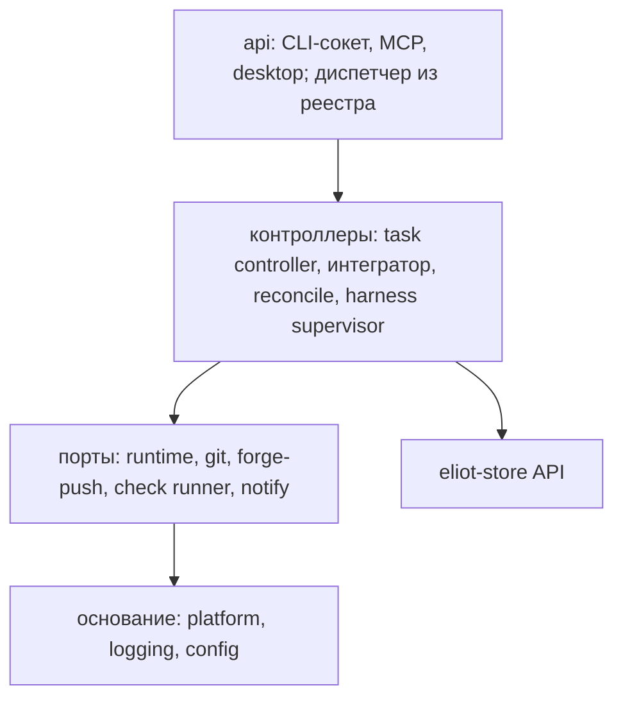

# Демон: супервизия, захват, сверка (eliot-daemon)

> Источник фактов: целевая архитектура v2.6 (27.11.2026). Живой контракт; исходная версия сохранена в archive/spec-v2.6.md; «раздел N» и «приложение X» — номера v2.6, ссылка ↗ ведёт туда, где он теперь. Общая суть — [ARCHITECTURE.md](../ARCHITECTURE.md), связи — [GRAPH.md](../GRAPH.md), навигация — [INDEX.md](../INDEX.md).

**Зачем.** Правила 3, 4 и 8: упавший участник перезапускается с известного состояния, падение одного не останавливает остальных, задача живёт вне агента. Демон — дерево супервизии на tokio со своим супервизором и контроллерами, которые общаются через Store и события.

**Владеет.** Дерево супервизии и перезапуски со скользящим окном; захват задачи и поколения; протокол смены поколения (отзыв, запрос, подтверждение); сверка (reconcile) и её инварианты; слои внутри демона; scheduler (выбор задачи и route, справедливость между проектами); блокировка одного демона на машину.

**Вход.** События Store (watch как сигнал перечитать), события runtime, таймеры ближайших дедлайнов, запросы API.

**Выход.** Переходы Task через Store; команды runtime (start, cancel); задания интегратору; уведомления.

**Инварианты.**
- Не больше 3 падений агента на задаче за 10 минут, демона — 5 за 5 минут (служба ОС).
- Два агента одну задачу не возьмут: условие проверяет единственный писатель.
- Сообщения, сигналы и коммиты старого поколения не принимаются; WIP-коммит и передача — только после подтверждённой остановки, иначе карантин worktree.
- Правда о жизни агента — живой runtime, а не таймер; пока демон лежал, сроки ожиданий не истекают.
- Зависимости слоёв только вниз (api → контроллеры → порты → основание); контроллеры не вызывают друг друга напрямую.
- Блокирующий код только в spawn_blocking или выделенных потоках.

**Зависит от.** [store.md](store.md), [runtime.md](runtime.md), [task-controller.md](task-controller.md), [integrator.md](integrator.md); эксплуатация — [operations.md](operations.md).

**Статус.** Скользящее окно — по коду OTP; остановка поколения по трём фактам — вывод, не измерено; KillMode в юните systemd отсутствует (проверено по коду, пункт этапа 6).

---

## 3. Супервизия и восстановление

### Дерево

```
служба ОС (Windows Service, systemd --user; launchd не в первой волне): перезапуск с лимитом
└── daemon
    ├── store writer           критичный: его падение = перезапуск демона
    ├── integrator × репозиторий
    │   ├── check runner       отдельный процесс на проверку: пустое окружение; сеть отрезана там, где ОС позволяет
    │   └── forge-push         отдельный короткий процесс: единственный держатель токена forge
    ├── task controller        один владелец переходов задачи: назначение, продолжение, приёмка, замена
    ├── harness supervisor × харнесс
    ├── reconcile              очередь ключей с дедупликацией
    └── API: CLI-сокет, MCP, desktop; дедлайн на каждый обработчик
agent runtime × N            отсоединённые процессы, не дети демона; по одному на агента:
                             адаптер харнесса, stdio, журнал доставки, сокет, custody процессов
```

Своего swarm-guard нет: перезапуск с лимитом умеют службы ОС (StartLimitBurst и StartLimitIntervalSec у systemd, счётчик сбоев у Windows SCM). Для запуска из терминала остаётся режим разработки без службы. Служба запускает демон с явно выбранной учётной записью и средой пользователя: автоматический переход на другую service identity не считается равным нынешнему запуску.

### Перезапуск по OTP

- Упал actor агента в демоне: перезапустить actor, переподключиться к runtime. Агент не заметит.
- Умер процесс харнесса или runtime: то же исполнение продолжается нативной сессией (Codex thread/resume, Claude --resume, ACP session/resume). Это восстановление, а не замена исполнителя; gen не меняется, если старое исполнение подтверждённо остановлено и сессия та же. Переход на другой харнесс — всегда замена: новый Attempt с gen+1.
- Перезагрузилась машина: то же для всех агентов.
- Интенсивность — скользящее окно, как в supervisor.erl (2281-2291): не больше 3 падений агента на задаче за 10 минут. Дальше тот же route не перезапускаем: пишется Stop restart\_limit, задача идёт в held(analysis), route получает Hold cooldown.
- Упал демон: служба ОС перезапускает его, не больше 5 раз за 5 минут. Дальше уведомление шлёт сама служба ОС (OnFailure= у systemd, действие восстановления SCM у Windows) командой swarm notify, которая не требует живого демона; при следующем старте в списке задач появляется обычная задача «починить Swarm» с логом падения. Текст паники возвращается в crash.rs:178, иначе причина падения теряется.

### Захват задачи, поколения, одна машина

Захват — одна IMMEDIATE-транзакция в Store: задача в ready переходит в claimed, создаётся Attempt, тут же вызывается admission команды запуска; события публикуются и команда планируется только после COMMIT. Так уже устроен запуск менеджера проекта (раздел 5 [↗](task-controller.md), «Запуск Task»). Два агента одну задачу не возьмут: условие проверяет единственный писатель. GitHub для старта не нужен; нынешний код его и не требует: work-truth.git локальный, ensure\_task делает blob, tree, commit и update-ref без push (work\_truth.rs:1265-1332).

Каждое исполнение несёт SWARM\_TASK и SWARM\_GEN = `Task.gen`; ветка swarm/\<task>-g\<gen> несёт тот же номер. Это адресные метки. `authenticate` связывает credential с локальным Agent и его `Agent.generation`; Store через неизменную привязку Runtime находит Attempt и Task. Resume меняет локальное поколение и Runtime, сохраняя `Task.gen`. Проверка прав и обеих привязок предшествует обработчику; равенство `SWARM_GEN == Agent.generation` не является проверкой. Старое исполнение не может изменить текущую Task; source receipts и проверка native generation в `source_batches.rs` сохраняются.

Смена поколения (замена исполнителя по вердикту разбора, отказ от resume) — три разных факта, а не один:

1. Отзыв разрешения: в Store gen+1, старые сигналы и коммиты отвергаются.
2. Запрос остановки: interrupt или cancel харнесса. В ACP v1 session/cancel — уведомление, подтверждение приходит результатом исходного prompt со stopReason cancelled; у каждого протокола свой признак.
3. Подтверждённая остановка: закончен ход, вышло семейство процессов в пределах custody, дочитан поток событий.

Только после третьего факта демон делает WIP-коммит незакоммиченной работы в старом worktree (после gitleaks), сохраняет ref refs/swarm/archive/\<task>-g\<n> и отдаёт работу дальше. Если остановка не подтверждена, старый worktree уходит в карантин как есть, новый исполнитель получает новый worktree от последнего согласованного SHA или archive-ref, а внешние действия старого поколения не повторяются только потому, что появился новый gen. Восстановление из резервной копии Store не оживляет старое поколение без сверки с runtime и Git.

На одной машине второй экземпляр демона не стартует: flock на Unix, LockFileEx на Windows (data\_dir.rs:363-383). В первой волне задачи ведёт одна машина; перенос задачи между машинами и несколько демонов над одним набором задач отложены.

### Сверка вместо доверия

Пробуждение контроллеров уже событийное: run\_goal\_driver (router/goals.rs:1350) подписан на события правил и watch, держит JoinSet, дедупликацию по агенту и отложенные продолжения, сверяет состояние при старте и при отставании канала; у него ещё 30-секундный тик для продолжений. Рабочий цикл правил (automation.rs:1388) ждёт события и ближайший дедлайн плюс периодическую сверку. Task controller берёт этот приём с ключом по задаче. watch — только сигнал перечитать состояние из Store: он хранит последнее значение, а не журнал. Сверка при старте и после отставания и ближайшие дедлайны нужны и дальше. Общий акторный фреймворк для этого не нужен.

Инварианты сверки, у каждого действие:

1. Каждый принятый переход задачи записан в Store; определение задачи с той же ревизией есть в work-truth.git. Нет ревизии — дописать.
2. Каждый squash-коммит интегратора в main достижим из origin/main, и задача отмечена done с этим OID. OID достижим, задача не done — закрыть задачу (ответ потерян после push). Трейлеры Swarm-Task и Swarm-Gen — индекс поиска, а не доказательство.
3. Задача done, а её OID недостижим из origin/main — тревога и разбор: историю переписали или задачу закрыли в обход.
4. Коммит в main без трейлера и не от человека — тревога: обход интегратора.
5. У задачи в claimed или running нет живого runtime текущего поколения. Сначала подтвердить остановку семейства процессов; затем то же исполнение продолжается resume. Замена исполнителя — только вердиктом разбора и через gate replace\_executor; без вердикта задача ждёт, а не переходит в ready сама.
6. Незавершённый шаг в журнале интегратора разрешается чтением origin (раздел 6 [↗](integrator.md)).

Чекпоинт «main сверен до OID» хранится в Store, чтобы не читать всю историю на каждом проходе. Правда о жизни агента — живой runtime, а не таймер: пока демон лежал, сроки ожиданий не истекают. Дедлайны хода и инструмента, остаток wall-бюджета и daemon\_lost\_s держит сам runtime (раздел 14 [↗](../INDEX.md#карта-разделов)), поэтому зависший ход при лежащем демоне всё равно прерывается.

### Чего Rust не даёт из Erlang

- Нет изоляции куч между задачами tokio. Паника ловится как JoinError только с panic=unwind; каждая задача под супервизором.
- Блокирующий код (git, SQLite, файлы) — только в spawn\_blocking или выделенных потоках.
- Настоящая изоляция есть только у процессов ОС. Поэтому харнессы в отдельных runtime, проверки и push — отдельные процессы.
- Фреймворк: обычный tokio (bounded mpsc, JoinSet, watch) и свой супервизор со скользящим окном, несколько сотен строк. ractor, actix, kameo и bastion проверены по исходникам (приложение А [↗](../archive/DONORS.md)): ни один не запускает и не супервизирует процессы ОС, а у kameo счётчик перезапусков со сбросом, а не скользящее окно. Поэтому супервизор свой.

## Слои внутри демона (раздел 14а)



Зависимости идут только вниз. Контроллеры не знают про api; порты не знают про контроллеры; platform ни от чего в демоне не зависит (сейчас у platform 25 входящих связей и он внутри большого цикла). Контроллеры общаются через Store и события, а не прямыми вызовами друг друга: так устроен нынешний run\_goal\_driver, и так же строится task controller.

## Дедлайн обработчика RPC (раздел 8)

У каждого обработчика RPC дедлайн (по умолчанию 30 с, операция может объявить свой). Сейчас ограничено только чтение строки запроса, сам обработчик ждётся без срока (daemon.rs:2297). По дедлайну клиент получает timeout с id; операция идемпотентна, повтор тем же id вернёт результат или in\_progress.

## Справедливость между проектами (раздел 12)

| Функция | Решение | Где живёт |
| --- | --- | --- |

| Справедливость между проектами | сохраняется | модуль scheduler в eliot-daemon |

## Этапы миграции

Порядок и критерии — [migration.md](migration.md); отметки выполнения — [backlog.md](../backlog.md).

## eliot-daemon в графе модулей (раздел 14)

| Модуль | Что в нём | На чём строится |
| --- | --- | --- |

| eliot-daemon | акторы и супервизор, task controller, scheduler (выбор задачи и route, справедливость между проектами), интегратор, reconcile, API, проверка JWT и Grant | нынешний демон, срез за срезом |
